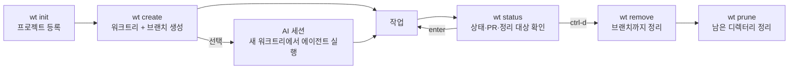

# workytree

[](https://github.com/Ahngbeom/workytree/actions/workflows/ci.yml)

Git worktree를 프로젝트 단위로 만들고, 상태를 한눈에 보고, 작업을 잃지 않게 지우는 zsh 도구다.
명령은 `workytree`이고, 대화형 셸에서는 짧은 별칭 `wt`를 쓴다.



## 기능

| 기능 | 명령 | 하는 일 |
|---|---|---|
| 워크트리 만들기 | `wt create` | repo → kind → ticket → base를 묻고 `<kind>/<ticket>` 브랜치와 워크트리를 만든 뒤 그 디렉터리로 이동 |
| 상태 보기 | `wt status` | 모든 워크트리의 최근 활동, PR/MR, 지워도 되는지 여부를 fzf 목록으로 표시 |
| 워크트리 지우기 | `wt remove` | 변경 사항·로컬 브랜치·원격 브랜치를 하나씩 확인하고 지운 뒤 원하는 곳으로 이동 |
| 정리 | `wt prune` | git이 잊은 워크트리 기록과 내용 없는 고아 디렉터리 정리 |
| AI 세션 | `wt create --ai` | 새 워크트리에서 Claude Code 같은 코딩 에이전트를 바로 실행 (기본 꺼짐) |
| 이동·조회 | `wt cd`, `wt path`, `wt list`, `wt repos` | 워크트리로 이동하거나 경로·목록 출력 |
| 설정 관리 | `wt project`, `wt repo`, `wt config` | 프로젝트·repo 등록, 설정 읽기·쓰기 |

모든 대화형 질문은 방향키와 Enter로 답한다. 자세한 조작은 [대화형 프롬프트](#대화형-프롬프트)에 있다.

## 빠른 시작

1. 설치한다.
   ```sh
   curl -fsSL https://raw.githubusercontent.com/Ahngbeom/workytree/main/install.sh | sh
   exec zsh
   ```
2. 프로젝트를 등록한다. clone이 모여 있는 디렉터리(`repo_root`)와 워크트리를 둘 디렉터리(`worktree_root`)를 묻는다.
   ```sh
   workytree init
   ```
3. 워크트리를 만든다.
   ```sh
   wt create
   ```

## 설치

저장소를 직접 clone한 뒤 설치 스크립트를 실행해도 된다.

```sh
git clone https://github.com/Ahngbeom/workytree.git workytree
cd workytree
sh install.sh
exec zsh
workytree init
```

| 항목 | 동작 |
|---|---|
| 설치 원본 | checkout 안에서 실행하면(`bin/workytree`, `lib/`, `shell/`이 옆에 있으면) 네트워크 없이 그 checkout을 그대로 씀 |
| 실행 파일 | `~/.local/bin/workytree`를 checkout으로 심볼릭 링크 |
| `~/.zshrc` | `source` 한 줄 추가. 먼저 `.zshrc.bak-<timestamp>`로 백업하고, 같은 줄을 두 번 넣지 않음 |
| 재실행 | 안전함. `curl` 설치본은 기본 위치(`~/.local/share/workytree`)에서 `git pull --ff-only`로 갱신 |
| 검증 환경 | zsh 5.9, git 2.50.1. `curl` 설치 경로는 CI의 `install-smoke` 작업이 커밋마다 검증 |

`fzf`가 `PATH`에 있으면 선택 화면에 fzf를 쓰고, 없으면 내장 메뉴를 쓴다. `wt status`의 목록 화면은 fzf 0.38 이상이 필요하다.

`wt` 별칭이 필요 없으면 설정에 `alias_wt = false`를 쓰거나, 현재 셸에서만 `WORKYTREE_ALIAS=0`을 설정한다.

## 개념

**프로젝트**는 `repo_root`와 `worktree_root`의 짝이다. `repo_root` 아래를 `scan_depth`(기본 3) 단계까지 훑어 repo를 찾는다. 워크트리는 `<worktree_root>/<repo>/<kind>/<ticket>`에 `<kind>/<ticket>` 브랜치로 만든다.

```ini
# ~/.config/workytree/config
default_project = work
alias_wt = true
kinds = feature,fix,chore,hotfix,refactor

[project work]
repo_root     = ~/work/products
worktree_root = ~/work/worktrees
scan_depth    = 3

[repo legacy]            # 선택: repo_root 밖의 clone을 직접 등록
path    = ~/elsewhere/legacy-api
project = work
```

> **주의**: `scan_depth`보다 깊은 repo는 아무 경고 없이 빠진다. 기본값 3이면 `repo_root/a/b/c`의 repo는 찾지만 `repo_root/a/b/c/d`는 찾지 못한다. 더 깊게 두었다면 그 프로젝트의 `scan_depth`를 올리거나 `workytree repo add`로 직접 등록한다.

repo 이름은 다음 순서로 찾는다.

1. 등록된 `[repo]` 별칭
2. 모든 프로젝트의 `repo_root` 스캔
3. 현재 디렉터리

여러 프로젝트에 같은 이름이 있으면 `--project <name>`으로 고른다. **같은 프로젝트 안**에서 이름이 겹치면 `--project`로는 가릴 수 없으므로 `workytree repo add <path> --name <alias>`로 다른 별칭을 붙인다.

## 사용법

```sh
wt create                          # 대화형: project → repo → kind → ticket → base → 확인
wt create fix PROJ-1               # repo 안에서: repo 확인 후 생성
wt create server fix PROJ-1        # repo 지정
wt create server fix PROJ-1 origin/develop -y
wt create --ai fix PROJ-1          # 생성하고 이동한 뒤 AI 세션 실행
wt create --no-ai fix PROJ-1       # 이번에는 AI 세션을 열지 않음
wt cd server fix PROJ-1            # 없는 워크트리면 오류(종료 코드 1)
wt list [repo] · wt repos · wt path [repo [kind [ticket]]]
wt status [repo] [--fetch|--offline] [--stale [days]] [--json] [--plain] [--branches]
wt remove                          # 대화형: 워크트리 선택 → 브랜치 → 이동할 곳 → 확인
wt remove server fix PROJ-1        # 대화형: 브랜치 → 이동할 곳 → 확인
wt remove server fix PROJ-1 [--force] [-b|-B] [-r] [--to <dir>] -y
wt prune [repo]
wt project add <name> <repo_root> <worktree_root>
wt repo add <path> [--name n] [--project p]
wt config get|set|edit|path
```

`--project`, `--yes`/`-y`, `--no-color`는 전역 옵션이라 명령줄 어디에 써도 된다. 스크립트·CI·에이전트에서의 동작은 [비대화 실행](#비대화-실행)에 있다.

## 워크트리 만들기


`create`는 빠진 인자만 묻는다. repo 안에서 실행하면 그 repo를 쓸지 먼저 확인하고, kind·ticket·base를 차례로 받은 뒤 요약을 보여 주고 `Create?`로 확인한다. 셸 통합으로 실행했다면 만든 워크트리로 바로 이동한다.

- 브랜치를 만들기 전에 `origin`을 fetch하므로 자동으로 고른 base(`origin/main` 등)가 항상 최신
- `origin`이 없으면 fetch를 건너뛰고, fetch가 실패하면 경고 후 로컬 ref로 계속 진행
- 같은 워크트리가 이미 있으면 새로 만들지 않고 재사용. ticket 브랜치가 아닌 브랜치가 체크아웃돼 있으면 실제 브랜치를 보여 주고 경고한다
- 브랜치를 어디서 가져올지 요약에 보여 준다: 로컬에 있으면 그 브랜치(base는 무시), `origin`에만 있으면 그 브랜치를 추적하는 로컬 브랜치(base를 묻지 않음), 둘 다 없으면 base에서 새 브랜치
- 워크트리 디렉터리를 손으로 지웠다면 git 기록이 남아 있으므로 `workytree prune <repo>`를 먼저 실행하라고 안내하고 멈춘다
- `Create?`를 묻거나 디렉터리를 만들기 전에 값을 검사한다. kind·ticket을 git 브랜치 이름으로 쓸 수 없으면(kind에 `/`, 공백, `..` 등) 종료 코드 2, base가 없거나 브랜치가 이미 다른 곳에 체크아웃돼 있으면 1로 멈춘다. kind·ticket·base를 대화형으로 입력했다면 잘못된 값만 다시 묻는다. 체크아웃 충돌은 대화형이어도 묻지 않고 멈춘다
- `-`로 시작할 수 있는 값은 ticket뿐이고 `--` 뒤에 쓴다: `wt create -- app fix -T2`. kind나 base가 `-`로 시작하면 `--` 뒤여도 종료 코드 2. 그 밖의 `-`로 시작하는 인자는 모르는 플래그(종료 코드 2)

## 상태 보기


`wt status`는 범위 안의 repo(`--project` 또는 `[repo]` 하나)에서 다음을 모두 보여 준다.

- 모든 워크트리
- `worktree_root` 아래에 있지만 git이 모르는 디렉터리

fzf 0.38 이상이 있고 양쪽이 터미널이면 상세 창이 있는 fzf 목록을 연다. `--plain`, `-y`, fzf 없음·구버전, 출력 파이프·리다이렉트 중 하나라도 해당하면 표로 출력하고, `--json`은 같은 데이터를 스크립트용으로 출력한다. 보기만 할 뿐 정리·fetch(`--fetch` 제외)는 하지 않고, 삭제는 `ctrl-d`와 브랜치 모드의 `alt-d`로만 한다. 워크트리가 없는 브랜치는 `--branches`로 본다. 호환성: `--json`에서 `"type":"branch"` 행이 빠졌고, 같은 정보는 `--branches --json`으로 옮겼다.

| 표시 | 뜻 |
|---|---|
| `✓` | 지워도 안전함: base 브랜치에 병합, PR/MR 병합(브랜치가 PR 마지막 커밋을 가리킬 때) 중 하나이면서 커밋 안 된 변경·push 안 된 커밋·잠금이 모두 없음 |
| `●` | 오래됨: `stale_days`(기본 30일)보다 오래 손대지 않았지만 안전하다고 증명되지는 않음 |
| `!` | 지우면 작업을 잃음: 커밋 안 된 변경(또는 확인 불가), upstream에 없는 커밋, upstream이 없으면 base에 없는 커밋, upstream이 삭제됐는데 base에 없는 커밋 |

| 키 | 동작 |
|---|---|
| `enter` | 워크트리로 이동 (셸 통합 전용, `bin/workytree`는 경로만 출력) |
| `ctrl-d` | 평소 질문과 함께 `wt remove` 실행 후 새로고침 |
| `ctrl-o` | 브라우저에서 PR/MR 열기 |
| `ctrl-r` | 모든 repo `git fetch` 후 새로고침 |
| `ctrl-s` | `stale`/`safe` 행만 보기 (다시 누르면 전체) |
| `ctrl-/` | 상세 창을 오른쪽 ↔ 아래로 전환 |
| `ctrl-b` | 브랜치 모드로 전환 |

- `ACTIVE`: 워크트리의 마지막 활동(index/HEAD), `COMMIT`: 브랜치의 마지막 커밋, 생성 시각: 상세 창
- base 브랜치는 `origin/HEAD`, 없으면 `origin/main`이나 `origin/master`, 그것도 없으면 메인 checkout의 브랜치
- 자기 커밋이 없는 브랜치는 "병합됨" 처리. 방금 만들고 커밋하지 않은 워크트리도 `✓`
- 상세 창은 터미널이 100열 이상이면 오른쪽, 아니면 아래에 표시되고 창 크기 변경에 맞춰 이동
- `✓`도 `git status`로 판단하므로 `remove`와 같은 사각지대가 있음: gitignore된 `.env` 같은 파일은 작업으로 치지 않음

브랜치 모드(`ctrl-b`, 또는 `--branches`로 시작)는 워크트리가 없는 로컬 브랜치와 `origin` 브랜치를 이름별로 한 행에 보여 준다. 헤더에는 `origin` ref를 마지막으로 fetch한 시점(repo 중 가장 오래된 것)이 나온다.

| 키 (브랜치 모드) | 동작 |
|---|---|
| `tab` / `shift-tab` | 행 표시·해제 |
| `alt-d` | 표시한 행(없으면 현재 행) 삭제 후 표시를 지우고 새로고침 |
| `ctrl-r` | 모든 repo `git fetch` 후 새로고침 |
| `ctrl-s` | 등급이 `safe`인 행만 보기 (다시 누르면 전체) |
| `ctrl-b` | 워크트리 목록으로 |
| `enter` | 아무 동작 없음(목록 유지) |

`alt-d`는 터미널로 나와 다음 순서로 진행하고, 키를 누르면 목록으로 돌아간다.

1. 원격 쪽을 지우거나 `pushed`를 확인해야 하는 repo만 `origin`을 fetch한다. fetch가 실패한 repo는 원격을 건너뛰고 `pushed` 행을 needs force로 내린다
2. 표시한 행을 지금 ref로 다시 판정해 safe / needs force / skipped 계획을 출력한다. 목록을 띄운 뒤 바뀐 것은 계획에 반영된다
3. safe 묶음 전체를 한 번 묻고, needs force는 브랜치마다 잃을 커밋 수와 함께 따로 묻는다. 기본값은 모두 아니오
4. 승인한 항목을 로컬 → 원격 순서로 지운다. 판정한 뒤 움직인 로컬 브랜치는 남기고, 원격은 판정한 커밋을 가리킬 때만 지운다(`--force-with-lease`)
5. ref마다 `✓`(지움, `(was <sha>)`와 복구 명령), `✗`(실패, git 메시지와 재시도 명령), `–`(남김) 결과와 삭제 로그 경로를 출력한다

| 등급 | 뜻 | 확인 |
|---|---|---|
| `merged` | base에 병합됐거나 PR/MR이 그 커밋 그대로 병합됨 | safe |
| `pushed` | 로컬만 지움. 남겨 둘 `origin` 브랜치에 로컬 커밋이 모두 있음 | safe |
| `backup` | 백업 이름(`backup/*`, `*-backup`, `*-backup-*`, `*-before-*`)이고, 이름의 티켓 키를 head에 가진 PR 중 병합된 것이 있고 열린 것이 없음. 백업에만 있는 커밋도 함께 지움 | safe |
| `gone`, `stale`, `unmerged` | 병합이 증명되지 않음 | needs force |
| `read-only`, `protected` | 동료 원격이나 PR이 열린 원격, `main`·`master`·`develop`·`release/*` | 지우지 않음 |

- 한 행은 그 브랜치의 로컬과 본인 원격을 함께 지운다. 원격은 tip 작성자가 그 repo의 `user.email`(대소문자 무시)이고 base에 없는 커밋도 모두 본인 것일 때만 지우고, 아니면 로컬만 지운다
- base에 없는 커밋이 하나도 없는 원격(base 커밋에서 갓 만든 브랜치, 머지된 브랜치)은 tip이 base 안에 있어 작성자로 소유를 알 수 없다. 같은 이름의 로컬 브랜치가 `origin/<b>`를 upstream으로 추적하고 tip 작성자가 본인일 때만 본인 것으로 보고, 아니면 `teammate`로 보아 원격은 지우지 않는다. base를 찾지 못한 repo에서는 원격을 지우지 않는다
- 그 브랜치를 head로 한 PR/MR이 열려 있거나 draft이면 원격은 지우지 않는다(계획에 `PR <ref> is open`으로 skipped)
- 로컬은 판정한 커밋을 가리킬 때 `git branch -D`로 지운다. squash 병합·백업 브랜치는 `-d`가 거부하기 때문이다
- 지운 ref는 `~/.local/state/workytree/deleted.log`(`XDG_STATE_HOME`)에 시각·repo·ref·sha·복구 명령으로 남는다. 결과 화면이 사라져도 이 파일로 되살릴 수 있지만, 다른 ref에 없는 커밋은 git gc 유예(기본 2주)가 지나면 되살릴 수 없다
- `--plain`, `-y`, 터미널 없음에서는 브랜치 모드도 표로만 출력하고 지우지 않는다

PR/MR 정보는 repo마다 한 번씩 `gh`(GitHub)나 `glab`(GitLab, `glab`이 로그인한 self-hosted 포함)을 호출해 가져온다. 둘 다 없거나 `--offline`이면 PR 열만 비고 나머지는 그대로 동작한다. squash·rebase 병합은 git이 추적할 조상 관계를 남기지 않으므로, 그런 브랜치는 PR/MR을 조회할 수 있을 때만 병합됨으로 표시된다.

```sh
wt config set stale_days 14                  # 모든 프로젝트
wt config set project.work.stale_days 60     # 한 프로젝트
```

스크립트에서는 `bin/workytree status --json`을 직접 호출한다. `wt` 함수를 거치면 이동할 경로를 찾으려고 출력을 먼저 가로채기 때문이다.

## 워크트리 지우기


터미널에서 실행하면 `remove`는 워크트리 밖의 것을 건드리기 전에 하나씩 묻는다.

1. 어떤 워크트리를 지울지 (`repo`·`kind`·`ticket`이 빠졌을 때). 주어진 인자로 목록을 좁히고 지금 있는 워크트리를 먼저 제안
2. 커밋 안 된 변경을 버릴지 (변경이 있을 때만. 거절하면 멈추고 `git stash -u`나 `--force`를 안내한다)
3. 로컬 브랜치를 지울지. 대상은 언제나 ticket 브랜치(`<kind>/<ticket>`)이고, 워크트리에 다른 브랜치가 체크아웃돼 있으면 질문과 계획에 함께 표시한다. 기본값은 판정에 따라 다르다
   - `merged into origin/main`: base 브랜치(`status`와 같은 기준)에 들어 있음. 기본값 예
   - `PR #N merged`(GitLab은 `PR !N merged`): base에는 없지만 PR/MR이 지금 커밋 그대로 병합됨. 기본값 예
   - `pushed, not merged into origin/main`: upstream에만 있음. 기본값 아니오. 원격 브랜치까지 지우면 커밋이 어디에도 남지 않으므로 한 번 더 확인
   - `not merged into origin/main`: 어디에도 없는 커밋이 있음. upstream이 원격에서 지워졌으면 `; its upstream was deleted`가 붙는다. 기본값 아니오. 지우려면 강제 삭제를 한 번 더 확인
4. 원격 브랜치를 지울지 (ticket 브랜치와 같은 이름의 원격 브랜치가 upstream이거나 `refs/remotes/<remote>/`에 있을 때. 이름이 다른 upstream은 대상이 아니다). `git fetch --prune origin` 직후 확인. 원격에 삭제를 push하므로 기본값 아니오. 원격 브랜치에 남는 로컬 브랜치나 base에 없는 커밋이 있으면 그 커밋을 잃는지 한 번 더 확인(기본값 아니오)
5. 지운 뒤 어디로 이동할지 (셸 통합으로 실행했을 때만)
6. 계획 요약과 `Proceed?`

단계마다 진행 표시줄이 나오고, 실패하면 `hint:` 줄로 해결 방법을 알려 주며, 마지막 요약에 지운 것·남긴 것·실패한 것을 정리한다.

- `-y`를 주거나 터미널이 없으면 묻지 않고 옵션대로 처리한다: `-b`/`-B` 로컬 브랜치, `-r` 원격 브랜치, `--to <dir>` 이동할 곳. 플래그가 없으면 브랜치는 남긴다
- `-b`는 위 판정이 병합됨인 브랜치를 지운다. 병합되지 않은 브랜치는 `git branch -d` 규칙을 따르고, `-r`과 함께 쓰면 로컬 브랜치를 남긴 채 요약에 ✗로 표시한다. 커밋을 버리고 지우려면 `-B`
- `-r`은 원격 브랜치의 커밋이 모두 로컬 브랜치(남기거나, 병합됐거나, 강제 삭제를 확인했을 때), base 브랜치, 그 커밋 그대로 병합된 PR/MR(로컬 브랜치를 판정하며 조회했을 때) 중 하나에 들어 있을 때만 지운다. 동료가 push한 커밋처럼 원격에만 있는 커밋이 있으면 원격 브랜치를 남기고 요약에 ✗로 표시한다. 그 커밋까지 버리고 지우려면 `-B`
- 원격 브랜치는 fetch로 확인한 커밋을 가리킬 때만 지운다(`--force-with-lease`). 그사이 누가 push했거나 fetch가 실패해 확인이 오래됐으면 지우지 않고 요약에 ✗로 표시한다
- `-r`이나 `-B` 없는 `-b`는 먼저 `origin`을 fetch한다. 로컬 브랜치를 판정할 때(터미널, `-B` 없는 `-b`) base에 없는 브랜치는 PR/MR이 병합됐는지 `gh`나 `glab`에 물으므로 눈에 띄게 오래 걸릴 수 있다
- `-b`만 줘도 원격 브랜치가 있으면 요약에 `remote branch  kept` 행이 나온다
- 워크트리에 ticket 브랜치가 아닌 브랜치가 체크아웃돼 있으면 `-b`/`-B`/`-r`은 아무것도 지우지 않고 종료 코드 1로 멈춘다
- 브랜치를 지우면 지우기 전 커밋을 `(was <sha>)`로 보여 주고, 되살리는 명령을 `hint:`로 알려 준다
- 지운 브랜치는 `~/.local/state/workytree/deleted.log`(`XDG_STATE_HOME`)에 시각·repo·ref·sha·복구 명령으로 남는다. 다른 ref에 없는 커밋은 git gc 유예(기본 2주)가 지나면 되살릴 수 없다
- 지금 있는 워크트리를 지우면 `--to`가 없는 한 원본 repo로 이동
- 브랜치 삭제가 실패해도 종료 코드는 0이고 요약에 ✗ 행으로 남는다. 그 시점에 워크트리는 이미 지워진 상태
- 원격 브랜치 삭제는 자격 증명을 묻지 않는다. 자격 증명이 없으면 ✗ 행과 힌트로 끝난다

> **주의**: gitignore된 파일(`.env`, `node_modules` 등)은 변경으로 치지 않으므로 경고 없이 함께 지워진다. [알려진 제약](#알려진-제약)을 참고한다.

## 정리

`wt prune [repo]`는 `git worktree prune`으로 사라진 워크트리 기록을 지우고, `worktree_root` 아래에서 git에 등록되지 않은 `<kind>/<ticket>` 디렉터리를 찾는다. 그 디렉터리에 버려도 되는 파일만 있으면 지우고, 그 밖의 경우(판단할 수 없을 때 포함)에는 남기고 경고한다.

## AI 세션


`create`는 새 워크트리를 AI 코딩 에이전트에 바로 넘길 수 있다. **기본값은 꺼짐**이다. 켜기 전에는 에이전트를 제안하거나 묻거나 실행하지 않고, 실행에 쓰는 임시 파일도 만들지 않는다.

```sh
wt create --ai fix PROJ-1        # 이번 한 번만
wt config set ai_session always  # 매번
```

에이전트는 현재 셸에서, 새 워크트리 안에서, 포그라운드로 실행된다. 에이전트를 끝내면 그 워크트리에 그대로 남는다. 터미널에서 `wt`를 실행하고 stdin도 터미널일 때만 동작한다. 출력을 `$(...)`·파이프·파일로 돌리거나, 스크립트나 `bin/workytree`로 실행하면 워크트리만 만든다. 이유는 `--ai`를 줬거나 stdin이 터미널일 때만 stderr에 한 줄로 알려 준다([비대화 실행](#비대화-실행)).

| 키 | 범위 | 뜻 |
|---|---|---|
| `ai_session` | 전역, `[project]` | `off`(기본), `ask`(먼저 확인), `always` |
| `ai_agent` | 전역, `[project]` | 실행할 에이전트. 비우면 자동 감지 |

자동 감지는 `PATH`에서 `claude`, `codex`, `gemini`, `cursor-agent`, `aider` 순서로 처음 찾은 것을 쓴다. `--ai`는 그 실행에 한해 `ai_session`을 덮어쓰고 `ask` 확인도 건너뛴다.

실행 전에 에이전트의 주요 옵션을 메뉴로 묻는다. `kinds`처럼 목록에서 고르거나 목록에 없는 값을 직접 입력할 수 있다. 무엇을 물을지는 `[agent <name>]` 섹션이 정한다.

```ini
[agent claude]
command         = claude
ask             = permission_mode,model,teammate_mode
permission_mode = plan,acceptEdits,auto,bypassPermissions,dontAsk,manual
model           = opus,sonnet,fable
effort          = low,medium,high,xhigh,max
teammate_mode   = auto,tmux,iterm2,in-process
```

- `ask`: 물을 옵션과 순서. 위 예시의 `effort`는 `ask`에 넣기 전까지 묻지 않음
- 키 이름 변환: `permission_mode` → `--permission-mode <value>`
- `(skip)`을 고르면 그 플래그 없이 실행
- 위 블록이 `claude`의 내장 프로필. 직접 쓴 `[agent claude]`는 합쳐지지 않고 **통째로 대체**하므로 목록을 줄일 수도 있음
- 프로필이 없는 에이전트(`ai_agent = aider` 등)는 옵션 메뉴 없음. `ask`면 "open a $name session here?"만 묻고, `always`나 `--ai`면 바로 실행
- `-y`/`--yes`: `ask`여도 확인과 옵션 메뉴 없이 `command`만 실행
- `--no-ai`: 이번 실행에서는 세션을 열지 않음. `always`와 `--ai`보다 우선
- `ask`인데 물을 터미널이 없고 `-y`도 없으면 실행하지 않음
- 질문을 취소(`q`)해도 워크트리는 남고 종료 코드 0. 세션을 열지 않은 것은 `create` 실패로 치지 않음

## 대화형 프롬프트

`create`, `remove`, `init`, AI 세션의 질문은 모두 방향키와 Enter로 답한다.

| 화면 | 이동 | 결정 | 바로 답하기 | 취소 |
|---|---|---|---|---|
| 예/아니오 확인 | ←/→ (↑/↓, Tab, h/j/k/l) | Enter. 기본값이 미리 선택됨 | `y` / `n` | `q`, Esc, Ctrl-C |
| 목록 선택 (fzf 없음) | ↑/↓ 또는 j/k, 끝에서 반대쪽으로 넘어감 | Enter | 숫자 1–9 | `q`, Esc, Ctrl-C |
| 목록 선택 (fzf 있음) | fzf 조작 그대로 | Enter | 검색어 입력 | Esc |

- 직접 값을 입력할 수 있는 목록(`kind`, 에이전트 옵션)은 마지막 줄 `(type a value…)`를 고르면 한 줄 입력으로 전환
- 취소하면 종료 코드 130. 단, AI 세션 질문은 워크트리를 만든 뒤라 취소해도 0

## 비대화 실행

스크립트, CI, AI 에이전트에서 실행해도 workytree는 키 입력을 기다리지 않는다. `-y`를 주거나 물을 터미널이 없으면(stdin이 터미널이 아니거나 `/dev/tty`를 열 수 없으면) 질문 대신 아래 표대로 동작한다.

`-y`/`--yes`는 "묻지 말고 진행"이다.

- 질문, fzf 목록, 편집기 모두 열지 않음
- 파괴적인 일은 플래그로만 함: 로컬 브랜치 삭제 `-b`/`-B`, 원격 브랜치 삭제 `-r`, 변경 버리기 `--force`
- 필요한 값이 빠지면 종료 코드 2. 메시지 끝의 `(not asking: --yes)` 또는 `(not asking: no terminal)`이 이유
- AI 세션은 파괴적이지 않으므로 `ai_session = ask`여도 확인 없이 실행. 이번 실행만 끄려면 `--no-ai`

| 명령 | 질문 | 대신 쓰는 인자·플래그 | `-y` | 터미널 없음 | 테스트 |
|---|---|---|---|---|---|
| `create` | 이 repo를 쓸지 | 첫 위치 인자 | 추론한 repo 사용 | 추론한 repo 사용 | `test_create_uses_the_inferred_repo_without_asking` |
| `create` | project, repo, kind, ticket | `--project`, 위치 인자 | 종료 코드 2 | 종료 코드 2 | `test_create_missing_arguments_name_the_reason` |
| `create` | base, `Create?` | 네 번째 위치 인자 | 자동 감지한 base로 생성 | 자동 감지한 base로 생성 | `test_create_takes_the_base_default_and_confirms_with_yes` |
| `create` | AI 세션 확인(`ask`), 옵션 메뉴 | `--ai`, `--no-ai` | 묻지 않고 실행 | 실행 안 함. 이유 한 줄은 `--ai`를 줬거나 stdin이 터미널일 때만 | `test_ai_session_runs_with_yes_and_is_skipped_without_a_terminal` |
| `remove` | 어떤 워크트리를 지울지 | `repo kind ticket` | 종료 코드 2 | 종료 코드 2 | `test_remove_missing_arguments_name_the_reason` |
| `remove` | 변경을 버릴지 | `--force` | 거부, 종료 코드 1 | 거부, 종료 코드 1 | `test_remove_refuses_a_dirty_worktree_without_force` |
| `remove` | 브랜치를 지울지, `Proceed?` | `-b`, `-B`, `-r` | 브랜치를 남기고 진행 | 브랜치를 남기고 진행 | `test_remove_keeps_branches_without_flags` |
| `remove` | 지운 뒤 어디로 갈지 | `--to <dir>` | 지운 워크트리 안이었으면 원본 repo | 같음 | `test_remove_from_inside_without_an_owning_shell_warns` |
| `init` | 설정 마법사 | `name repo_root worktree_root` | 종료 코드 2 | 종료 코드 2 | `test_init_missing_arguments_name_the_reason` |
| `status` | fzf 목록 | `--plain`, `--json` | 표 출력 | 표 출력 | `test_status_prints_the_table_with_yes_or_without_a_terminal` |
| `config edit` | 편집기 | `config get`, `config set` | 종료 코드 2 | 종료 코드 2 | `test_config_edit_refuses_with_yes_or_without_a_terminal` |
| git 원격 호출 | 자격 증명 | 없음 | 묻지 않고 실패(✗ 행) | 묻지 않고 실패(✗ 행) | `test_remote_git_never_prompts_for_credentials` |

테스트 이름은 `tests/noninteractive.test.zsh`에 있다. 표와 테스트가 어긋나면 `test_readme_matrix_names_every_test_in_this_file`이 실패한다.

### 셸 통합의 모드

`wt`(셸 함수)는 실행될 때마다 아래 모드 하나를 정한다. 모드는 안내 줄, 이동할 곳 질문, status 목록, AI 세션만 정한다. **cd는 대화형 셸이면 모든 모드에서 한다**: `( wt cd x && make ) > log`의 `make`는 `x`에서 실행된다.

| 모드 | 언제 | 출력 | 이동할 곳 질문 | status 목록(fzf) | AI 세션 |
|---|---|---|---|---|---|
| terminal | 대화형 셸, stdout이 터미널 | `cd: <경로>` | 함 | 씀 | stdin도 터미널이면 실행 |
| redirected | 대화형 셸 최상위에서 stdout을 파일로 보냄(`wt cd x > /dev/null`) | 경로만 | 함 | 안 씀 | 실행 안 함 |
| captured | `$(...)`, 파이프, 출력을 돌린 서브셸 | 경로만 | 안 함 | 안 씀 | 실행 안 함 |
| script | 래퍼를 source한 비대화형 셸 | CLI 출력 그대로, cd 안 함 | 안 함 | 안 씀 | 실행 안 함 |
| 직접 실행 | `bin/workytree`, `command workytree` | CLI 출력 그대로, cd 안 함 | 안 함 | stdout이 터미널이면 씀 | 실행 안 함 |

- `cd:` 줄의 색은 `NO_COLOR`, `--no-color`, `TERM=dumb` 중 하나라도 있으면 빠짐
- captured, script, 직접 실행에서 `remove`가 지금 있는 워크트리를 지우면 셸은 지워진 디렉터리에 남음. stderr에 경고 한 줄과 `cd <경로>` 힌트가 나오고, stdout 마지막 줄은 그 경로
- AI 세션을 건너뛴 이유는 `--ai`를 줬거나, 세션이 켜져 있고 stdin이 터미널일 때 stderr에 한 줄로 나옴. CI와 에이전트 하네스에서는 나오지 않음
- 실행 중 Ctrl-C로 끊었을 때 셸의 현재 디렉터리가 지워졌으면 남아 있는 가장 가까운 상위 디렉터리로 옮기고 한 줄로 알림

### 출력 규약

- `create`, `cd`는 stdout 마지막 줄이 경로. `remove`는 이동할 곳이 있을 때만(지운 워크트리 안에서 실행했거나 `--to`를 줬을 때). `create`가 그 앞에 출력하는 줄(`source repo:` 등)은 바뀔 수 있으므로 스크립트에서 읽지 않음
- 경고, 오류, 힌트, 진행 표시는 stderr, 질문은 `/dev/tty`
- `cd`는 없는 워크트리면 종료 코드 1. 경로 계산만 하려면 `path`(대상이 없어도 종료 코드 0)
- 원격 git 호출(fetch, 원격 브랜치 삭제)은 자격 증명을 묻지 않음(`GIT_TERMINAL_PROMPT=0`). SSH 설정은 건드리지 않음

에이전트와 스크립트에서는 `wt` 대신 `command workytree`를 쓴다. 셸 함수가 없는 환경이나 셸 스냅숏(Claude Code의 Bash 도구 등)에서도 똑같이 동작한다.

| 환경 변수 | 뜻 |
|---|---|
| `WORKYTREE_CONFIG` | 설정 파일 경로 |
| `XDG_CONFIG_HOME` | 기본 설정 위치(`$XDG_CONFIG_HOME/workytree/config`) |
| `XDG_STATE_HOME` | 삭제 로그 위치(`$XDG_STATE_HOME/workytree/deleted.log`, 기본 `~/.local/state`) |
| `NO_COLOR` | 색 끄기, `--no-color`와 같음 |
| `VISUAL`, `EDITOR` | `config edit`가 여는 편집기 |
| `WORKYTREE_ALIAS=0` | `wt` 함수를 만들지 않음 |
| `WORKYTREE_BIN` | 셸 함수가 실행할 CLI. 기본값은 설치 위치이고, 실행할 수 없으면 `PATH`의 `workytree` |

## 설정

설정 파일은 `~/.config/workytree/config`이다. `wt config path`로 위치를, `wt config edit`로 편집기를 연다.

| 키 | 위치 | 기본값 | 설명 |
|---|---|---|---|
| `default_project` | 전역 | 없음 | 프로젝트를 고르지 않았을 때 쓸 프로젝트 |
| `alias_wt` | 전역 | `true` | `wt` 별칭 설치 |
| `kinds` | 전역 | `feature,fix,chore,hotfix,refactor` | `create`의 kind 목록 |
| `stale_days` | 전역, `[project]` | `30` | `status`의 `●` 기준 일수 |
| `ai_session` | 전역, `[project]` | `off` | [AI 세션](#ai-세션) 참고 |
| `ai_agent` | 전역, `[project]` | 자동 감지 | [AI 세션](#ai-세션) 참고 |
| `repo_root` | `[project]` | 필수 | repo를 찾을 디렉터리 |
| `worktree_root` | `[project]` | 필수 | 워크트리를 만들 디렉터리 |
| `scan_depth` | `[project]` | `3` | `repo_root` 스캔 깊이 |
| `path`, `project` | `[repo]` | 필수 | 직접 등록한 repo의 경로와 프로젝트 |

```sh
wt config set stale_days 14
wt config set project.work.worktree_root ~/work/worktrees
```

## 종료 코드

| 코드 | 뜻 |
|---|---|
| 0 | 성공 |
| 1 | 일반 오류: 잘못된 인자 값(모르는 repo·프로젝트 등), 없는 워크트리로 `cd`, `--force` 없이 변경이 있는 워크트리를 `remove -y`, 또는 유효한 설정이 이미 있어 `init`이 거부함 |
| 2 | 사용법 오류: 인자 개수가 틀림, 모르는 플래그, 형식이 틀린 이름·키(`project add 'bad name'`, `config set a.b c`), 빈 값, `-y`나 터미널 없음 때문에 물을 수 없는 필수 값, 터미널 없는 `config edit` |
| 3 | 설정 **파일 상태** 문제: 설정 파일 없음, 파싱 실패(중복 섹션·키, 읽을 수 없는 줄), 읽을 수 없거나 일반 파일이 아님, `[project]`에 `repo_root`·`worktree_root` 누락, `repo_root`·`worktree_root`가 상대 경로·`/`·`$HOME`의 상위 디렉터리, 설정 디렉터리에 쓸 수 없음 |
| 130 | 대화형 질문 취소 (`q`, Esc, Ctrl-C, EOF). AI 세션 질문 취소는 제외 |

`remove`에서 브랜치 삭제가 실패해도(병합 안 된 브랜치를 `-b`로 지우려 한 경우 등) 종료 코드는 0이다. 워크트리는 이미 지워졌고, 실패는 요약의 ✗ 행으로 남는다.

`resolve_repo`의 "unsafe repo name" 거부와 `prune`의 여러 repo 일괄 실패는 3이 더 어울리지만 1로 끝난다. 알고 있는 어긋남이며 이번에는 고치지 않는다.

## 알려진 제약

개발 중에 발견했고 의도적으로 그대로 둔 동작이다. 버그보다 이쪽을 먼저 만나게 될 것이다.

| 제약 | 대응 |
|---|---|
| `remove`가 gitignore된 파일을 경고 없이 지움 | 지우기 전에 `.env` 같은 파일을 따로 백업 |
| bare repo(`project.git`)를 찾지 못함 | `workytree repo add <bare.git 경로>`로 등록 |
| 심볼릭 링크로만 닿는 repo, `repo_root` 바로 그 위치의 repo를 찾지 못함 | `workytree repo add`로 등록 |
| `create`의 첫 위치 인자가 알려진 repo 이름이면 repo로 해석됨 | 인자 네 개를 모두 쓰거나 repo 안에서·대화형으로 실행 |
| `[project]` 하나가 불완전하면 설정 전체를 거부함 | `config path/get/set/edit`는 동작하므로 `config set project.<name>.worktree_root <path>`로 복구 |
| 내용이 똑같은 `wt` 함수를 직접 쓰면 workytree 것으로 보고 셸 설정을 다시 읽을 때마다 덮어씀 | 직접 관리하려면 `alias_wt = false` |
| 섹션을 지우면 그 위의 주석 줄이 남음 | 남은 주석을 직접 정리 |
| `repo add`는 git 작업 디렉터리면 무엇이든 받음 | 워크트리가 아닌 원본 clone 경로를 지정, 심볼릭 링크면 `--name` 지정 |
| `teammate_mode`는 문서화되지 않은 `claude` 플래그에 기댐 | 깨지면 자기 `[agent claude]`의 `ask`에서 `teammate_mode`를 뺌 |
| `[agent]`의 `command`는 셸 명령줄처럼 토큰으로 나뉨 | 아래 상세 참고 |
| AI 세션을 켜는 설정은 다음 셸부터 적용됨 | 새 셸을 열거나 `--ai` 사용 |
| `bin/workytree` 첫 줄이 `#!/usr/bin/env -S zsh -f`라서 `env -S`가 필요함 | macOS와 GNU coreutils 8.30 이상에서 동작. 없는 환경(BusyBox 등)에서는 `zsh -f <설치 경로>/bin/workytree`로 실행 |
| `bin/workytree`는 `~/.zshenv`를 읽지 않음 | `PATH`, `GH_TOKEN` 같은 값은 export해 두어야 CLI에 닿음 |
| AI 세션이 켜져 있으면 `post-checkout` hook이 실행 내용을 바꿀 수 있음 | 아래 상세 참고 |

<details>
<summary><code>remove</code>와 gitignore된 파일</summary>

`remove`는 `git status`로 워크트리가 깨끗한지 판단한다. gitignore된 파일은 정의상 `git status`에 보이지 않으므로, 그런 파일만 있는 워크트리는 깨끗하다고 판단해 그대로 지운다. 종료 코드는 0이고 `--force`도 필요 없으며, `Proceed?` 요약에도 파일은 나오지 않는다. `git worktree remove`와 같은 동작이라 workytree가 고치지는 않지만, 다른 곳에 없는 `.env`는 `remove`를 실행하는 순간 사라진다.

</details>

<details>
<summary><code>[agent]</code> <code>command</code>의 토큰 처리</summary>

`command`는 argv 한 원소당 한 줄로 셸 래퍼에 전달되고 `${(f)}`로 다시 읽힌다. 덕분에 설정 문자열에 `eval`을 쓰지 않지만, 그 전에 `${(z)}`/`${(Q)}`를 거치므로 셸 따옴표 규칙이 그대로 적용된다.

| 쓴 값 | 에이전트가 받는 값 |
|---|---|
| `claude --sys "be brief"`, `hello\ there` | 따옴표·백슬래시가 빠진 인자 하나 |
| `claude --bare C:\path` (따옴표 없음) | `C:path` (백슬래시가 이스케이프로 사라짐) |
| `claude --bare 'C:\path\to'`, `"C:\path\to"` | `C:\path\to` 그대로 |
| `claude --bare $'a\nb' --after` | 인자 네 개 `--bare`, `a`, `b`, `--after` (줄바꿈이 원소 구분자가 됨) |

빈 문자열 인자(`--flag ""`)는 `[agent]` 프로필로 표현할 수 없다.

</details>

<details>
<summary>AI 세션 설정이 다음 셸부터 적용되는 이유</summary>

AI 세션을 켰는지는 대화형 셸이 래퍼를 source할 때 한 번 확인한다. 이 확인에는 CLI 호출이 들어가고 `create` 전에 답이 필요하므로, 이미 실행 중인 셸은 시작할 때의 답을 유지한다. `workytree config set ai_session ask|always`는 실행할 때 이 사실을 알려 준다. `--ai`는 어느 셸에서든 바로 동작하고, **끄는** 설정은 CLI가 매번 `ai_session`을 다시 읽으므로 바로 적용된다. `alias_wt`와 같은 절충이다.

</details>

<details>
<summary>AI 세션과 <code>post-checkout</code> hook</summary>

래퍼는 `$TMPDIR` 아래에 `workytree-ai.XXXXXX` 임시 파일을 만들고, `cd` 뒤에 그 파일의 내용을 실행한다. 이 파일은 AI 세션을 켠 실행(`--ai`, 또는 설정 어딘가의 `ai_session = ask|always`)이 터미널에서 실행될 때만 만든다. 기능을 켰다면 `git worktree add` 중에 도는 hook이 glob으로 이 파일을 찾아 자기 명령을 넣을 수 있다.

새로운 코드 실행 경로는 아니다. `post-checkout` hook은 기능과 상관없이 매 `create`마다 사용자 권한으로 임의 코드를 실행한다. 달라지는 것은 실행 맥락으로, 가로채는 하위 프로세스에서 곧 입력할 포그라운드 셸로 바뀐다. 경로나 파일 디스크립터를 숨겨도 막을 수 없다. Linux에서는 같은 사용자 프로세스가 `/proc/<pid>/environ`과 `/proc/<pid>/fd`로 다른 프로세스의 환경과 열린 파일에 접근할 수 있기 때문이다. 그래서 켠 실행에서만 이 경로가 생긴다는 점이 workytree가 실제로 보장할 수 있는 성질이다.

</details>

## 개발

```sh
zsh tests/run.zsh                 # 전체 테스트
zsh docs/demo/render.zsh          # README GIF 다시 녹화 (vhs, ffmpeg 필요)
zsh docs/demo/render.zsh status   # 하나만
```

GIF는 `docs/demo/setup.zsh`가 만드는 임시 샌드박스(`$TMPDIR/workytree-demo`)에서 녹화하므로 실제 설정과 repo는 건드리지 않는다. 장면은 `docs/demo/*.tape`에서 고친다.
