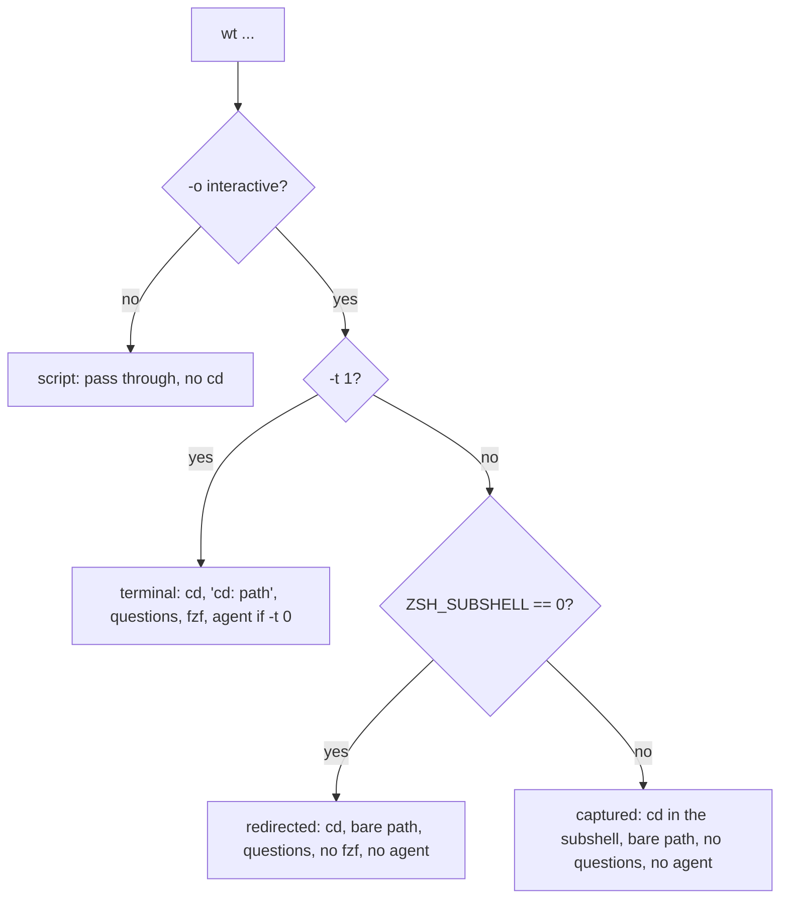

# Non-interactive Shell Contract (Phase 1) Implementation Plan

> **For agentic workers:** REQUIRED SUB-SKILL: Use superpowers:subagent-driven-development (recommended) or superpowers:executing-plans to implement this plan task-by-task. Steps use checkbox (`- [ ]`) syntax for tracking.

**Goal:** `wt` decides once per call who owns the caller's shell, and every run that cannot ask a person (`-y`, no terminal, `$(...)`, scripts, agent harnesses) proceeds or fails with a reason instead of waiting. This fixes K1 to K4, isolates the CLI from the user's zsh rc files, and documents the contract in README.

**Architecture:** `shell/workytree.zsh` computes a mode (`terminal`, `redirected`, `captured`, `script`) and passes it as `WORKYTREE_SHELL`. When it arms no AI runfile, it passes the reason as `WORKYTREE_AI_SKIP`. `bin/workytree` copies both into non-exported globals (`WT_SHELL`, `WT_AI_SKIP`, `WT_CAN_CD`) before any git call. `lib/prompt.zsh` gets uncached predicates (`prompt_tty`, `prompt_available`, `prompt_blocker`, `prompt_screen`) that every question, fzf screen and editor call goes through. The cd itself still follows `-o interactive`, so the mode only gates the announcement, questions, fzf and the agent.



**Tech Stack:** zsh 5.9 (modules zsh/zpty for tests, zsh/zle), git 2.50 (any git with `push --delete`), BSD or GNU `env` with `-S` (macOS, coreutils >= 8.30), optional `fzf`.

**Spec:** `docs/superpowers/specs/2026-10-23-noninteractive-ux-design.md`

Every code block in this plan was run in a fresh clone of `fix/non-interactive-shell` at `48c022b`, task by task in this order, with Task 1's helper already in its final form (`zpty -b`, no `2>/dev/null` on zpty builtins, kill on timeout). Each task's Step 2 failures and Step 4 counts come from that run (macOS, zsh 5.9, git 2.50.1, `PATH` without any real AI agent). The full suite ended at 1150 passed, 0 failed (baseline before Task 1: 1000).

Before Task 1, commit the spec and both plans on their own. The spec already matches this plan (startup message, test placement, file names). Skip this step if the docs reached `main` first.

```bash
git add docs/superpowers/specs/2026-10-23-noninteractive-ux-design.md docs/superpowers/plans/2026-10-23-noninteractive-shell.md docs/superpowers/plans/2026-10-23-branch-safety.md
git commit -m "docs: spec and plans for the non-interactive shell contract and branch safety"
```

## Global Constraints

- Shell: zsh only. Every touched file passes `zsh -n`. CI lint covers `bin/workytree`, `lib/*.zsh`, `lib/cmd/*.zsh`, `shell/`, `tests/*.zsh`.
- No new dependency. `zsh/zpty` ships with zsh. Tests do not use python, `script(1)` or `timeout(1)`.
- Never name a local `path` (tied to `$PATH`) or `argv`.
- Mode names are exactly `terminal|redirected|captured|script`. Skip reasons are exactly `script|redirected|captured|stdin|tmp|startup|no-ai`. Empty `WORKYTREE_SHELL` means the CLI ran directly.
- Old names stay accepted for one release: `WORKYTREE_CD_CAPABLE=1` reads as `terminal`, and `__ai-configured` stays in the dispatch list.
- The prompt predicates are plain functions with no cache. Tests toggle `WT_YES` and `WORKYTREE_PROMPT_INPUT` between calls.
- AI end-to-end tests configure `ai_agent = fakeagent` with the script in the sandbox `$HOME/bin`. Never enable `ask`/`always` with an agent name that exists on a real `PATH`: `bin/workytree` puts `/opt/homebrew/bin` and `/usr/local/bin` first.
- Pty tests use `pty_run`, or `pty_start`/`pty_wait`/`pty_send`/`pty_finish`. Never put `2>/dev/null` on a zpty builtin (Task 1 says why).
- Comments follow `~/.claude/CLAUDE.md`: only what quietly breaks the next edit. Do not carry the old history and measurement comments in `shell/workytree.zsh` and the `bin/workytree` header into the rewrite. That rationale lives in the spec and the commit messages.
- Out of scope: create's stdout→stderr move (P3), network time bounds (P2), merged verdict, branch identity and create argument validation (T7), key decoding (T7-5), new exit codes.
- T7 units may land first (spec §13.2). Rebase onto them and resolve as the table "Merge notes with Phase 1" in `docs/superpowers/plans/2026-10-23-branch-safety.md` says. The zpty block in Task 1 must stay byte-identical to that plan's Task 8 copy: two different blocks under the same names merge without a conflict, and the later definitions silently win.

## Review Focus

1. **The cd still follows inside subshells**: `( wt cd x && make ) > log` and `{ wt cd x && pwd } | cat` must still run in `x`. Ownership must never gate the cd. Pinned by `test_cd_follows_inside_subshells_and_piped_groups` (Task 1), which must still pass after Task 6.
2. **K1 and K3**: `x=$(wt cd …)` gets exactly the path, with no `cd:` and no ESC byte, and the wrapper sends `captured` there, never `redirected`, so remove does not claim the caller's shell. Pinned by `test_capture_and_pipes_get_the_bare_path` and `test_wrapper_sends_one_mode_per_context` in Task 6; the CLI's side by `test_remove_from_inside_without_an_owning_shell_warns` in Task 4.
3. **K2**: an agent never inherits a pipe, a file or a while-read loop's stdin. The runfile is armed only in terminal mode with `-t 0`. Pinned by `test_agent_never_runs_where_it_cannot_attach_to_the_terminal` in Task 8.
4. **-y never waits on a keyboard**: no fzf, and `WT_YES` is checked before the prompt test hook. Pinned by `test_status_prints_the_table_with_yes_or_without_a_terminal` and `test_yes_beats_the_prompt_hook_and_names_itself` in Task 5.
5. **The CLI reads no rc file**: a `.zshenv` with `err_exit`, `noclobber`, `ksh_arrays`, an alias and a `git()` function changes nothing. Pinned by `test_cli_ignores_the_users_zshenv` in Task 2.

## File Map

| File | Task | Responsibility |
|---|---|---|
| `tests/helpers.zsh` | 1 | zpty session helpers; `setup_env` unsets the protocol variables, `EDITOR`, `VISUAL`, `NO_COLOR` |
| `bin/workytree` | 2, 4, 8 | `-S zsh -f` shebang, `emulate -R zsh`, `__shell-init` dispatch (2); protocol capture, `WT_CAN_CD` (4); usage line (8) |
| `lib/cmd/shell_init.zsh` (new) | 2 | `cmd___shell-init` |
| `install.sh` | 2 | smoke-run the CLI before touching `.zshrc` |
| `shell/workytree.zsh` | 3, 6, 8 | source-time block (3); `workytree()` rewrite (6); AI arming and `--no-ai` (8) |
| `lib/cmd/remove.zsh` | 4, 5, 9 | K3 warning (4); K4 message (5); remote push via `wt_git_remote` (9) |
| `lib/cmd/status.zsh` | 4, 5 | colour gate on `WT_SHELL`, ctrl-d child leaves the worktree (4); `prompt_screen` gate (5) |
| `lib/prompt.zsh` | 5 | `prompt_tty`, `prompt_available`, `prompt_blocker`, `prompt_screen` |
| `lib/cmd/create.zsh`, `lib/cmd/init.zsh` | 5, 8 | K4 messages (5); `--no-ai` (8) |
| `lib/cmd/config.zsh` | 5 | `config edit` refuses without a terminal or with `-y` |
| `lib/cmd/path.zsh` | 7 | `cmd_cd` checks its target |
| `lib/agent.zsh` | 8 | skip reasons, no-agent warning, ask rule |
| `lib/worktree.zsh` | 9 | `wt_git_remote` |
| `README.md` | 10 | section `비대화 실행`; AI, status, remove, exit codes and known-limits updates |
| `tests/noninteractive.test.zsh` (new) | 4, 5, 8, 9, 10 | one test per README matrix row |
| `tests/shell.test.zsh`, `tests/cli.test.zsh`, `tests/install.test.zsh`, `tests/status.test.zsh`, `tests/status_tui.test.zsh`, `tests/prompt.test.zsh`, `tests/config.test.zsh`, `tests/agent.test.zsh`, `tests/remove.test.zsh` | 1-10 | see each task |

Run every test file from the repo root: `zsh tests/<name>.test.zsh`. The last line is `N passed, M failed`. When a failure message spans several lines, `M` counts lines, so read the `FAIL` lines rather than `M`.

## Finding Coverage

Every Phase 1 finding of the review, by the task that fixes it:

| Task | Findings |
|---|---|
| 1 | `automation:test-gap-tty-yes` |
| 2 | `contexts:zshenv-fork-bomb`, `contexts:cli-inherits-zshenv` |
| 3 | `contexts:source-time-cost`, `contexts:broken-config-alias-warning` |
| 4 | `contexts:remove-in-capture-false-move` (the CLI half; Task 6 makes the wrapper send `captured`) |
| 5 | `journeys:yes-flag-semantics`, `automation:yes-flag-semantics-inconsistent`, `automation:prompt-input-env-overrides-yes`, `automation:config-edit-no-tty-guard` |
| 6 | `contexts:claude-snapshot-wrapper-broken`, `automation:harness-snapshot-wrapper-broken`, `contexts:print-P-path-expansion`, `output:wrapper-print-P`, `contexts:cd-line-color`, `contexts:failure-drops-last-line`, `contexts:ksh-arrays-wrapper`, `contexts:posix-traps-exit-trap`, `contexts:ctrl-c-runfile-leak`, `critic:remove-interrupt-strands-deleted-cwd` |
| 7 | `contexts:cd-missing-target-silent`, `journeys:cd-typo-silent`, `automation:path-cd-missing-worktree-rc0` |
| 8 | `contexts:ai-misleading-warning-noninteractive`, `output:ai-wrong-cause-shell-integration`, `output:ai-silent-no-agent`, `automation:ai-ask-runs-without-asking`, `automation:no-ai-opt-out-flag` |
| 9 | `automation:remove-remote-credential-prompt-blocks` |
| 10 | `automation:readme-missing-noninteractive-contract`, `contexts:script-wt-cd-noop` (documented: a script gets the path and no cd), `automation:readme-exit-code-table-wrong`, `output:exit-code-taxonomy-docs` |

Task 4 also removes P3's `output:status-action-stray-path`: the status ctrl-d child no longer stands in the worktree, so it prints no destination. P3 drops that row.

---

### Task 1: Pty test helpers and pinned cd-following

**Files:**
- Modify: `tests/helpers.zsh:26` (`setup_env` unset list); insert the pty helpers before `wt() {` (`:41`)
- Test: `tests/shell.test.zsh` (append two tests)

**Interfaces:**
- Consumes: `zsh/zpty`, `pgrep -P`.
- Produces (tests only):
  - `pty_start [code]`: `zsh -d -i -c <code>` on a pty, or a line-mode `zsh -d -i +Z` when no code is given. `$HOME/.zshrc` exports `TMPDIR=$TMP_ROOT`, sources the wrapper and writes `$$` to `$HOME/.pty.pid`.
  - `pty_wait <text> [tenths=100]` → rc 1 on timeout. `pty_send <bytes>`.
  - `pty_finish [tenths=200]`: sets global `WT_PTY_OUT` to the transcript with CRs removed. On timeout it appends `[pty timed out]` and kills the process tree.
  - `pty_run <code>`: `pty_start`, then `pty_finish`, then prints `WT_PTY_OUT`.

- [ ] **Step 1: Write the failing tests**. Append to `tests/shell.test.zsh` before `run_tests`:

```zsh
# The cd follows `-o interactive`, not the wrapper mode: a subshell or a group whose output is
# piped or redirected is still a shell the user typed into, and `( wt cd x && make ) > log`
# must run make in x.
test_cd_follows_inside_subshells_and_piped_groups() {
  fixture
  wt create app fix A main -y >/dev/null 2>&1
  local w="$HOME/wts/app/fix/A"
  assert_eq "$(zsh_i 'cd ~; ( wt cd app fix A >/dev/null && pwd ); pwd')" "$w"$'\n'"$HOME" "( )"
  assert_eq "$(zsh_i 'cd ~; ( wt cd app fix A && pwd ) > o; tail -1 o; pwd')" "$w"$'\n'"$HOME" "( ) > file"
  assert_eq "$(zsh_i 'cd ~; { wt cd app fix A >/dev/null && pwd } | cat; pwd')" "$w"$'\n'"$HOME" "{ } | cat"
}

test_create_on_a_terminal_cds_and_announces_once() {
  fixture
  local out; local -a cd_lines
  out="$(pty_run 'wt create app fix A main -y 2>/dev/null; print -r -- "PWD=$PWD"')"
  cd_lines=( ${(M)${(f)out}:#*cd:*} )
  assert_contains "$out" "PWD=$HOME/wts/app/fix/A"
  assert_eq "${#cd_lines}" 1 "one cd: line"
}
```

- [ ] **Step 2: Run it to verify it fails**

Run: `zsh tests/shell.test.zsh`
Expected: FAIL with `command not found: pty_run`. The three subshell assertions already pass: they pin today's behaviour.

- [ ] **Step 3: Implement**. In `setup_env`, extend the unset list:

```zsh
  unset WORKYTREE_PROMPT_INPUT WORKYTREE_PROMPT_KEYS WORKYTREE_CONFIG WORKYTREE_ALIAS ZDOTDIR \
    WORKYTREE_SHELL WORKYTREE_AI_SKIP WORKYTREE_AI_RUNFILE WORKYTREE_CD_CAPABLE EDITOR VISUAL NO_COLOR
```

Insert before `wt() {`:

```zsh
# pty_start [code]: an interactive zsh on a pseudo-terminal, so stdin, stdout and /dev/tty are
# all a terminal, with $HOME/.zshrc sourcing the wrapper. With <code> it runs `zsh -i -c <code>`;
# without, a line-mode shell (no ZLE) that runs whatever pty_send types.
typeset -g WT_PTY_OUT=''
pty_start() {
  zmodload zsh/zpty
  print -r -- "print -r -- \$\$ > '$HOME/.pty.pid'; export TMPDIR='$TMP_ROOT'; source '$WT_TEST_ROOT/shell/workytree.zsh'" > "$HOME/.zshrc"
  WT_PTY_OUT=''
  if (( $# )); then
    zpty -b WT_PTY "ZDOTDIR=${(q)HOME} TERM=xterm-256color zsh -d -i -c ${(q)1}"
  else
    zpty -b WT_PTY "ZDOTDIR=${(q)HOME} TERM=xterm-256color zsh -d -i +Z"
  fi
}
# No 2>/dev/null on zpty builtins: zpty -d then closes the saved stderr, and every later
# FAIL line of the test file goes nowhere.
_pty_drain() { local chunk; while zpty -r -t WT_PTY chunk; do WT_PTY_OUT+="$chunk"; done; }
# pty_wait <text> [tenths=100]: rc 1 if <text> has not appeared by then.
pty_wait() {
  local -i i
  for (( i = 0; i < ${2:-100}; i++ )); do
    _pty_drain
    [[ "$WT_PTY_OUT" == *"$1"* ]] && return 0
    sleep 0.1
  done
  return 1
}
pty_send() { zpty -w -n WT_PTY "$1"; }
_pty_kill_tree() { local c; for c in $(pgrep -P "$1"); do _pty_kill_tree "$c"; done; kill -9 "$1" 2>/dev/null; }
# pty_finish [tenths=200]: waits for the shell to exit and leaves the transcript, CRs removed,
# in WT_PTY_OUT. Call it in the shell that ran pty_start, not in a $(...): zpty cannot watch a
# child of another process. A shell still running at the deadline is killed with everything it
# started (zpty -d alone waits on an fzf that ignores SIGHUP), and the transcript ends in
# "[pty timed out]".
pty_finish() {
  local -i i
  for (( i = 0; i < ${1:-200}; i++ )); do
    _pty_drain
    zpty -t WT_PTY || break
    sleep 0.1
  done
  if zpty -t WT_PTY; then
    WT_PTY_OUT+=$'\n[pty timed out]'
    [[ -s "$HOME/.pty.pid" ]] && _pty_kill_tree "$(<"$HOME/.pty.pid")"
  fi
  _pty_drain
  zpty -d WT_PTY
  WT_PTY_OUT="${WT_PTY_OUT//$'\r'/}"
}
# pty_run <code>: pty_start <code>, then pty_finish; prints the transcript.
pty_run() { pty_start "$1"; pty_finish; print -r -- "$WT_PTY_OUT"; }
```

The `-b` flag makes the pty non-blocking. Without it, `zpty -r -t` blocks until the child writes again.

- [ ] **Step 4: Run tests to verify they pass**

Run: `zsh tests/shell.test.zsh && zsh -n tests/helpers.zsh`
Expected: `63 passed, 0 failed`.

- [ ] **Step 5: Commit**

```bash
git add tests/helpers.zsh tests/shell.test.zsh
git commit -F - <<'MSG'
test: drive the wrapper on a real pty and pin cd-following in subshells

K1 to K4 only show up when stdin, stdout and /dev/tty are a terminal, and the existing
zsh_i helper has a pipe for stdout. zpty needs -b: without it, zpty -r -t blocks until the
child writes again. A hung child (a real fzf) is killed by process tree, because zpty -d
alone waits for it.

The subshell tests pin the behaviour Phase 1 must keep: ( wt cd x && make ) > log runs make
in x.
MSG
```

---

### Task 2: CLI isolation and `__shell-init`

**Files:**
- Modify: `bin/workytree:1-4` (shebang, `emulate`), `bin/workytree:88` (dispatch list), `install.sh:64`
- Create: `lib/cmd/shell_init.zsh`
- Test: `tests/cli.test.zsh` (append two tests), `tests/install.test.zsh` (append one)

**Interfaces:**
- Consumes: `ai_configured_anywhere`, `WT_CFG[alias_wt]`, `WT_CONFIG_LOAD_ERROR`.
- Produces: `workytree __shell-init` prints exactly one line, `ai=0|1 alias=0|1 config=ok|error`. It never writes stderr and always exits 0. It is not listed in `usage`.

- [ ] **Step 1: Write the failing tests**. Append to `tests/cli.test.zsh`:

```zsh
# hostile_zshenv: a ZDOTDIR whose .zshenv flips options, aliases mv, shadows git with a
# function and announces itself. bin/workytree must read none of it.
hostile_zshenv() {
  mkdir -p "$HOME/zdot"
  cat > "$HOME/zdot/.zshenv" <<'EOF'
print -u2 ZSHENV-RAN
setopt err_exit no_clobber ksh_arrays
alias mv='mv -i'
git() { print -u2 GIT-FUNCTION-RAN; command git "$@"; }
EOF
  export ZDOTDIR="$HOME/zdot"
}

test_cli_ignores_the_users_zshenv() {
  make_repo "$HOME/src/app"
  write_config <<'EOF'
[project me]
repo_root = ~/src
worktree_root = ~/wts
EOF
  hostile_zshenv
  local rc
  wt --version >/dev/null 2>"$HOME/err"; rc=$?
  assert_eq "$rc" 0 "--version under err_exit"
  wt config set stale_days 9 >/dev/null 2>>"$HOME/err"
  assert_eq "$(wt config get stale_days 2>>"$HOME/err")" 9 "config set under noclobber"
  wt create app fix Z main -y >/dev/null 2>>"$HOME/err"
  wt remove app fix Z -y >/dev/null 2>>"$HOME/err"; rc=$?
  assert_eq "$rc" 0 "remove under noclobber"
  assert_not_exists "$HOME/wts/app/fix/Z"
  assert_eq "$(grep -c -e ZSHENV-RAN -e GIT-FUNCTION-RAN "$HOME/err")" 0 "no .zshenv code ran"
  unset ZDOTDIR
}

test_shell_init_reports_ai_alias_and_config_state() {
  assert_eq "$(wt __shell-init 2>&1)" "ai=0 alias=1 config=ok" "no config file"
  write_config <<'EOF'
ai_session = ask
alias_wt = false
EOF
  assert_eq "$(wt __shell-init 2>&1)" "ai=1 alias=0 config=ok"
  print 'ai_session = off' >> "$XDG_CONFIG_HOME/workytree/config"
  local out rc
  out="$(wt __shell-init 2>&1)"; rc=$?
  assert_eq "$rc" 0
  assert_eq "$out" "ai=0 alias=1 config=error" "a broken config reads as defaults, and says so"
}
```

Append to `tests/install.test.zsh`:

```zsh
# The installer runs the CLI once, so a platform whose env(1) lacks -S fails at install time
# with a reason instead of at the first `wt create`.
test_install_refuses_a_cli_that_does_not_start() {
  mkdir -p "$HOME/inst/bin" "$HOME/inst/lib" "$HOME/inst/shell"
  printf '#!/bin/sh\nexit 1\n' > "$HOME/inst/bin/workytree"; chmod +x "$HOME/inst/bin/workytree"
  print '# existing' > "$HOME/.zshrc"
  local out rc
  out="$(WORKYTREE_INSTALL_DIR="$HOME/inst" sh "$WT_TEST_ROOT/install.sh" 2>&1)"; rc=$?
  assert_eq "$rc" 1
  assert_contains "$out" "does not start"
  assert_contains "$out" "env -S"
  assert_eq "$(<"$HOME/.zshrc")" "# existing" ".zshrc untouched"
}
```

- [ ] **Step 2: Run them to verify they fail**

Run: `zsh tests/cli.test.zsh; zsh tests/install.test.zsh`
Expected: FAIL with `--version under err_exit: expected [0] got [1]`, `config set under noclobber: expected [9] got []`, `remove under noclobber: expected [0] got [1]`, `no .zshenv code ran: expected [0] got [5]`, and `unknown command: __shell-init`. install fails with `.zshrc untouched`, because the source line was appended.

- [ ] **Step 3: Implement**.
  - In `bin/workytree`, change line 1 to `#!/usr/bin/env -S zsh -f`. Make `emulate -R zsh` the first statement, before `set -u` and `setopt extendedglob`. `-f` stops `~/.zshenv` (options, aliases, functions, and the wrapper re-sourcing itself). `emulate -R` resets whatever `/etc/zshenv` set. Exported variables still arrive.
  - Add `__shell-init` to the dispatch list next to `__complete` (keep `__ai-configured`).
  - Create `lib/cmd/shell_init.zsh`:

```zsh
# cmd___shell-init: one line, "ai=0|1 alias=0|1 config=ok|error", parsed by shell/workytree.zsh.
cmd___shell-init() {
  local ai=0 alias_on=1 cfg=ok
  [[ -n "$WT_CONFIG_LOAD_ERROR" ]] && cfg=error
  ai_configured_anywhere && ai=1
  [[ "${${WT_CFG[alias_wt]:-}:l}" == (false|0|no) ]] && alias_on=0
  print -r -- "ai=$ai alias=$alias_on config=$cfg"
}
```

  - In `install.sh`, before `echo "workytree: linked $BIN_DIR/workytree"`:

```sh
"$INSTALL_DIR/bin/workytree" --version >/dev/null 2>&1 \
  || die "$INSTALL_DIR/bin/workytree does not start; it needs zsh on PATH and an env(1) that supports env -S (macOS, GNU coreutils 8.30+)"
```

- [ ] **Step 4: Run tests to verify they pass**

Run: `zsh tests/cli.test.zsh && zsh tests/install.test.zsh && zsh -n bin/workytree lib/cmd/shell_init.zsh && sh -n install.sh`
Expected: `19 passed, 0 failed`, then `27 passed, 0 failed`.

- [ ] **Step 5: Commit**

```bash
git add bin/workytree lib/cmd/shell_init.zsh install.sh tests/cli.test.zsh tests/install.test.zsh
git commit -F - <<'MSG'
fix(cli): never read the user's zsh rc files; add __shell-init

bin/workytree ran `#!/usr/bin/env zsh`, so ~/.zshenv ran on every call. With err_exit,
--version died silently. noclobber made remove refuse with a bogus "could not verify
worktree status". A .zshenv that sourced the wrapper started CLIs that sourced it again,
and the number of zsh processes doubled at each level.

A body-level re-exec or `emulate` runs after .zshenv, so only the shebang can stop it:
`env -S zsh -f`. That needs BSD env or coreutils >= 8.30, so the installer now smoke-runs
the CLI and names the requirement. Exported variables still reach the CLI.

__shell-init answers ai/alias/config in one call, so the wrapper no longer starts the CLI
twice when a shell starts.
MSG
```

---

### Task 3: One CLI call per interactive shell start, none in scripts

**Files:**
- Modify: `shell/workytree.zsh:156-228` (delete `_workytree_alias_enabled` with its comment, and the `_WORKYTREE_AI_CONFIGURED` / alias block). Keep the R35 comment, `_WORKYTREE_WT_BODY` and `_workytree_wt_is_ours`.
- Test: `tests/shell.test.zsh` (append two tests)

**Interfaces:**
- Consumes: `workytree __shell-init` (Task 2).
- Produces: global `_WORKYTREE_AI_CONFIGURED` (0/1). `wt` is installed unless `WORKYTREE_ALIAS=0`, `alias=0` (interactive shells only), or a foreign `wt` exists. With `config=error`, one stderr line: `workytree: config has errors; run 'workytree list' to see them`. The foreign-`wt` warning is then suppressed.

- [ ] **Step 1: Write the failing tests**:

```zsh
# counting_install: a copy of the integration whose bin/workytree appends its first argument to
# $HOME/cli.calls before running the real CLI. $HOME/.zshenv sources it, as a user who moved
# the source line out of .zshrc would.
counting_install() {
  mkdir -p "$HOME/inst/shell" "$HOME/inst/bin"
  cp "$SHELL_FILE" "$HOME/inst/shell/workytree.zsh"
  print -r -- "#!/bin/sh
echo \"\$1\" >> '$HOME/cli.calls'
exec '$WT_BIN' \"\$@\"" > "$HOME/inst/bin/workytree"
  chmod +x "$HOME/inst/bin/workytree"
  print -r -- "source '$HOME/inst/shell/workytree.zsh'" > "$HOME/.zshenv"
}

test_sourcing_runs_the_cli_once_in_interactive_shells_and_never_otherwise() {
  fixture; counting_install
  assert_eq "$(ZDOTDIR="$HOME" zsh -d -c 'whence -w wt' 2>&1)" "wt: function" "non-interactive still gets wt"
  assert_not_exists "$HOME/cli.calls"
  ZDOTDIR="$HOME" zsh -d -i -c true >/dev/null 2>&1
  assert_eq "$(<"$HOME/cli.calls")" "__shell-init"
  assert_eq "$(WORKYTREE_ALIAS=0 ZDOTDIR="$HOME" zsh -d -c 'whence -w wt' 2>&1)" "wt: none"
}

test_broken_config_at_startup_prints_one_line_and_no_alias_advice() {
  write_config <<'EOF'
kinds = a
kinds = b
EOF
  print -r -- "alias wt='echo mine'; source '$SHELL_FILE'" > "$HOME/.zshrc"
  assert_eq "$(ZDOTDIR="$HOME" zsh -d -i -c wt 2>&1)" \
    "workytree: config has errors; run 'workytree list' to see them"$'\n'"mine"
}
```

- [ ] **Step 2: Run them to verify they fail**

Run: `zsh tests/shell.test.zsh`
Expected: FAIL with `exists …/cli.calls` (the non-interactive source ran the CLI), `expected [__shell-init] got [__ai-configured …`, and the alias-advice line in place of the config line.

- [ ] **Step 3: Implement**. Replace the deleted blocks with:

```zsh
typeset -gi _WORKYTREE_AI_CONFIGURED=0
() {
  local init alias_msg="workytree: 'wt' is already defined; not installing the alias (set 'alias_wt = false' or WORKYTREE_ALIAS=0 to silence)"
  local -i want_alias=1 cfg_err=0
  if [[ -o interactive ]]; then
    init=" $("$WORKYTREE_BIN" __shell-init 2>/dev/null) "
    [[ "$init" == *" ai=1 "* ]] && _WORKYTREE_AI_CONFIGURED=1
    [[ "$init" == *" alias=0 "* ]] && want_alias=0
    if [[ "$init" == *" config=error "* ]]; then
      cfg_err=1
      print -u2 -r -- "workytree: config has errors; run 'workytree list' to see them"
    fi
  fi
  [[ "${WORKYTREE_ALIAS:-1}" == 0 ]] && want_alias=0
  (( want_alias )) || return 0
  if (( $+functions[wt] )) && _workytree_wt_is_ours; then
    functions[wt]="$_WORKYTREE_WT_BODY"
  elif (( $+functions[wt] || $+commands[wt] || $+aliases[wt] )); then
    (( cfg_err )) || print -u2 -r -- "$alias_msg"
  else
    functions[wt]="$_WORKYTREE_WT_BODY"
  fi
}
```

- [ ] **Step 4: Run tests to verify they pass**

Run: `zsh tests/shell.test.zsh && zsh tests/agent.test.zsh`
Expected: `68 passed, 0 failed`, then `75 passed, 0 failed` (`__ai-configured` still works).

- [ ] **Step 5: Commit**

```bash
git add shell/workytree.zsh tests/shell.test.zsh
git commit -F - <<'MSG'
fix(shell): one __shell-init call per interactive shell, none in scripts

Sourcing ran the CLI twice (__ai-configured, config get alias_wt) in every shell, including
`zsh -c` from tools and the shells the CLI itself started. Non-interactive shells now make
no CLI call: they cannot launch an agent anyway, and alias_wt is not consulted there.

A broken config used to reach this code as "unset", so a user who had set alias_wt = false
was told to set it. One line now names the real problem.
MSG
```

---

### Task 4: CLI reads the wrapper mode; K3 warning

**Files:**
- Modify: `bin/workytree:10-31` (replace the runfile/CD_CAPABLE header block), `lib/cmd/remove.zsh:294` and `:346`, `lib/cmd/status.zsh:286-290` and `:457` (`cmd___status-action`)
- Create: `tests/noninteractive.test.zsh`
- Test: `tests/cli.test.zsh` (append one), `tests/status.test.zsh` (append one), `tests/status_tui.test.zsh` (append one)

**Interfaces:**
- Consumes: env `WORKYTREE_SHELL`, `WORKYTREE_AI_SKIP`, `WORKYTREE_AI_RUNFILE`, and legacy `WORKYTREE_CD_CAPABLE=1`.
- Produces: non-exported globals `WT_SHELL` (`''|terminal|redirected|captured|script`), `WT_AI_SKIP`, `WT_AI_RUNFILE`, and `WT_CAN_CD` (1 iff `WT_SHELL` is `terminal` or `redirected`). remove: when `!WT_CAN_CD` and `$PWD` is inside the target, it prints `warn "your shell's current directory was removed: <target>"` plus `hint "cd <dest>"`. The last stdout line is still `<dest>`.
- Exception (spec §3.4): status ctrl-d runs `__status-action remove` as an fzf child with no `WORKYTREE_SHELL`, so it looks like a direct call. The parent status prints the main checkout last (`status.zsh:375`) and the wrapper moves the shell there. The child therefore leaves the worktree before calling `cmd_remove`, and neither warns nor prints a destination.

- [ ] **Step 1: Write the failing tests**. Create `tests/noninteractive.test.zsh`:

```zsh
#!/usr/bin/env zsh
# README "비대화 실행": one test per row of the question table, each covering both -y and
# "no terminal". Rows that need a real terminal run on a pty (helpers.zsh: pty_run).
source "${0:A:h}/helpers.zsh"

fixture() {
  make_repo "$HOME/src/app"
  write_config <<'EOF'
[project me]
repo_root = ~/src
worktree_root = ~/wts
EOF
}

# remove_from_inside <mode>: removes fix/K from inside it with WORKYTREE_SHELL=<mode>; sets
# OUT (stdout) and ERR (stderr).
remove_from_inside() {
  wt create app fix K main -y >/dev/null 2>&1
  OUT="$(cd "$HOME/wts/app/fix/K" && WORKYTREE_SHELL=$1 "$WT_BIN" remove app fix K -y 2>"$HOME/err" </dev/null)"
  ERR="$(<"$HOME/err")"
}

test_remove_from_inside_without_an_owning_shell_warns() {
  fixture
  local mode OUT ERR
  for mode in captured script ''; do
    remove_from_inside "$mode"
    assert_eq "${OUT##*$'\n'}" "$HOME/src/app" "last line, mode=[$mode]"
    assert_contains "$ERR" "your shell's current directory was removed" "mode=[$mode]"
    assert_contains "$ERR" "hint: cd $HOME/src/app"
    assert_eq "${ERR#*moving to}" "$ERR" "no move line, mode=[$mode]"
  done
  for mode in terminal redirected; do
    remove_from_inside "$mode"
    assert_eq "${OUT##*$'\n'}" "$HOME/src/app"
    assert_eq "${ERR#*directory was removed}" "$ERR" "no warning, mode=$mode"
    assert_contains "$ERR" "→ moving to"
  done
}

run_tests
```

Append to `tests/cli.test.zsh`:

```zsh
test_wrapper_protocol_never_reaches_git_hooks() {
  make_repo "$HOME/src/app"
  write_config <<'EOF'
[project me]
repo_root = ~/src
worktree_root = ~/wts
EOF
  printf '#!/bin/sh\necho "hook sees [${WORKYTREE_SHELL-}${WT_SHELL-}${WORKYTREE_AI_SKIP-}${WT_AI_SKIP-}]" >&2\n' \
    > "$HOME/src/app/.git/hooks/post-checkout"
  chmod +x "$HOME/src/app/.git/hooks/post-checkout"
  assert_contains "$(WORKYTREE_SHELL=terminal WORKYTREE_AI_SKIP=stdin wt create app fix H main -y 2>&1)" "hook sees []"
}
```

Append to `tests/status.test.zsh`:

```zsh
# Colour is forced only when the wrapper says its stdout is a terminal; `wt status > f` must
# not write escapes into f.
test_table_colour_follows_the_wrapper_mode() {
  fixture
  local esc=$'\e['
  assert_contains "$(WORKYTREE_SHELL=terminal wt status --offline)" "$esc" "terminal"
  local out; out="$(WORKYTREE_SHELL=redirected wt status --offline)"
  assert_eq "${out#*$esc}" "$out" "redirected: no escapes"
}
```

Append to `tests/status_tui.test.zsh`, before `# fzf searches only the displayed field`. The test stubs `_status_pause`, which otherwise waits for a key when the suite runs from a terminal:

```zsh
# ctrl-d runs remove in a child of status; the parent prints the main checkout last and the
# wrapper moves the shell there.
test_action_remove_from_inside_leaves_the_cwd_to_the_parent() {
  fixture
  local rec out err
  rec="$(print -r -- "$RECORDS" | grep '^worktree')"
  out="$(_status_pause() { :; }; WT_CONFIG_EXISTS=1; cd "$HOME/wts/app/fix/A" && cmd___status-action remove "$rec" </dev/null 2>"$HOME/err")"
  err="$(<"$HOME/err")"
  assert_contains "$err" "removed: $HOME/wts/app/fix/A"
  assert_eq "${err#*directory was removed}" "$err" "no stranded-shell warning"
  assert_eq "$out" "" "no destination line"
}
```

- [ ] **Step 2: Run them to verify they fail**

Run: `zsh tests/noninteractive.test.zsh; zsh tests/cli.test.zsh; zsh tests/status.test.zsh; zsh tests/status_tui.test.zsh`
Expected: FAIL in noninteractive: no warning in the captured, script and direct modes, and no `→ moving to` in terminal or redirected mode. cli: the hook sees `[terminalstdin]`. status: `terminal` has no escapes. The `redirected` assertion already passes. status_tui: `no destination line: expected [] got [<repo>]`. Its `no stranded-shell warning` assertion passes until the K3 warning below exists, and fails if `status.zsh:457` is left unchanged.

- [ ] **Step 3: Implement**.
  - `bin/workytree`: replace lines 10-31 with:

```zsh
# Set by shell/workytree.zsh. Copied into non-exported names and unset before any git call, so
# no hook or fzf child sees them: `typeset -g` alone keeps an export the caller already had.
typeset -g +x WT_AI_RUNFILE="${WORKYTREE_AI_RUNFILE:-}" WT_AI_SKIP="${WORKYTREE_AI_SKIP:-}" WT_SHELL="${WORKYTREE_SHELL:-}"
[[ -z "$WT_SHELL" && "${WORKYTREE_CD_CAPABLE:-}" == 1 ]] && WT_SHELL=terminal
unset WORKYTREE_AI_RUNFILE WORKYTREE_AI_SKIP WORKYTREE_SHELL WORKYTREE_CD_CAPABLE
# The wrapper cds a shell the user keeps to the last stdout line of remove/status.
typeset -gi +x WT_CAN_CD=0
[[ "$WT_SHELL" == (terminal|redirected) ]] && WT_CAN_CD=1
```

  - `lib/cmd/remove.zsh`: after `:294` (`[[ -z "$dest" ]] && … dest="$repo_path"`) add the following. It must stay before `builtin cd -- "$repo_path"` (`:312`), which changes `$PWD`.

```zsh
  local -i strands_cwd=0
  (( ! WT_CAN_CD )) && _rm_is_inside "$PWD" "$target" && strands_cwd=1
```

  After `:346` (`(( WT_CAN_CD )) && print -r -- "  → moving to     $dest"`):

```zsh
    (( strands_cwd )) && { warn "your shell's current directory was removed: $target"; hint "cd ${(q-)dest}"; }
```

  - `lib/cmd/status.zsh`: `WT_CAN_CD` now includes `redirected`, so status reads the mode directly. Use `[[ -t 0 ]] && { [[ -t 1 || "$WT_SHELL" == terminal ]]; }` in the fzf gate at `:286` (Task 5 replaces it), and at `:290`: `if (( interactive )) || [[ "$WT_SHELL" == terminal ]]; then ui_init force; fi`.
  - `lib/cmd/status.zsh:457`, in `cmd___status-action`, leave the worktree before removing it (`f[4]` is the repo path). No comment: the status_tui test names the reason.

```zsh
        ( WT_PROJECT_OPT="${f[2]}"; builtin cd -- "${f[4]}" 2>/dev/null; cmd_remove "${f[3]}" "${f[6]}" "${f[7]}" )
```

- [ ] **Step 4: Run tests to verify they pass**

Run: `zsh tests/noninteractive.test.zsh && zsh tests/cli.test.zsh && zsh tests/status.test.zsh && zsh tests/status_tui.test.zsh && zsh tests/remove_interactive.test.zsh`
Expected: `18 passed`, `20 passed`, `46 passed`, `31 passed`, `91 passed`, all with `0 failed`. remove_interactive still sends the legacy `WORKYTREE_CD_CAPABLE=1`.

- [ ] **Step 5: Commit**

```bash
git add bin/workytree lib/cmd/remove.zsh lib/cmd/status.zsh tests/noninteractive.test.zsh tests/cli.test.zsh tests/status.test.zsh tests/status_tui.test.zsh
git commit -F - <<'MSG'
fix(cli): read the wrapper mode; warn when remove strands the caller's cwd

WORKYTREE_SHELL replaces the CD_CAPABLE boolean: the CLI needs to know whether the cd lands
in a shell the user keeps (terminal, redirected), not just whether one is attempted. Under
$(...), in scripts and run directly, removing the worktree the caller stands in used to
leave it in a deleted directory without a word (K3); it now says so and prints the cd.

status ctrl-d is the exception: its remove runs in an fzf child that looks like a direct
call, while the parent status sends the shell home. The child now leaves the worktree first,
so it neither warns nor prints the stray destination line it used to.

WORKYTREE_CD_CAPABLE=1 is still read as terminal for one release, so shells that sourced
the old wrapper keep working.
MSG
```

---

### Task 5: -y never waits; refusals name the real cause

**Files:**
- Modify: `lib/prompt.zsh:5-10`, `lib/cmd/create.zsh:133,138,142`, `lib/cmd/remove.zsh:185`, `lib/cmd/init.zsh:58`, `lib/cmd/status.zsh:286`, `lib/cmd/config.zsh:58`
- Modify tests: `tests/config.test.zsh:294-296`, `:460`, `:634-635` run `config edit` without a terminal. Move them onto a pty.
- Test: `tests/noninteractive.test.zsh` (append nine tests), `tests/prompt.test.zsh` (append one)

**Interfaces:**
- Produces:
  - `prompt_tty`: rc 0 if `WORKYTREE_PROMPT_INPUT` is set, or if stdin is a tty and `/dev/tty` opens.
  - `prompt_available`: `(( ! ${WT_YES:-0} )) && prompt_tty`.
  - `prompt_blocker`: prints `--yes` when `WT_YES`, else `no terminal`.
  - `prompt_screen`: `prompt_available && { WT_SHELL == terminal || (WT_SHELL empty && -t 1) }`.
- Pinned messages:
  - create: `<what> is required: … (not asking: --yes|no terminal)`.
  - remove: `… (repo, kind and ticket are required; not asking: …)`.
  - init: `usage: workytree init <name> <repo_root> <worktree_root> (not asking: …)`.
  - config edit: exit 2 with `config edit needs a terminal for the editor (not opening one: …)`, plus the hint `use: workytree config path | get <key> | set <key> <value>`.

- [ ] **Step 1: Write the failing tests**. Append to `tests/noninteractive.test.zsh`:

```zsh
# fake_fzf: an fzf on PATH that reports being opened. A real fzf in a system directory wins
# (bin/workytree puts those first); then a regression shows up as the pty timing out instead.
fake_fzf() {
  mkdir -p "$HOME/bin"
  printf '#!/bin/sh\n[ "$1" = --version ] && { echo "0.55.0 (fake)"; exit 0; }\necho FZF-OPENED\nexit 130\n' > "$HOME/bin/fzf"
  chmod +x "$HOME/bin/fzf"
  export PATH="$HOME/bin:$PATH"
}

test_create_uses_the_inferred_repo_without_asking() {
  fixture
  (cd "$HOME/src/app" && "$WT_BIN" create fix IN main -y </dev/null >/dev/null 2>&1)
  assert_dir "$HOME/wts/app/fix/IN"
  (cd "$HOME/src/app" && "$WT_BIN" create fix IN2 main </dev/null >/dev/null 2>&1)
  assert_dir "$HOME/wts/app/fix/IN2"
}

test_create_missing_arguments_name_the_reason() {
  fixture
  local out
  out="$(pty_run "$WT_BIN create app -y; print RC=\$?")"
  assert_contains "$out" "kind is required"
  assert_contains "$out" "(not asking: --yes)"
  assert_contains "$out" "RC=2"
  out="$(wt create app 2>&1)"
  assert_contains "$out" "(not asking: no terminal)"
}

test_create_takes_the_base_default_and_confirms_with_yes() {
  fixture
  local rc
  WORKYTREE_PROMPT_INPUT=/dev/null "$WT_BIN" create app fix P -y >/dev/null 2>&1; rc=$?
  assert_eq "$rc" 0 "-y wins over the prompt test hook"
  assert_dir "$HOME/wts/app/fix/P"
  wt create app fix P2 >/dev/null 2>&1
  assert_dir "$HOME/wts/app/fix/P2"
}

test_remove_missing_arguments_name_the_reason() {
  fixture
  local out
  out="$(pty_run "$WT_BIN remove app -y; print RC=\$?")"
  assert_contains "$out" "(repo, kind and ticket are required; not asking: --yes)"
  assert_eq "${out#*without a terminal}" "$out" "no terminal blamed for -y"
  assert_contains "$out" "RC=2"
  assert_contains "$(wt remove app 2>&1)" "not asking: no terminal"
}

test_remove_refuses_a_dirty_worktree_without_force() {
  fixture
  wt create app fix D main -y >/dev/null 2>&1
  print x > "$HOME/wts/app/fix/D/new.txt"
  assert_exit 1 wt remove app fix D -y
  assert_dir "$HOME/wts/app/fix/D"
  assert_exit 0 wt remove app fix D --force -y
  assert_not_exists "$HOME/wts/app/fix/D"
}

test_remove_keeps_branches_without_flags() {
  fixture
  wt create app fix B main -y >/dev/null 2>&1
  wt remove app fix B -y >/dev/null 2>&1
  assert_exit 0 git -C "$HOME/src/app" show-ref --verify --quiet refs/heads/fix/B
}

test_init_missing_arguments_name_the_reason() {
  local out
  out="$(pty_run "$WT_BIN init -y; print RC=\$?")"
  assert_contains "$out" "(not asking: --yes)"
  assert_contains "$out" "RC=2"
  assert_contains "$(wt init 2>&1)" "(not asking: no terminal)"
}

test_status_prints_the_table_with_yes_or_without_a_terminal() {
  fixture; fake_fzf
  local out
  out="$(pty_run "$WT_BIN status -y --offline; print RC=\$?")"
  assert_contains "$out" "REPO"
  assert_contains "$out" "RC=0"
  assert_eq "${out#*FZF-OPENED}" "$out" "no fzf under -y"
  assert_contains "$(wt status --offline)" "REPO"
}

test_config_edit_refuses_with_yes_or_without_a_terminal() {
  fixture
  local out rc
  out="$(pty_run "EDITOR=false $WT_BIN config edit -y; print RC=\$?")"
  assert_contains "$out" "(not opening one: --yes)"
  assert_contains "$out" "RC=2"
  out="$(EDITOR=false wt config edit 2>&1)"; rc=$?
  assert_eq "$rc" 2
  assert_contains "$out" "(not opening one: no terminal)"
  assert_contains "$out" "workytree config path"
  assert_contains "$(pty_run "EDITOR=true $WT_BIN config edit; print RC=\$?")" "RC=0" "a terminal still gets the editor"
}
```

Append to `tests/prompt.test.zsh`:

```zsh
test_yes_beats_the_prompt_hook_and_names_itself() {
  local -i WT_YES=1
  WORKYTREE_PROMPT_INPUT=/dev/null prompt_available
  assert_eq "$?" 1 "-y never asks, even with the test hook set"
  assert_eq "$(prompt_blocker)" "--yes"
  WT_YES=0
  assert_eq "$(prompt_blocker)" "no terminal"
}
```

In `tests/config.test.zsh`, run the three existing `config edit` calls on a pty:

```zsh
# :294-296 (test_broken_config_path_and_edit_still_work)
  local out; out="$(pty_run "EDITOR=cat $WT_BIN config edit; print RC=\$?")"
  assert_contains "$out" $'kinds = a\nkinds = b\nRC=0'
# :460
  out="$(pty_run "EDITOR=cat $WT_BIN config edit")"
# :634-635
  out="$(pty_run "EDITOR=true $WT_BIN config edit; print RC=\$?")"
  assert_contains "$out" "RC=0" "config edit must still reach the editor"
```

- [ ] **Step 2: Run them to verify they fail**

Run: `zsh tests/noninteractive.test.zsh; zsh tests/prompt.test.zsh`
Expected: FAIL in the rows for create, remove and init (no `not asking:` suffix, and `without a terminal` under -y) and in `-y wins over the prompt test hook: expected [0] got [130]`. In the config edit row, `RC=1` comes from exec'ing `false`. In the status row, the fake fzf prints `FZF-OPENED`; with a real fzf in `/opt/homebrew/bin`, the transcript instead ends `[pty timed out]` after 20 s. prompt fails with `expected [1] got [0]` and an empty `prompt_blocker`. The inferred-repo, dirty and keep-branches rows already pass: they pin behaviour.

- [ ] **Step 3: Implement**.
  - `lib/prompt.zsh`: replace `prompt_available()` (`:5-10`) with:

The order inside `prompt_available` (`WT_YES` before the test hook) is pinned by `test_yes_beats_the_prompt_hook_and_names_itself`, so it gets no comment.

```zsh
prompt_tty() {
  [[ -n "${WORKYTREE_PROMPT_INPUT:-}" ]] && return 0
  [[ -t 0 ]] || return 1
  { : < /dev/tty; } 2>/dev/null
}
prompt_available() { (( ! ${WT_YES:-0} )) && prompt_tty; }
prompt_blocker() { if (( ${WT_YES:-0} )); then print -r -- --yes; else print -r -- 'no terminal'; fi; }
# Through the wrapper, stdout is its capture pipe: only the mode says a terminal is behind it.
prompt_screen() {
  prompt_available || return 1
  [[ "${WT_SHELL:-}" == terminal ]] || [[ -z "${WT_SHELL:-}" && -t 1 ]]
}
```

  - Append ` (not asking: $(prompt_blocker))` to the three `usage_error` strings at `create.zsh:133,138,142`. In `remove.zsh:185`, replace `required without a terminal)` with `required; not asking: $(prompt_blocker))`. In `init.zsh:58`, the message becomes `usage: workytree init <name> <repo_root> <worktree_root> (not asking: $(prompt_blocker))`.
  - `status.zsh:286`: `if (( ! ST_JSON && ! ST_PLAIN )) && prompt_screen; then`.
  - `config.zsh:58`: insert before `local f; …`:

```zsh
    edit) if ! prompt_available || [[ ! -t 1 ]]; then
            error "config edit needs a terminal for the editor (not opening one: $(prompt_blocker))"
            hint "use: workytree config path | get <key> | set <key> <value>"
            exit 2
          fi
```

- [ ] **Step 4: Run tests to verify they pass**

Run: `zsh tests/noninteractive.test.zsh && zsh tests/prompt.test.zsh && zsh tests/config.test.zsh && zsh tests/status_tui.test.zsh`
Expected: `49 passed`, `34 passed`, `178 passed` (one fewer than before: the pty version merges a status check into the transcript check), `31 passed`, all with `0 failed`.

- [ ] **Step 5: Commit**

```bash
git add lib/prompt.zsh lib/cmd/create.zsh lib/cmd/remove.zsh lib/cmd/init.zsh lib/cmd/status.zsh lib/cmd/config.zsh tests/noninteractive.test.zsh tests/prompt.test.zsh tests/config.test.zsh
git commit -F - <<'MSG'
fix(prompt): -y never waits for a keyboard; refusals name --yes or the missing terminal

On a terminal, -y made remove and init refuse with "without a terminal" (K4).
`status -y` opened fzf and waited. `config edit` exec'd the editor with no terminal: vim
wrote escape codes to stdout, or hung on an open pipe. A leftover WORKYTREE_PROMPT_INPUT
overrode -y and created nothing (rc 130).

-y now means "do not ask; proceed": no question, no fzf, no editor. Destructive steps still
need -b/-B/-r/--force. prompt_blocker gives every refusal one cause: "--yes" or
"no terminal".
MSG
```

---

### Task 6: Rewrite `workytree()` around one mode

**Files:**
- Modify: `shell/workytree.zsh:1-154`. Replace the header comment, both `_workytree_*` helpers and `workytree()`. Keep the `WORKYTREE_ROOT` and `WORKYTREE_BIN` lines.
- Modify tests in `tests/shell.test.zsh`:
  - `test_cd_translates_to_path_subcommand` becomes `test_cd_reaches_the_cli_as_cd`.
  - `test_status_output_last_line_is_a_cd_target` prints `mode=[${WORKYTREE_SHELL:-}]` and asserts `mode=[redirected]`. The last two lines of its comment ("reports whether the wrapper claimed the cd capability -- which it must not …") become `# and reports the mode: zsh_i's top level has a pipe on stdout, so redirected.`
  - `test_create_without_ai_runs_nothing` drops its `cd:` assertion and its comment, and asserts that the last line is the path.
  - `test_ai_flag_scan_matches_the_cli_parsing` uses `stand_in` on a pty.
- Test: `tests/shell.test.zsh` (append eight tests and `stand_in`)

**Interfaces:**
- Consumes: `WORKYTREE_BIN` if executable, else `${commands[workytree]}`, and the `_WORKYTREE_AI_CONFIGURED` flag; both may be missing.
- Produces: `workytree "$@"`, which calls no `_`-prefixed function and needs no global.
  - It passes `WORKYTREE_SHELL=<mode>` on every call (and `WORKYTREE_AI_RUNFILE` on an armed create).
  - Script mode, and subcommands other than `create|cd|remove|status`, pass through uncaptured.
  - Without a binary it returns rc 127 with `workytree: not found on PATH (install it, or set WORKYTREE_BIN)`.
  - Terminal mode prints `$'\e[38;5;70mcd:\e[0m '<path>`, or `cd: <path>` under `NO_COLOR`, `--no-color` or `TERM=dumb`. Other interactive modes print the bare path.
  - On failure it replays all captured stdout and returns the CLI's rc.
  - The always block removes the runfile and, if `$PWD` vanished, cds to the nearest existing ancestor, printing `workytree: your shell's directory was removed; moved to <dir>` on stderr.

- [ ] **Step 1: Write the failing tests**. Rewrite `test_cd_translates_to_path_subcommand` as:

```zsh
# `cd` reaches the CLI as `cd`: cmd_cd checks that the target exists, cmd_path does not.
test_cd_reaches_the_cli_as_cd() {
  fixture
  local stub="$TMP_ROOT/stub-workytree" log="$TMP_ROOT/stub.log"
  cat > "$stub" <<'SCRIPT'
#!/usr/bin/env zsh
print -r -- "$1 $WORKYTREE_SHELL" > "$WT_STUB_LOG"
print -r -- "/stub/target/path"
SCRIPT
  chmod +x "$stub"
  zsh -c "
    export WT_STUB_LOG='$log'
    source '$SHELL_FILE'
    WORKYTREE_BIN='$stub'
    workytree cd app fix T >/dev/null
  "
  assert_eq "$(cat "$log")" "cd script"
}
```

Replace the body of `test_ai_flag_scan_matches_the_cli_parsing` (it called the deleted `_workytree_has_ai_flag`):

```zsh
# The wrapper's --ai scan must agree with cmd_create: `--` ends create's flags, so a later
# --ai is a positional. A stand-in CLI reports whether it was handed a runfile.
test_ai_flag_scan_matches_the_cli_parsing() {
  fixture
  stand_in '[ -n "$WORKYTREE_AI_RUNFILE" ] && s=ARMED || s=NOT-ARMED; echo "$* -> $s"'
  local out
  out="$(pty_run "WORKYTREE_BIN=$HOME/stand-in
    wt create app fix PROJ-1; wt create --ai app fix; wt create app fix PROJ-1 --ai
    wt create -- --ai fix; wt create --ai -- x")"
  assert_contains "$out" "create app fix PROJ-1 -> NOT-ARMED"
  assert_contains "$out" "create --ai app fix -> ARMED"
  assert_contains "$out" "create app fix PROJ-1 --ai -> ARMED"
  assert_contains "$out" "create -- --ai fix -> NOT-ARMED" "-- makes a following --ai a positional"
  assert_contains "$out" "create --ai -- x -> ARMED" "--ai before -- is still the flag"
}
```

Append:

```zsh
# K1: inside $(...) or a pipe the caller gets the bare path, never the "cd:" announcement.
test_capture_and_pipes_get_the_bare_path() {
  fixture
  wt create app fix A main -y >/dev/null 2>&1
  assert_eq "$(zsh_i 'x=$(wt cd app fix A); print -r -- "[$x]"')" "[$HOME/wts/app/fix/A]"
  assert_eq "$(zsh_i 'wt create app fix B main -y 2>/dev/null | tail -1')" "$HOME/wts/app/fix/B"
}

test_terminal_cd_line_honours_no_color_and_dumb_terminals() {
  fixture
  wt create app fix A main -y >/dev/null 2>&1
  local w="$HOME/wts/app/fix/A" out
  assert_contains "$(pty_run 'wt cd app fix A')" $'\e[38;5;70mcd:\e[0m '"$w"
  out="$(pty_run 'NO_COLOR=1 wt cd app fix A; wt --no-color cd app fix A; TERM=dumb wt cd app fix A')"
  assert_eq "$out" "cd: $w"$'\n'"cd: $w"$'\n'"cd: $w"
}

test_wrapper_survives_caller_options_and_odd_ticket_names() {
  fixture
  local code
  code="$(cat <<'EOF'
export NO_COLOR=1
setopt ksh_arrays sh_word_split posix_traps prompt_subst
wt create app fix '50%d' main -y 2>/dev/null
wt create app fix 'U$(id>PWNED)' main -y 2>/dev/null
print -r -- "PWD=$PWD"
wt cd app >/dev/null; print -r -- "PWD=$PWD"
EOF
)"
  local out; out="$(pty_run "$code")"
  assert_contains "$out" "cd: $HOME/wts/app/fix/50%d"
  assert_contains "$out" "cd: $HOME/wts/app/fix/U\$(id>PWNED)"
  assert_contains "$out" "PWD=$HOME/wts/app/fix/U\$(id>PWNED)"
  assert_contains "$out" "PWD=$HOME/src/app"
  assert_not_exists "$HOME/wts/app/fix/U\$(id>PWNED)/PWNED"
}

test_failure_replays_every_line_and_keeps_the_exit_code() {
  fixture
  mkdir -p "$HOME/src/app/.git/refs/heads/fix"; : > "$HOME/src/app/.git/refs/heads/fix/EX.lock"
  assert_contains "$(zsh_i 'cd ~; wt create app fix EX main -y 2>/dev/null; print rc=$?; pwd')" \
    "base ref: main"$'\n'"rc=1"$'\n'"$HOME"
}

# Claude Code's shell snapshot keeps workytree() and wt() but drops `_`-prefixed helpers and
# plain globals such as WORKYTREE_BIN.
test_wrapper_works_from_a_shell_snapshot() {
  fixture
  zsh -f -c "source '$SHELL_FILE'; typeset -f workytree wt" > "$HOME/snap.zsh"
  mkdir -p "$HOME/pbin"; ln -s "$WT_BIN" "$HOME/pbin/workytree"
  local out
  out="$(PATH="$HOME/pbin:$PATH" zsh -f -c "source '$HOME/snap.zsh'; wt --version; print rc=\$?; wt path app" 2>&1)"
  assert_contains "$out" "workytree 0."
  assert_contains "$out" "rc=0"
  assert_contains "$out" "$HOME/src/app"
  out="$(zsh -f -c "source '$HOME/snap.zsh'; path=(/usr/bin /bin); wt --version; print rc=\$?" 2>&1)"
  assert_contains "$out" "workytree: not found on PATH"
  assert_contains "$out" "rc=127"
}

# stand_in <body>: a fake bin/workytree for the wrapper to call; WORKYTREE_BIN points at it.
stand_in() {
  print -r -- "#!/bin/sh
$1" > "$HOME/stand-in"
  chmod +x "$HOME/stand-in"
}

# The mode is what the CLI decides ownership from (WT_CAN_CD, the K3 warning, fzf); the bare
# path in a capture alone cannot tell captured from redirected.
test_wrapper_sends_one_mode_per_context() {
  fixture
  stand_in 'echo "mode=$WORKYTREE_SHELL" >&2; echo "$HOME"'
  local code out
  local -a modes
  code="$(cat <<EOF
WORKYTREE_BIN=$HOME/stand-in
wt cd x
x=\$(wt cd x)
wt cd x | cat
wt cd x > /dev/null
( wt cd x ) > /dev/null
zsh -f -c "source '$SHELL_FILE'; WORKYTREE_BIN=$HOME/stand-in; wt cd x"
EOF
)"
  out="$(pty_run "$code")"
  modes=( ${(M)${(f)out}:#mode=*} )
  assert_eq "$modes" "mode=terminal mode=captured mode=captured mode=redirected mode=captured mode=script"
}

test_ctrl_c_removes_the_runfile_and_keeps_the_users_exit_trap() {
  fixture
  stand_in 'echo STARTED >&2; sleep 30'
  pty_start
  pty_send "setopt posix_traps; trap 'print USER-EXIT-TRAP' EXIT; WORKYTREE_BIN=$HOME/stand-in"$'\n'
  pty_send $'wt create app fix X --ai -y\n'
  pty_wait STARTED
  pty_send $'\x03'
  sleep 0.5
  pty_send $'print -r -- "RUNFILES=$(ls "$TMPDIR" | grep -c "^workytree-ai\\.")"; exit\n'
  pty_finish
  assert_contains "$WT_PTY_OUT" "RUNFILES=0"
  assert_contains "$WT_PTY_OUT" "USER-EXIT-TRAP"
}

test_ctrl_c_after_the_cwd_was_deleted_lands_in_an_existing_directory() {
  fixture
  mkdir -p "$HOME/wts/app/fix/GONE"
  stand_in 'rm -rf "$PWD"; echo REMOVED >&2; sleep 30'
  pty_start
  pty_send "WORKYTREE_BIN=$HOME/stand-in; cd ~/wts/app/fix/GONE"$'\n'
  pty_send $'wt remove app fix GONE -y\n'
  pty_wait REMOVED
  pty_send $'\x03'
  sleep 0.5
  pty_send $'print -r -- "NOW=$PWD"; exit\n'
  pty_finish
  assert_contains "$WT_PTY_OUT" "workytree: your shell's directory was removed; moved to $HOME/wts/app/fix"
  assert_contains "$WT_PTY_OUT" "NOW=$HOME/wts/app/fix"
}
```

- [ ] **Step 2: Run it to verify it fails**

Run: `zsh tests/shell.test.zsh`
Expected: FAIL:
- `[[\e[38;5;70mcd:\e[39m …]]` instead of the bare path (K1).
- `expected [cd script] got [path ]`.
- `RUNFILES=1` and no `USER-EXIT-TRAP` (posix_traps).
- No `moved to` after Ctrl-C.
- `base ref: main` missing: the wrapper drops the last line before the failure.
- `\e[39m` instead of `\e[0m`, and colour under NO_COLOR.
- `cd: …/50<cwd>` (print -P).
- `command not found: _workytree_locate_subcommand` from the snapshot.
- `expected [mode=terminal mode=captured …] got [mode= mode= mode= mode= mode= mode=]`.
- `mode=[]` where `mode=[redirected]` is expected.

The rewritten `test_ai_flag_scan_matches_the_cli_parsing` already passes: it pins through the public function the behaviour the old version checked through `_workytree_has_ai_flag`, which Step 3 deletes.

- [ ] **Step 3: Implement**. Replace everything above `# R35:` except the two `typeset -g WORKYTREE_ROOT/BIN` lines with the code below. This is the whole algorithm. The AI arming here is still "configured or `--ai`"; Task 8 narrows it.

```zsh
# workytree shell integration — source this from ~/.zshrc. Defines workytree() (and wt())
# so create/cd/remove/status can move the caller's shell: bin/workytree prints the path as its
# last stdout line, and workytree() cds there. Modes and the CLI protocol: docs/superpowers/
# specs/2026-10-23-noninteractive-ux-design.md.
typeset -g WORKYTREE_ROOT="${${(%):-%x}:A:h:h}"
typeset -g WORKYTREE_BIN="$WORKYTREE_ROOT/bin/workytree"

# workytree() must not call a `_`-prefixed helper or rely on a non-exported global: shell
# snapshots (Claude Code's Bash tool) keep only workytree() and wt(). No `emulate -L`: it would
# drop the caller's cd options (auto_pushd, chase_links) for the final cd.
workytree() {
  setopt localoptions noksharrays noshwordsplit
  local bin="${WORKYTREE_BIN:-}"
  [[ -n "$bin" && -x "$bin" ]] || bin="${commands[workytree]:-}"
  if [[ -z "$bin" ]]; then
    print -u2 -r -- "workytree: not found on PATH (install it, or set WORKYTREE_BIN)"
    return 127
  fi
  local mode=script
  if [[ -o interactive ]]; then
    if [[ -t 1 ]]; then mode=terminal
    elif (( ZSH_SUBSHELL )); then mode=captured
    else mode=redirected; fi
  fi
  # Mirrors parse_global_opts and cmd_create token for token: the first token that is not a
  # global option is the subcommand, and `--` ends create's own flags.
  local sub="" a
  local -i skip=0 dashdash=0 want_ai=0 plain=0
  for a in "$@"; do
    [[ "$a" == --no-color ]] && plain=1
    if (( skip )); then skip=0
    elif [[ -z "$sub" ]]; then
      case "$a" in
        --project) skip=1 ;;
        --project=*|--yes|-y|--no-color) ;;
        *) sub="$a" ;;
      esac
    elif (( ! dashdash )); then
      case "$a" in
        --) dashdash=1 ;;
        --ai) want_ai=1 ;;
      esac
    fi
  done
  if [[ "$mode" == script || "$sub" != (create|cd|remove|status) ]]; then
    WORKYTREE_SHELL=$mode "$bin" "$@"
    return
  fi

  local runfile="" output target
  local -i rc
  {
    if [[ "$sub" == create ]] && (( want_ai || ${_WORKYTREE_AI_CONFIGURED:-0} )); then
      runfile="$(command mktemp "${TMPDIR:-/tmp}/workytree-ai.XXXXXX" 2>/dev/null)" || runfile=""
    fi
    output="$(WORKYTREE_SHELL=$mode WORKYTREE_AI_RUNFILE=$runfile "$bin" "$@")"
    rc=$?
    if (( rc )); then
      [[ -n "$output" ]] && print -r -- "$output"
      return $rc
    fi
    target="${output##*$'\n'}"
    [[ "$output" == *$'\n'* ]] && print -r -- "${output%$'\n'*}"
    if [[ -z "$target" || ! -d "$target" ]]; then
      [[ -n "$target" ]] && print -r -- "$target"
      return 0
    fi
    builtin cd -- "$target" || return 1
    if [[ "$mode" != terminal ]]; then
      print -r -- "$target"
    elif (( ! plain )) && [[ -z "${NO_COLOR:-}" && "${TERM:-}" != dumb ]]; then
      print -r -- $'\e[38;5;70mcd:\e[0m '"$target"
    else
      print -r -- "cd: $target"
    fi
    if [[ -n "$runfile" && -s "$runfile" ]]; then
      local -a ai_cmd; ai_cmd=( ${(f)"$(<"$runfile")"} )
      command rm -f -- "$runfile"
      (( ${#ai_cmd} )) && "${ai_cmd[@]}"
    fi
    return 0
  } always {
    [[ -n "$runfile" ]] && command rm -f -- "$runfile"
    if [[ ! -d "$PWD" ]]; then
      local up="${PWD:h}"
      while [[ "$up" != / && ! -d "$up" ]]; do up="${up:h}"; done
      builtin cd -- "$up" 2>/dev/null \
        && print -u2 -r -- "workytree: your shell's directory was removed; moved to $up"
    fi
  }
}
```

`{ … } always { … }` replaces `trap … EXIT`. It runs on return and on Ctrl-C, and it never touches a trap the user set, even under `posix_traps`.

- [ ] **Step 4: Run tests to verify they pass**

Run: `zsh tests/shell.test.zsh && zsh -n shell/workytree.zsh`
Expected: `87 passed, 0 failed`. `test_cd_follows_inside_subshells_and_piped_groups` from Task 1 still passes.

- [ ] **Step 5: Commit**

```bash
git add shell/workytree.zsh tests/shell.test.zsh
git commit -F - <<'MSG'
fix(shell): one wrapper mode decides the announcement; survive snapshots, options and Ctrl-C

The cd stays on -o interactive. $(...), a pipe's left side, ( ) | cat and { } | cat all
have ZSH_SUBSHELL=1 with a pipe on stdout, so no predicate can tell `x=$(wt cd y)` from
`( wt cd y && make ) | tee log`. Gating the cd would run make in the wrong directory. What
the mode gates is everything that was wrong in captures (K1): the coloured "cd:" line in x,
the destination question, fzf, and the agent.

The function calls no `_` helper and needs no global, because Claude Code's shell snapshot
drops both and wt failed with rc 126. print -r replaces print -P, which expanded % and,
under prompt_subst, $(...) in ticket names. `always` replaces `trap EXIT`: the trap leaked
the runfile on Ctrl-C and replaced the user's EXIT trap under posix_traps.
MSG
```

---

### Task 7: `wt cd` fails on a missing target

**Files:**
- Modify: `lib/cmd/path.zsh:15`
- Test: `tests/cli.test.zsh` (append one), `tests/shell.test.zsh` (append one)

**Interfaces:**
- Produces: `cmd_cd` prints the same path as `cmd_path` when that directory exists. Otherwise it fails with `die_with_hints "not found: <path>" "list existing worktrees with: workytree list[ <repo>]"` (exit 1). `cmd_path` is unchanged: compute-only, rc 0.

- [ ] **Step 1: Write the failing tests**. Append to `tests/cli.test.zsh`:

```zsh
test_cd_checks_its_target_and_path_does_not() {
  make_repo "$HOME/src/app"
  write_config <<'EOF'
[project me]
repo_root = ~/src
worktree_root = ~/wts
EOF
  local out rc
  out="$(wt cd app fix NOPE 2>&1)"; rc=$?
  assert_eq "$rc" 1
  assert_contains "$out" "workytree: not found: $HOME/wts/app/fix/NOPE"
  assert_contains "$out" "hint: list existing worktrees with: workytree list app"
  assert_exit 1 wt cd app fix
  assert_eq "$(wt cd app)" "$HOME/src/app"
  assert_eq "$(wt path app fix NOPE)" "$HOME/wts/app/fix/NOPE" "path stays compute-only"
  assert_exit 0 wt path app fix NOPE
}
```

Append to `tests/shell.test.zsh`:

```zsh
test_cd_to_a_missing_worktree_fails_and_stays_put() {
  fixture
  local out; out="$(zsh_i 'cd ~; wt cd app fix NOPE && touch m; print rc=$?; pwd')"
  assert_contains "$out" "workytree: not found: $HOME/wts/app/fix/NOPE"
  assert_contains "$out" "rc=1"$'\n'"$HOME"
  assert_not_exists "$HOME/m"
}
```

- [ ] **Step 2: Run them to verify they fail**

Run: `zsh tests/cli.test.zsh; zsh tests/shell.test.zsh`
Expected: FAIL with `expected [1] got [0]`, `exit code of: wt cd app fix: expected [1] got [0]`, and `exists …/home/m`.

- [ ] **Step 3: Implement**. Replace `cmd_cd() { cmd_path "$@"; }` with:

```zsh
cmd_cd() {
  local p
  p="$(cmd_path "$@")" || exit $?
  [[ -d "$p" ]] || die_with_hints "not found: $p" "list existing worktrees with: workytree list${1:+ $1}"
  print -r -- "$p"
}
```

- [ ] **Step 4: Run tests to verify they pass**

Run: `zsh tests/cli.test.zsh && zsh tests/shell.test.zsh`
Expected: `27 passed, 0 failed`, then `90 passed, 0 failed`.

- [ ] **Step 5: Commit**

```bash
git add lib/cmd/path.zsh tests/cli.test.zsh tests/shell.test.zsh
git commit -F - <<'MSG'
fix(cd): fail on a missing target instead of printing the path with rc 0

A ticket typo printed the computed path and returned 0, so `wt cd typo && git reset …` ran
in the current directory. cd now checks the directory in the CLI, which covers wt, direct
calls and harnesses with one rule. `path` keeps its compute-only contract for scripts that
ask before creating anything.
MSG
```

---

### Task 8: AI session only where the agent can attach; `--no-ai`

**Files:**
- Modify: `shell/workytree.zsh` (`workytree()` scan and arming), `lib/cmd/create.zsh:99-113,165`, `lib/agent.zsh:113` and `:145-168`, `bin/workytree:47` (usage)
- Modify tests in `tests/shell.test.zsh`:
  - Replace everything from `# fake_claude: a fake agent placed on PATH.` to just before `# A hook cannot be simulated after the fact` with the block in Step 1.
  - Delete `test_ai_flag_arms_the_channel_even_when_config_says_nothing`, which `test_create_ai_runs_the_agent_inside_the_new_worktree` now covers on a pty.
  - Delete the old `test_configured_session_arms_the_channel_without_the_flag` further down (it still calls `fake_claude`). The Step 1 block has its pty version, and zsh keeps the later of two definitions, so leaving the old one makes it fail with `command not found: fake_claude`.
  - Extend `test_ai_flag_scan_matches_the_cli_parsing` with `--no-ai`.
- Test: `tests/agent.test.zsh` (append two), `tests/noninteractive.test.zsh` (append one)

**Interfaces:**
- Wrapper (create only), in this order:
  - `--no-ai` → `WORKYTREE_AI_SKIP=no-ai`.
  - mode not terminal → `=<mode>`.
  - `! -t 0` → `=stdin`.
  - neither `--ai` nor `_WORKYTREE_AI_CONFIGURED` → `=startup`.
  - `mktemp` fails → `=tmp`.
  - Otherwise `WORKYTREE_AI_RUNFILE=<file>`.
  Exactly one of the two is non-empty on a wrapped create. Script mode passes `WORKYTREE_AI_SKIP` too.
- `cmd_create` accepts `--no-ai` and calls `ai_maybe_offer <project> <forced 0|1> <refused 0|1>`.
- `_ai_skip_reason` maps `WT_AI_SKIP` to text:
  - `script`: "not an interactive shell".
  - `redirected|captured`: "output is redirected or captured".
  - `stdin`: "stdin is not a terminal".
  - `tmp`: "could not create a temp file in $TMPDIR".
  - `startup`: "enabled after this shell started; open a new shell or pass --ai".
  - empty: "shell integration required (source shell/workytree.zsh and use wt)".
- `ai_maybe_offer`:
  - `refused` → return.
  - No runfile → one `warn "ai session skipped: <reason>"`, only when `forced` or `-t 0`.
  - No agent found → `warn "ai session skipped: no AI agent found on PATH (looked for a, b, …)"`.
- `ai_build_argv`: `ask` with `! prompt_available` and no `WT_YES` → `warn "ai session skipped: ai_session = ask needs a terminal to ask (pass --ai or -y to run it)"`, rc 1. `ask` with `WT_YES` runs with no question and no option interview.

- [ ] **Step 1: Write the failing tests**. The replacement block for `tests/shell.test.zsh`:

```zsh
# fake_agent [exit-code]: $HOME/bin/fakeagent, configured as ai_agent. It reports its cwd,
# whether its stdin is a terminal, and each argument on its own ARG: line. Never a real agent
# name: bin/workytree puts /opt/homebrew/bin and /usr/local/bin ahead of $HOME/bin.
fake_agent() {
  mkdir -p "$HOME/bin"
  printf '#!/bin/sh\n[ -t 0 ] && t=1 || t=0\necho "AGENT-RAN pwd=$PWD tty=$t"\nfor a in "$@"; do printf "ARG:%%s\\n" "$a"; done\nexit %s\n' \
    "${1:-0}" > "$HOME/bin/fakeagent"
  chmod +x "$HOME/bin/fakeagent"
  export PATH="$HOME/bin:$PATH"
  wt config set ai_agent fakeagent >/dev/null
}

test_create_ai_runs_the_agent_inside_the_new_worktree() {
  fixture; fake_agent
  assert_contains "$(pty_run 'wt create app fix PROJ-1 main --ai -y')" \
    "AGENT-RAN pwd=$HOME/wts/app/fix/PROJ-1 tty=1"
}

test_create_without_ai_runs_nothing() {
  fixture; fake_agent
  local out; out="$(pty_run 'wt create app fix PROJ-1 main -y')"
  assert_eq "${out#*AGENT-RAN}" "$out" "no --ai, no agent"
  assert_contains "$out" "$HOME/wts/app/fix/PROJ-1"
}

test_agent_exit_code_does_not_fail_create() {
  fixture; fake_agent 3
  local out; out="$(pty_run 'wt create app fix PROJ-1 main --ai -y; echo "rc=$?"')"
  assert_contains "$out" "AGENT-RAN"
  assert_contains "$out" "rc=0" "the worktree was created; the agent's own exit is not create's"
}

test_runfile_is_removed_after_the_run() {
  fixture; fake_agent
  mkdir -p "$HOME/wts/app/fix/EX"
  local out
  out="$(pty_run 'wt create app fix PROJ-1 main --ai -y; wt create app fix EX main --ai -y; print -r -- "LEFT=$(ls "$TMPDIR" | grep -c "^workytree-ai\.")"')"
  assert_contains "$out" "AGENT-RAN"
  assert_contains "$out" "LEFT=0" "no runfile left after a run or a failed create"
}

test_runfile_is_removed_without_ai() {
  fixture
  local out
  out="$(zsh_i 'wt create app fix PROJ-1 main -y; ls "${TMPDIR:-/tmp}" | grep -c "^workytree-ai\." || true')"
  assert_eq "${out##*$'\n'}" "0" "no runfile left behind on a plain create without --ai"
}

# The argv goes config -> ai_build_argv -> runfile -> the wrapper's ${(f)} split; a quoted,
# space-containing value must arrive as one argument without its quotes.
test_multi_element_argv_survives_the_round_trip() {
  fixture; fake_agent
  cat >> "$XDG_CONFIG_HOME/workytree/config" <<'EOF'

[agent fakeagent]
command = fakeagent --bare "hello there" --flag
EOF
  local out; out="$(pty_run 'wt create app fix PROJ-1 main --ai -y')"
  local -a args; args=( ${${(M)${(f)out}:#ARG:*}#ARG:} )
  assert_eq "${#args}" "3" "all three arguments arrived"
  assert_eq "${args[1]}" "--bare"
  assert_eq "${args[2]}" "hello there" "one argument, no quote characters"
  assert_eq "${args[3]}" "--flag"
}

test_configured_session_arms_the_channel_without_the_flag() {
  fixture; fake_agent
  wt config set ai_session always >/dev/null
  assert_contains "$(pty_run 'wt create app fix PROJ-1 main -y')" "AGENT-RAN" "ai_session = always arms it with no flag"
}

# K2: the agent runs only in terminal mode with a terminal on stdin. Everywhere else it would
# inherit a pipe, a file or the loop's input.
test_agent_never_runs_where_it_cannot_attach_to_the_terminal() {
  fixture; fake_agent
  wt config set ai_session ask >/dev/null
  local code
  code="$(cat <<EOF
x=\$(wt create app fix T2 main -y)
wt create app fix T3 main -y | cat
wt create app fix T4 main -y > ~/log
wt create app fix T5 main -y < /dev/null
printf 'T6\nT7\n' | while read t; do wt create app fix \$t main -y; done
zsh -f -c "source '$SHELL_FILE'; wt create app fix T8 main -y"
EOF
)"
  local out; out="$(pty_run "$code" 2>&1)"
  assert_eq "${out#*AGENT-RAN}" "$out" "no agent outside terminal mode"
  assert_eq "${out#*session here?}" "$out" "and no question"
  assert_dir "$HOME/wts/app/fix/T7"
}

test_ai_skip_names_one_cause() {
  fixture; fake_agent
  local code
  code="$(cat <<EOF
wt create app fix S1 main --ai -y > /dev/null
wt create app fix S2 main --ai -y < /dev/null
TMPDIR=$HOME/no-such-dir wt create app fix S3 main --ai -y
zsh -f -c "source '$SHELL_FILE'; wt create app fix S4 main --ai -y"
$WT_BIN create app fix S5 main --ai -y
EOF
)"
  local out; out="$(pty_run "$code")"
  local -a lines; lines=( ${(M)${(f)out}:#*ai session skipped*} )
  assert_eq "${#lines}" 5 "one line per create"
  assert_contains "${lines[1]}" "output is redirected or captured"
  assert_contains "${lines[2]}" "stdin is not a terminal"
  assert_contains "${lines[3]}" "could not create a temp file in $HOME/no-such-dir"
  assert_contains "${lines[4]}" "not an interactive shell"
  assert_contains "${lines[5]}" "shell integration required"
}

test_ai_enabled_after_the_shell_started_says_so() {
  fixture; fake_agent
  local out; out="$(pty_run 'wt config set ai_session always 2>/dev/null; wt create app fix L1 main -y')"
  assert_contains "$out" "ai session skipped: enabled after this shell started; open a new shell or pass --ai"
  assert_eq "${out#*AGENT-RAN}" "$out"
}

test_no_ai_beats_always_and_ai() {
  fixture; fake_agent
  wt config set ai_session always >/dev/null
  local out; out="$(pty_run 'wt create app fix N1 main -y --no-ai; wt create --ai app fix N2 main -y --no-ai')"
  assert_eq "${out#*AGENT-RAN}" "$out" "--no-ai always wins"
  assert_eq "${out#*ai session skipped}" "$out" "and says nothing"
  assert_dir "$HOME/wts/app/fix/N2"
}

test_ask_with_yes_runs_without_asking() {
  fixture; fake_agent
  wt config set ai_session ask >/dev/null
  local out; out="$(pty_run 'wt create app fix Y1 main -y')"
  assert_contains "$out" "AGENT-RAN pwd=$HOME/wts/app/fix/Y1"
  assert_eq "${out#*session here?}" "$out" "no question"
}
```

In `test_ai_flag_scan_matches_the_cli_parsing`, make the stand-in print the reason and add three cases:

```zsh
  stand_in '[ -n "$WORKYTREE_AI_RUNFILE" ] && s=ARMED || s="NOT-ARMED:$WORKYTREE_AI_SKIP"; echo "$* -> $s"'
  local out
  out="$(pty_run "WORKYTREE_BIN=$HOME/stand-in
    wt create app fix PROJ-1; wt create --ai app fix; wt create app fix PROJ-1 --ai
    wt create -- --ai fix; wt create --ai -- x
    wt create --no-ai app fix; wt create -- --no-ai fix; wt create --ai -- --no-ai")"
  assert_contains "$out" "create app fix PROJ-1 -> NOT-ARMED:startup"
  assert_contains "$out" "create --ai app fix -> ARMED"
  assert_contains "$out" "create app fix PROJ-1 --ai -> ARMED"
  assert_contains "$out" "create -- --ai fix -> NOT-ARMED:startup" "-- makes a following --ai a positional"
  assert_contains "$out" "create --ai -- x -> ARMED" "--ai before -- is still the flag"
  assert_contains "$out" "create --no-ai app fix -> NOT-ARMED:no-ai"
  assert_contains "$out" "create -- --no-ai fix -> NOT-ARMED:startup"
  assert_contains "$out" "create --ai -- --no-ai -> ARMED"
```

Append to `tests/agent.test.zsh` (it already has `fake_agent <name>` and `cli_fixture`):

```zsh
test_no_ai_flag_writes_nothing_and_says_nothing() {
  cli_fixture; fake_agent claude
  wt config set ai_session always >/dev/null
  local rf="$TMP_ROOT/runfile" out; : > "$rf"
  out="$(WORKYTREE_AI_RUNFILE="$rf" wt create app fix PROJ-1 main --no-ai -y 2>&1)"
  assert_eq "$(<"$rf")" ""
  assert_eq "${out#*ai session}" "$out"
  assert_eq "${out##*$'\n'}" "$HOME/wts/app/fix/PROJ-1"
}

test_no_agent_found_warns() {
  write_config <<'EOF'
[project w]
repo_root = ~/a
worktree_root = ~/b
EOF
  config_load
  local -a WT_AI_PROBE_ORDER=(wt-absent-a wt-absent-b)
  local WT_AI_RUNFILE="$TMP_ROOT/runfile"
  assert_eq "$(ai_maybe_offer w 1 0 2>&1)" \
    "ai session skipped: no AI agent found on PATH (looked for wt-absent-a, wt-absent-b)"
}
```

Append to `tests/noninteractive.test.zsh` (the AI row):

```zsh
test_ai_session_runs_with_yes_and_is_skipped_without_a_terminal() {
  fixture
  mkdir -p "$HOME/bin"; printf '#!/bin/sh\n' > "$HOME/bin/fakeagent"; chmod +x "$HOME/bin/fakeagent"
  export PATH="$HOME/bin:$PATH"
  wt config set ai_agent fakeagent >/dev/null
  wt config set ai_session ask >/dev/null
  local rf="$TMP_ROOT/runfile" out; : > "$rf"
  WORKYTREE_AI_RUNFILE="$rf" wt create app fix A1 main -y >/dev/null 2>&1
  assert_eq "$(<"$rf")" "fakeagent" "-y runs it"
  : > "$rf"
  out="$(WORKYTREE_AI_RUNFILE="$rf" wt create app fix A2 main 2>&1)"
  assert_dir "$HOME/wts/app/fix/A2"
  assert_eq "$(<"$rf")" "" "no terminal, no -y: not run"
  assert_contains "$out" "ai session skipped: ai_session = ask needs a terminal to ask (pass --ai or -y to run it)"
}
```

- [ ] **Step 2: Run them to verify they fail**

Run: `zsh tests/shell.test.zsh; zsh tests/agent.test.zsh; zsh tests/noninteractive.test.zsh`
Expected: FAIL:
- shell:
  - `no agent outside terminal mode` (`</dev/null` ran it without asking).
  - `one line per create: expected [5] got [3]`, every line saying `shell integration required`.
  - `NOT-ARMED:` with no reason.
  - `dir missing …/N2` (`--no-ai` counted as a fifth positional, so create stopped with a usage error).
- agent: `expected [ai session skipped: no AI agent found …] got []`, and a usage error from `--no-ai` taken as a positional.
- noninteractive: `no terminal, no -y: not run: expected [] got [fakeagent]`.

- [ ] **Step 3: Implement**.
  - `shell/workytree.zsh`, scan: add `no_ai=0` to the `local -i` line and `--no-ai) no_ai=1 ;;` next to `--ai`. Replace everything from the pass-through `if` to the `output=` line inside the `{` block with the code below. The `local runfile …`, `local -i rc` and `{` lines in the middle are unchanged from Task 6; the code after `output=` stays as it is. The agent inherits the function's stdin and stdout, so it is armed only where both are the terminal; `test_agent_never_runs_where_it_cannot_attach_to_the_terminal` pins that, so the code carries no comment.

```zsh
  local ai_skip=""
  if [[ "$sub" == create ]]; then
    if (( no_ai )); then ai_skip=no-ai
    elif [[ "$mode" != terminal ]]; then ai_skip=$mode
    elif [[ ! -t 0 ]]; then ai_skip=stdin
    elif (( ! want_ai && ! ${_WORKYTREE_AI_CONFIGURED:-0} )); then ai_skip=startup
    fi
  fi
  if [[ "$mode" == script || "$sub" != (create|cd|remove|status) ]]; then
    WORKYTREE_SHELL=$mode WORKYTREE_AI_SKIP=$ai_skip "$bin" "$@"
    return
  fi

  local runfile="" output target
  local -i rc
  {
    if [[ "$sub" == create && -z "$ai_skip" ]]; then
      runfile="$(command mktemp "${TMPDIR:-/tmp}/workytree-ai.XXXXXX" 2>/dev/null)" || { runfile=""; ai_skip=tmp; }
    fi
    output="$(WORKYTREE_SHELL=$mode WORKYTREE_AI_RUNFILE=$runfile WORKYTREE_AI_SKIP=$ai_skip "$bin" "$@")"
```

  - `lib/cmd/create.zsh`: declare `local -i want_ai=0 no_ai=0 saw_dashdash=0`. Add `--no-ai) no_ai=1 ;;` to the loop, and replace its four-line comment with the one line `# TODO(T7-2): every other dash-prefixed token stays positional and can reach git as an option.` If T7-2 is already on `main`, the loop is its strict parser: add only the `--no-ai` arm before `-*)` and no TODO line. The usage string ends `[--ai|--no-ai]`; the last line becomes `ai_maybe_offer "$project" "$want_ai" "$no_ai"`. In `bin/workytree` usage, the create line becomes two lines: `workytree create [--ai|--no-ai] [repo] [kind] [ticket] [base]`, then the description `create (or reuse) a worktree; asks for missing args` on its own line, aligned with the other descriptions.
  - `lib/agent.zsh`: in `ai_build_argv`, before `if prompt_available; then`:

```zsh
  if [[ "$mode" == ask ]] && ! prompt_available && (( ! ${WT_YES:-0} )); then
    warn "ai session skipped: ai_session = ask needs a terminal to ask (pass --ai or -y to run it)"
    return 1
  fi
```

  Replace the `ai_maybe_offer` header comment and its body up to and including the `ai_resolve_agent` line with:

```zsh
_ai_skip_reason() {
  case "${WT_AI_SKIP:-}" in
    script)              print -r -- "not an interactive shell" ;;
    redirected|captured) print -r -- "output is redirected or captured" ;;
    stdin)               print -r -- "stdin is not a terminal" ;;
    tmp)                 print -r -- "could not create a temp file in ${TMPDIR:-/tmp}" ;;
    startup)             print -r -- "enabled after this shell started; open a new shell or pass --ai" ;;
    *)                   print -r -- "shell integration required (source shell/workytree.zsh and use wt)" ;;
  esac
}

# ai_maybe_offer <project> <forced:0|1> <refused:0|1>: called after create succeeded. When an
# agent should run, writes its argv to WT_AI_RUNFILE. Always rc 0: a session that does not
# start is not a failed create, and every diagnostic goes to stderr.
ai_maybe_offer() {
  local project="$1"
  local -i forced=$2 refused=${3:-0}
  local mode name cmd first out
  local -a cmd_words

  (( refused )) && return 0
  if (( forced )); then mode=always; else mode="$(ai_session_mode "$project")"; fi
  [[ "$mode" == off ]] && return 0

  if [[ -z "${WT_AI_RUNFILE:-}" ]]; then
    # Silent in CI and agent harnesses unless asked for: they have no terminal on stdin.
    (( forced )) || [[ -t 0 ]] || return 0
    warn "ai session skipped: $(_ai_skip_reason)"
    return 0
  fi

  name="$(ai_resolve_agent "$project")" || {
    warn "ai session skipped: no AI agent found on PATH (looked for ${(j:, :)WT_AI_PROBE_ORDER})"
    return 0
  }
```

- [ ] **Step 4: Run tests to verify they pass**

Run: `zsh tests/shell.test.zsh && zsh tests/agent.test.zsh && zsh tests/noninteractive.test.zsh && zsh tests/create.test.zsh`
Expected: `107 passed`, `79 passed`, `53 passed`, `35 passed`, all with `0 failed`.

- [ ] **Step 5: Commit**

```bash
git add shell/workytree.zsh lib/cmd/create.zsh lib/agent.zsh bin/workytree tests/shell.test.zsh tests/agent.test.zsh tests/noninteractive.test.zsh
git commit -F - <<'MSG'
fix(ai): start the agent only where it can attach to the terminal; add --no-ai

The runfile was armed in every interactive shell, including $(...), pipes and redirects.
The agent then ran with the capture or pipe as its stdio. In a while-read loop it ate the
loop's remaining input, so only the first worktree was made (K2). ai_session = ask with no
terminal ran without asking.

The wrapper now arms only in terminal mode with a terminal on stdin. Otherwise it tells the
CLI why (WORKYTREE_AI_SKIP), and the CLI prints that one cause. The old message blamed
"shell integration" for a missing TMPDIR, for a setting enabled after the shell started,
and in scripts. A missing agent used to be silent.

-y with ask runs the session without asking (D3: a session is not destructive). --no-ai is
the per-run opt-out; without it, a user of -y could not decline.
MSG
```

---

### Task 9: Remote git calls never prompt

**Files:**
- Modify: `lib/worktree.zsh:141-149`, `lib/cmd/remove.zsh:43`
- Test: `tests/noninteractive.test.zsh` (append one)

**Interfaces:**
- Produces: `wt_git_remote <repo_path> <git args…>` runs `GIT_TERMINAL_PROMPT=0 git -C <repo_path> …`. `wt_fetch_origin` and `remove_remote_branch` both use it. SSH settings are untouched. There is no timeout (that is P2).

- [ ] **Step 1: Write the failing test**:

```zsh
# origin_with_probe_push: origin is a local bare repo for fetches, but pushes go to a
# wtprobe:: URL, which git hands to $HOME/bin/git-remote-wtprobe. The helper logs the
# GIT_TERMINAL_PROMPT it was given and fails, like a remote that wants credentials.
origin_with_probe_push() {
  git init -q --bare "$HOME/origin.git"
  git -C "$HOME/src/app" remote add origin "$HOME/origin.git"
  git -C "$HOME/src/app" push -q origin main
  git -C "$HOME/src/app" config remote.origin.pushurl wtprobe::x
  mkdir -p "$HOME/bin"
  printf '#!/bin/sh\necho "prompt=[$GIT_TERMINAL_PROMPT]" >> "%s/probe.log"\nexit 1\n' "$HOME" > "$HOME/bin/git-remote-wtprobe"
  chmod +x "$HOME/bin/git-remote-wtprobe"
  export PATH="$HOME/bin:$PATH"
}

# with_pushed_branch <ticket>: a worktree fix/<ticket> whose branch is on origin.
with_pushed_branch() {
  wt create app fix "$1" main -y >/dev/null 2>&1
  git -C "$HOME/src/app" push -q "$HOME/origin.git" "fix/$1"
  git -C "$HOME/src/app" fetch -q origin
  git -C "$HOME/src/app" branch -q -u "origin/fix/$1" "fix/$1"
}

test_remote_git_never_prompts_for_credentials() {
  fixture; origin_with_probe_push
  with_pushed_branch R1
  local out rc
  out="$(wt remove app fix R1 -r -y 2>&1)"; rc=$?
  assert_eq "$rc" 0 "a failed remote delete is a ✗ row, not a failed remove"
  assert_contains "$out" "failed to delete remote branch: origin/fix/R1"
  with_pushed_branch R2
  pty_run "$WT_BIN remove app fix R2 -r -y" >/dev/null
  assert_eq "$(<"$HOME/probe.log")" $'prompt=[0]\nprompt=[0]' "no terminal, then a terminal"
}
```

- [ ] **Step 2: Run it to verify it fails**

Run: `zsh tests/noninteractive.test.zsh`
Expected: FAIL with `no terminal, then a terminal: expected [prompt=[0]…] got [prompt=[]…]`.

- [ ] **Step 3: Implement**. In `lib/worktree.zsh`, above `wt_fetch_origin`:

```zsh
# wt_git_remote <repo_path> <git args...>: git, for every call that talks to a remote. SSH is
# left alone: forcing BatchMode would override the user's core.sshCommand.
wt_git_remote() { local repo_path="$1"; shift; GIT_TERMINAL_PROMPT=0 git -C "$repo_path" "$@"; }
```

Drop the `GIT_TERMINAL_PROMPT` sentence from `wt_fetch_origin`'s comment. Its fetch becomes `wt_git_remote "$repo_path" fetch --prune --quiet origin`. In `remove.zsh:43`, the push becomes `wt_git_remote "$repo_path" push "$remote" --delete "$rbranch"`.

- [ ] **Step 4: Run tests to verify they pass**

Run: `zsh tests/noninteractive.test.zsh && zsh tests/remove.test.zsh && zsh tests/remove_interactive.test.zsh`
Expected: `56 passed`, `38 passed`, `91 passed`, all with `0 failed`.

- [ ] **Step 5: Commit**

```bash
git add lib/worktree.zsh lib/cmd/remove.zsh tests/noninteractive.test.zsh
git commit -F - <<'MSG'
fix(remove): never prompt for credentials when deleting a remote branch

Fetch already ran with GIT_TERMINAL_PROMPT=0, but `push --delete` did not. On an HTTPS
remote with no stored credential, `remove -r -y </dev/null` stopped on "Username for …"
after the worktree was already gone. Both calls now go through one helper. The time bound
for a remote that never answers is P2.
MSG
```

---

### Task 10: README contract

**Files:**
- Modify: `README.md`. Insert section `## 비대화 실행` before `## 설정`, then update the 사용법, 상태 보기, 워크트리 지우기, AI 세션, 종료 코드 and 알려진 제약 sections and the hook details.
- Test: `tests/noninteractive.test.zsh` (append one), `tests/remove.test.zsh` (`test_remove_with_branch_flags`: pin the exit code the README now states)

**Interfaces:**
- Produces: a README table whose test column names every `test_` function in `tests/noninteractive.test.zsh` (written as `` | `test_name` | ``).

- [ ] **Step 1: Write the failing test**:

```zsh
test_readme_matrix_names_every_test_in_this_file() {
  local readme t
  readme="$(<"$WT_TEST_ROOT/README.md")"
  for t in ${(ok)functions[(I)test_*]}; do
    [[ "$t" == "$0" ]] && continue
    [[ "$readme" == *"| \`$t\` |"* ]]; assert_eq "$?" 0 "README row for $t"
  done
}
```

In `tests/remove.test.zsh`, `test_remove_with_branch_flags`, replace `assert_contains "$(wt remove app fix U -b 2>&1)" "not deleted"` with:

```zsh
  local out rc
  out="$(wt remove app fix U -b 2>&1)"; rc=$?
  assert_contains "$out" "not deleted"
  assert_eq "$rc" 0 "a branch -b could not delete is a ✗ row, not a failed remove"
```

- [ ] **Step 2: Run it to verify it fails**

Run: `zsh tests/noninteractive.test.zsh; zsh tests/remove.test.zsh`
Expected: FAIL with twelve lines, `README row for test_…: expected [0] got [1]`. remove passes (`39 passed`): it pins today's exit code, which the README table had wrong.

- [ ] **Step 3: Write the README**. Insert before `## 설정`:

```markdown
## 비대화 실행

스크립트, CI, AI 에이전트에서 실행해도 workytree는 키 입력을 기다리지 않는다. `-y`를 주거나 물을 터미널이 없으면(stdin이 터미널이 아니거나 `/dev/tty`를 열 수 없으면) 질문 대신 아래 표대로 동작한다.

`-y`/`--yes`는 "묻지 말고 진행"이다.

- 질문, fzf 목록, 편집기 모두 열지 않음
- 파괴적인 일은 플래그로만 함: 로컬 브랜치 삭제 `-b`/`-B`, 원격 브랜치 삭제 `-r`, 변경 버리기 `--force`
- 필요한 값이 빠지면 종료 코드 2. 메시지 끝의 `(not asking: --yes)` 또는 `(not asking: no terminal)`이 이유
- AI 세션은 파괴적이지 않으므로 `ai_session = ask`여도 확인 없이 실행. 이번 실행만 끄려면 `--no-ai`

| 명령 | 질문 | 대신 쓰는 인자·플래그 | `-y` | 터미널 없음 | 테스트 |
|---|---|---|---|---|---|
| `create` | 이 repo를 쓸지 | 첫 위치 인자 | 추론한 repo 사용 | 추론한 repo 사용 | `test_create_uses_the_inferred_repo_without_asking` |
| `create` | project, repo, kind, ticket | `--project`, 위치 인자 | 종료 코드 2 | 종료 코드 2 | `test_create_missing_arguments_name_the_reason` |
| `create` | base, `Create?` | 네 번째 위치 인자 | 자동 감지한 base로 생성 | 자동 감지한 base로 생성 | `test_create_takes_the_base_default_and_confirms_with_yes` |
| `create` | AI 세션 확인(`ask`), 옵션 메뉴 | `--ai`, `--no-ai` | 묻지 않고 실행 | 실행 안 함, 이유 한 줄 | `test_ai_session_runs_with_yes_and_is_skipped_without_a_terminal` |
| `remove` | 어떤 워크트리를 지울지 | `repo kind ticket` | 종료 코드 2 | 종료 코드 2 | `test_remove_missing_arguments_name_the_reason` |
| `remove` | 변경을 버릴지 | `--force` | 거부, 종료 코드 1 | 거부, 종료 코드 1 | `test_remove_refuses_a_dirty_worktree_without_force` |
| `remove` | 브랜치를 지울지, `Proceed?` | `-b`, `-B`, `-r` | 브랜치를 남기고 진행 | 브랜치를 남기고 진행 | `test_remove_keeps_branches_without_flags` |
| `remove` | 지운 뒤 어디로 갈지 | `--to <dir>` | 지운 워크트리 안이었으면 원본 repo | 같음 | `test_remove_from_inside_without_an_owning_shell_warns` |
| `init` | 설정 마법사 | `name repo_root worktree_root` | 종료 코드 2 | 종료 코드 2 | `test_init_missing_arguments_name_the_reason` |
| `status` | fzf 목록 | `--plain`, `--json` | 표 출력 | 표 출력 | `test_status_prints_the_table_with_yes_or_without_a_terminal` |
| `config edit` | 편집기 | `config get`, `config set` | 종료 코드 2 | 종료 코드 2 | `test_config_edit_refuses_with_yes_or_without_a_terminal` |
| git 원격 호출 | 자격 증명 | 없음 | 묻지 않고 실패(✗ 행) | 묻지 않고 실패(✗ 행) | `test_remote_git_never_prompts_for_credentials` |

테스트 이름은 `tests/noninteractive.test.zsh`에 있다. 표와 테스트가 어긋나면 `test_readme_matrix_names_every_test_in_this_file`이 실패한다.

### 셸 통합의 모드

`wt`(셸 함수)는 실행될 때마다 아래 모드 하나를 정한다. 모드는 안내 줄, 질문, fzf, AI 세션만 정한다. **cd는 대화형 셸이면 모든 모드에서 한다**: `( wt cd x && make ) > log`의 `make`는 `x`에서 실행된다.

| 모드 | 언제 | 출력 | 이동할 곳 질문 | fzf | AI 세션 |
|---|---|---|---|---|---|
| terminal | 대화형 셸, stdout이 터미널 | `cd: <경로>` | 함 | 씀 | stdin도 터미널이면 실행 |
| redirected | 대화형 셸 최상위에서 stdout을 파일로 보냄(`wt cd x > /dev/null`) | 경로만 | 함 | 안 씀 | 실행 안 함 |
| captured | `$(...)`, 파이프, 출력을 돌린 서브셸 | 경로만 | 안 함 | 안 씀 | 실행 안 함 |
| script | 래퍼를 source한 비대화형 셸 | CLI 출력 그대로, cd 안 함 | 안 함 | 안 씀 | 실행 안 함 |
| 직접 실행 | `bin/workytree`, `command workytree` | CLI 출력 그대로, cd 안 함 | 안 함 | stdout이 터미널이면 씀 | 실행 안 함 |

- `cd:` 줄의 색은 `NO_COLOR`, `--no-color`, `TERM=dumb` 중 하나라도 있으면 빠짐
- captured, script, 직접 실행에서 `remove`가 지금 있는 워크트리를 지우면 셸은 지워진 디렉터리에 남음. stderr에 경고 한 줄과 `cd <경로>` 힌트가 나오고, stdout 마지막 줄은 그 경로
- AI 세션을 건너뛴 이유는 `--ai`를 줬거나, 세션이 켜져 있고 stdin이 터미널일 때 stderr에 한 줄로 나옴. CI와 에이전트 하네스에서는 나오지 않음
- 실행 중 Ctrl-C로 끊었을 때 셸의 현재 디렉터리가 지워졌으면 남아 있는 가장 가까운 상위 디렉터리로 옮기고 한 줄로 알림

### 출력 규약

- `create`, `cd`, `remove`는 stdout 마지막 줄에 경로를 출력함. `create`가 그 앞에 출력하는 줄(`source repo:` 등)은 바뀔 수 있으므로 스크립트에서 읽지 않음
- 경고, 오류, 힌트, 진행 표시는 stderr, 질문은 `/dev/tty`
- `cd`는 없는 워크트리면 종료 코드 1. 경로 계산만 하려면 `path`(항상 종료 코드 0)
- 원격 git 호출(fetch, 원격 브랜치 삭제)은 자격 증명을 묻지 않음(`GIT_TERMINAL_PROMPT=0`). SSH 설정은 건드리지 않음

에이전트와 스크립트에서는 `wt` 대신 `command workytree`를 쓴다. 셸 함수가 없는 환경이나 셸 스냅숏(Claude Code의 Bash 도구 등)에서도 똑같이 동작한다.

| 환경 변수 | 뜻 |
|---|---|
| `WORKYTREE_CONFIG` | 설정 파일 경로 |
| `XDG_CONFIG_HOME` | 기본 설정 위치(`$XDG_CONFIG_HOME/workytree/config`) |
| `NO_COLOR` | 색 끄기, `--no-color`와 같음 |
| `VISUAL`, `EDITOR` | `config edit`가 여는 편집기 |
| `WORKYTREE_ALIAS=0` | `wt` 함수를 만들지 않음 |
| `WORKYTREE_BIN` | 셸 함수가 실행할 CLI. 기본값은 설치 위치이고, 실행할 수 없으면 `PATH`의 `workytree` |
```

Other edits:

| Section | Change |
|---|---|
| 사용법 | Add `wt create --no-ai fix PROJ-1       # 이번에는 AI 세션을 열지 않음`. Annotate `wt cd server fix PROJ-1` with `# 없는 워크트리면 오류(종료 코드 1)`. After the global-options sentence, add `스크립트·CI·에이전트에서의 동작은 [비대화 실행](#비대화-실행)에 있다.` |
| 상태 보기 | The table conditions become `` `--plain`, `-y`, fzf 없음·구버전, 출력 파이프·리다이렉트 `` |
| 워크트리 지우기 | Append `플래그가 없으면 브랜치는 남긴다` to the `-y` bullet. The exit bullet becomes `브랜치 삭제가 실패해도 종료 코드는 0이고 요약에 ✗ 행으로 남는다`. New bullet: `원격 브랜치 삭제는 자격 증명을 묻지 않는다. 자격 증명이 없으면 ✗ 행과 힌트로 끝난다` |
| AI 세션 (`:214`) | Replace the "셸 통합으로 실행할 때만…" sentences with: 터미널에서 `wt`를 실행하고 stdin도 터미널일 때만 동작한다. 출력을 `$(...)`·파이프·파일로 돌리거나, 스크립트나 `bin/workytree`로 실행하면 워크트리만 만들고 이유를 stderr에 한 줄로 알려 준다([비대화 실행](#비대화-실행)). |
| AI 세션 (`:240`) | The `-y` bullet becomes `` `ask`여도 확인과 옵션 메뉴 없이 `command`만 실행 ``. Add the bullets `` `--no-ai`: 이번 실행에서는 세션을 열지 않음. `always`와 `--ai`보다 우선 `` and `` `ask`인데 물을 터미널이 없고 `-y`도 없으면 실행하지 않음 `` |
| 종료 코드 | Row 1: drop "`-B` 없이 병합 안 된 브랜치"; add "없는 워크트리로 `cd`" and "`--force` 없이 변경이 있는 워크트리를 `remove -y`". Row 2: add "형식이 틀린 이름·키(`project add 'bad name'`, `config set a.b c`), 빈 값, `-y`나 터미널 없음 때문에 물을 수 없는 필수 값, 터미널 없는 `config edit`". After the table: "`remove`에서 브랜치 삭제가 실패해도(병합 안 된 브랜치를 `-b`로 지우려 한 경우 등) 종료 코드는 0이다. 워크트리는 이미 지워졌고, 실패는 요약의 ✗ 행으로 남는다." |
| 알려진 제약 | New rows: "`bin/workytree` 첫 줄이 `#!/usr/bin/env -S zsh -f`라서 `env -S`가 필요함 → macOS와 GNU coreutils 8.30 이상에서 동작. 없는 환경(BusyBox 등)에서는 `zsh -f <설치 경로>/bin/workytree`로 실행" and "`bin/workytree`는 `~/.zshenv`를 읽지 않음 → `PATH`, `GH_TOKEN` 같은 값은 export해 두어야 CLI에 닿음" |
| AI 세션과 `post-checkout` hook | "…에서만 만든다" becomes "…이 터미널에서 실행될 때만 만든다" |

- [ ] **Step 4: Run the matrix, then everything**

Run: `zsh tests/noninteractive.test.zsh && zsh tests/run.zsh`
Expected: `68 passed, 0 failed`, then every file `0 failed` (1150 assertions in total). Also run the CI lint loop:

```bash
for f in bin/workytree lib/*.zsh lib/cmd/*.zsh shell/workytree.zsh shell/completions/_workytree tests/*.zsh; do zsh -n "$f" || echo "syntax error: $f"; done
```

Before committing, read the added comment lines across the branch once as a separate pass (`git diff main -- '*.zsh' bin/workytree | grep '^+ *#'`). Every line must name something that quietly breaks the next edit.

- [ ] **Step 5: Commit**

```bash
git add README.md tests/noninteractive.test.zsh tests/remove.test.zsh
git commit -F - <<'MSG'
docs(readme): document the non-interactive contract

One section now holds what was scattered over remove, status and AI: what -y means, the
wrapper modes, what each question does under -y and with no terminal, the stdout contract,
and the env -S requirement. The exit-code table claimed an unmerged -b exits 1; it ends 0
with a ✗ row, as the remove section already said, and test_remove_with_branch_flags now
pins that.

A test keeps the question table and tests/noninteractive.test.zsh in step.
MSG
```

## Status

Replayed end to end at `48c022b` in a fresh clone, one commit per task in this plan's order: every Step 2 failed as listed and every Step 4 count matched. 25 files changed, suite 1000 → 1150 assertions, 0 failed, `zsh -n` lint clean (macOS / Darwin 25.6, zsh 5.9, git 2.50.1). CI on Ubuntu was not run. Ubuntu-specific points to check there:

- `pgrep -P`: procps provides it.
- `env -S`: coreutils >= 8.30.
- `zpty -b`: the same module.
- Interactive `zsh -d -i` startup output on runners where `/etc/zsh/zshrc` is skipped by `-d`.
