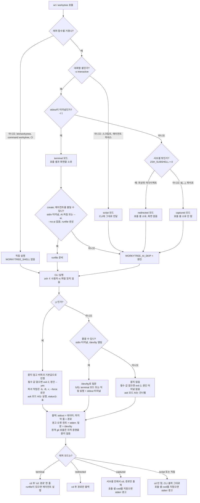

# 셸 맥락과 비대화 실행 설계: 호출 셸 소유, CLI 격리, `-y` 계약, 개선 로드맵

작성일: 2026-10-23

래퍼가 호출 맥락을 네 모드(terminal, redirected, captured, script)로 한 번 판정하고, 이 모드로 알림 줄·질문·화면·AI 에이전트를 정한다. cd는 지금처럼 대화형 셸이면 따라간다. 리뷰가 찾은 117건 가운데 112건은 최우선 정정 트랙 T7(PR 5개)과 단계 P1–P7에 나누고 5건은 보류한다. 이 브랜치(`fix/non-interactive-shell`)가 P1이다.

## 1. 배경과 목표

### 1.1 배경

래퍼(`shell/workytree.zsh`)는 "대화형 셸인가"(`-o interactive`) 하나로 cd, 알림 줄, remove의 목적지 질문, AI 에이전트 실행을 함께 정한다. 이 판정은 `$(...)`와 파이프 안에서도 참이어서, 리뷰 전부터 다음 네 문제가 알려져 있었다.

| ID | 증상 |
|---|---|
| K1 | `$(wt …)`나 파이프에 ANSI 색이 든 `cd: <경로>`가 캡처되고, cd는 사라지며, 에이전트가 캡처 안에서 실행됨 |
| K2 | 비대화형 셸에서도 runfile을 준비해 AI 질문을 한 뒤 결과를 버림 |
| K3 | 비대화 `remove`로 서 있던 워크트리를 지우면 호출자가 지워진 cwd에 안내 없이 남음 |
| K4 | 터미널에서 `-y`를 줬는데 "without a terminal", "non-interactive"라고 안내함 |

리뷰 규모: 다섯 관점(실행 맥락, 프롬프트, 출력, 사용자 여정, 자동화)과 critic이 117건을 냈다. 검증 결과는 확인 98, 의도된 동작 10, 개연성 1, 반박 1, critic 신규 7(별도 검증 없음)이고, 심각도는 high 1, medium 26, low 90이다.

### 1.2 사용자 결정

| ID | 결정 |
|---|---|
| D1 | 단계별 로드맵, 단계마다 PR 하나. 이 브랜치는 P1로 T1(호출 셸 소유), T2(CLI 격리), T4(비대화 계약)의 핵심만 다룸. T3(출력 채널), T5(프롬프트 위젯), T6(명령 흐름·메시지)는 P1이 구조상 필요로 하지 않는 한 뒤로 미룸 |
| D2 | T7 정확성 버그(커밋 손실, 엉뚱한 브랜치 처리 등)는 별도 트랙이고 최우선. 자체 브랜치·PR로 P1 전이나 병행 진행 가능 |
| D3 | `-y`는 "묻지 않고 진행". 파괴 작업은 `-b`/`-B`/`-r`/`--force`로만. `remove -y` 동작은 유지하고, `-y`가 원인인데 "터미널 없음"을 탓하는 메시지를 고치고 문서화. AI `ask`와 `-y`의 관계도 D3에 맞춰 정하고 명시 |
| D4 | 산출물은 이 설계(한국어)와 `docs/superpowers/plans`의 계획(영어), Mermaid 흐름도 |

### 1.3 목표

- 호출 셸과 화면을 누가 소유하는지 래퍼가 한 곳에서 판정하고, CLI는 그 판정을 받아 원인을 정확히 안내
- CLI는 사용자의 rc 파일·옵션·함수와 무관하게 같은 동작
- 스크립트·CI·에이전트에서 키보드를 기다리지 않는다는 계약을 README와 테스트로 고정
- 커밋을 잃거나 엉뚱한 브랜치를 지우는 버그(T7)를 P1보다 먼저 또는 함께 수정
- 나머지 UX 개선은 따로 되돌릴 수 있는 단계별 PR로 분리

## 2. 비목표

- bash 등 zsh 외 셸 지원
- 새 필수 의존성(`timeout(1)`, `jq`, `flock` 등). 테스트도 zsh 내장 모듈 `zsh/zpty`만 사용
- 새 종료 코드(부분 실패, '대상 없음' 전용 코드): §8 보류
- AI 에이전트 옵션 답 기억, create 질문을 편집 가능한 요약 하나로 합치기: §8 보류
- 같은 ticket 동시 create 잠금: §8 보류
- P1 범위 밖이고 §7의 다른 단계가 맡는 것
  - create 안내 줄의 stderr 이동, 스트림별 색, 진행 표시(P3)
  - 네트워크 시간 제한, create·remove의 `--offline`(P2)
  - 병합 판정, 브랜치 대상, 복구 sha(T7-1), 대시 인자 거부와 값 검증(T7-2), 브랜치 출처 판정(T7-3), `repo add --project`(T7-4), 키 해석·선입력(T7-5)
  - 취소 의미와 위젯(P4), 명령별 `--help`와 문구(P5), `config set` 검증·init·완성(P6), `--dry-run`·`remove --current`·prune 종료 코드(P7)

## 3. 상호작용 모델

### 3.1 개념 요약

| 개념 | 한 줄 정의 | 정하는 곳 | 쓰는 곳 |
|---|---|---|---|
| 래퍼 모드 | 호출 맥락: terminal, redirected, captured, script, 래퍼 없음 | `workytree()` 맨 앞 | 알림 줄, 목적지 질문, fzf, 에이전트, K3 경고 |
| cd 따라가기 | 성공 시 stdout 마지막 줄이 디렉터리면 `builtin cd` | `workytree()` | create, cd, remove, status |
| 호출 셸 소유 (`WT_CAN_CD`) | cd가 사용자가 계속 쓰는 셸에 닿는가 | `bin/workytree` 머리 | remove 목적지 질문·이동 줄·K3 경고 |
| 화면 소유 | 화면을 차지하는 UI(fzf, P4 위젯)를 띄워도 되는가 | `lib/prompt.zsh` 도우미 | `cmd_status`(fzf, 색 강제), P4 위젯 |
| 에이전트 부착 | runfile을 준비할지, 아니면 건너뛴 원인 | 래퍼(준비), `ai_maybe_offer`(안내) | create |
| 프롬프트 판정 | 사람이 답할 수 있나, 물어야 하나, 못 묻는 원인 | `lib/prompt.zsh` | create, remove, init, AI, config edit |
| `-y` 계약 | 묻지 않고 비파괴 기본값으로 진행, 키보드를 읽지 않음 | `parse_global_opts`, `lib/prompt.zsh` | 모든 명령 |
| 키보드 비대기 | 물을 수 없으면 아무것도 사람을 기다리지 않음 | `lib/prompt.zsh`, 원격 git 도우미, `config edit` | create, remove, status, config |
| CLI 격리 | CLI가 사용자 rc 파일을 읽지 않음 | `bin/workytree` 첫 줄 | 모든 CLI 실행, 셸 시작 |
| 래퍼 자립성 | 함수 본문만 복사돼도 동작 | `workytree()` | 셸 스냅숏, 에이전트 하네스 |
| 출력 채널 | stdout은 데이터, stderr는 사람용, `/dev/tty`는 질문 | §6 | 스크립트, 래퍼 재생 |
| 종료 코드 | 0/1/2/3/130, 부분 실패는 0과 ✗ 행 | README '종료 코드' | 스크립트, 테스트 |
| 병합 판정·ticket 브랜치 | 'merged'의 단일 정의, ticket 브랜치 기준 동작(T7) | `lib/status.zsh`, `lib/cmd/remove.zsh` | remove, status, P7 선택 목록 |

### 3.2 래퍼 모드

래퍼 호출마다 한 번 계산해 `WORKYTREE_SHELL`로 CLI에 넘긴다.

| 모드 | 조건 | 대표 호출 |
|---|---|---|
| `terminal` | 대화형 && `-t 1` | 프롬프트의 `wt create …`, `( wt cd x && make )`, `wt … &` |
| `redirected` | 대화형 && `! -t 1` && `ZSH_SUBSHELL == 0` | `wt cd x > /dev/null`, `wt create … > log` |
| `captured` | 대화형 && `! -t 1` && `ZSH_SUBSHELL > 0` | `x=$(wt cd x)`, `wt … \| tail -1`, `( wt … ) > f`, `{ wt …; } \| tee log` |
| `script` | 비대화형 셸 | `zsh -c`, 래퍼를 source한 스크립트, 에이전트 하네스 |
| (값 없음) | 래퍼를 거치지 않음 | `bin/workytree`, `command workytree`, CI |

모드별 동작:

| 모드 | cd | 알림 | remove 목적지 질문 | status 화면 | AI 에이전트 | 호출 셸 cwd를 지웠을 때 |
|---|---|---|---|---|---|---|
| terminal | 함 | `cd: <경로>` 한 줄 | 물을 수 있으면 물음 | 물을 수 있으면 fzf | 붙일 수 있으면 실행 | 래퍼가 목적지로 이동 |
| redirected | 함 | 경로만 | 물을 수 있으면 물음 | 표 | 건너뜀 (`redirected`) | 래퍼가 목적지로 이동 |
| captured | 서브셸 안에서만 | 경로만 | 묻지 않음 | 표 | 건너뜀 (`captured`) | stderr 경고와 `cd` 힌트 |
| script | 안 함 | CLI 출력 그대로 | 묻지 않음 | 표 | 건너뜀 (`script`) | stderr 경고와 `cd` 힌트 |
| 래퍼 없음 | 안 함 | CLI 출력 그대로 | 묻지 않음 | `-t 1`이고 물을 수 있으면 fzf | 건너뜀, "shell integration required" | stderr 경고와 `cd` 힌트 |

> **주의**: `wt create … > log`는 cd하지만 에이전트를 시작하지 않고, `wt status > f`는 표를 쓴다. README 모드 표에도 이 두 경계를 적는다.

이전 래퍼가 보내는 `WORKYTREE_CD_CAPABLE=1`은 한 릴리스 동안 terminal로 읽는다.

### 3.3 cd 따라가기와 소유를 나눈 이유

cd는 지금 규칙(대화형이면 cd)을 모든 대화형 모드에서 유지한다. 소유는 질문, 화면, 에이전트, 알림 꾸밈만 정한다.

pty 위 대화형 zsh에서 측정한 값(§13.1):

| 호출 | `ZSH_SUBSHELL` | `-t 1` | stdout | 모드 |
|---|---|---|---|---|
| 최상위 | 0 | 참 | 터미널 | terminal |
| `… > /dev/null` | 0 | 거짓 | 파일 | redirected |
| `$( … )` | 1 | 거짓 | 파이프 | captured |
| 파이프 왼쪽 | 1 | 거짓 | 파이프 | captured |
| `( … ) \| cat`, `{ … } \| cat` | 1 | 거짓 | 파이프 | captured |
| `( … ) > 파일` | 1 | 거짓 | 파일 | captured |
| `( … )` | 1 | 참 | 터미널 | terminal |
| `… &` | 1 | 참 | 터미널 | terminal |
| `… < /dev/null`, `while read` 루프 안 | 0 | 참 | 터미널 | terminal, stdin이 터미널이 아니라 에이전트는 건너뜀 |

`x=$(wt …)`와 `( wt cd x && make ) | tee log`는 서브셸 깊이와 stdout 종류가 같아서 어떤 조건으로도 구별할 수 없다. 소유 판정으로 cd까지 막으면 후자가 엉뚱한 디렉터리에서 `make`를 실행한다. `$(...)` 안의 cd는 서브셸과 함께 사라지므로 해가 없고, K1에서 눈에 보이는 증상(색 든 `cd:` 캡처, 의미 없는 질문, 캡처 안 에이전트)은 모두 꾸밈과 runfile 준비에서 나오므로 모드로 막힌다.

`wt create --ai … &`(리다이렉트 없음)는 terminal로 분류되어 에이전트가 백그라운드 잡으로 시작하고 터미널 입력에서 멈춘다. 대화형 프로그램을 백그라운드로 보냈을 때의 표준 잡 제어 동작이라 막지 않는다(§8). 리다이렉트를 붙인 `… > /dev/null 2>&1 &`는 captured가 되어 에이전트를 준비하지 않는다.

### 3.4 호출 셸 소유와 K3

- `WT_CAN_CD`는 모드가 terminal 또는 redirected일 때 참
- 참일 때만 remove가 목적지를 묻고 `→ moving to`를 출력
- 거짓(captured, script, 래퍼 없음)이고 호출자의 `$PWD`가 지운 워크트리 안이면 stderr에 경고 한 줄("your shell's current directory was removed")과 `cd <목적지>` 힌트. stdout 마지막 줄은 목적지 그대로, 종료 코드도 그대로
- 대화형 모드에서 Ctrl-C로 끊겨 `$PWD`가 사라졌으면 래퍼의 `always` 블록이 가장 가까운 상위 디렉터리로 이동하고 한 줄 알림
- status의 ctrl-d가 부르는 자식 `__status-action remove`는 `WORKYTREE_SHELL`을 물려받지 않아 래퍼 없음처럼 보이지만 K3 경고를 내지 않음. 지워진 cwd는 부모 status가 원래 repo를 마지막 줄로 출력하고(`lib/cmd/status.zsh:375`) 래퍼가 그리로 이동
- `( wt remove … )`처럼 출력이 터미널인 서브셸은 terminal로 분류돼 경고가 없고, 이동은 서브셸 안에서만 일어남. 서브셸 안 cd의 일반 의미라 §8 첫 행과 같은 이유로 다루지 않음

### 3.5 화면 소유

fzf처럼 화면을 차지하는 UI는 `prompt_available && (WT_SHELL == terminal || (WT_SHELL 없음 && -t 1))`일 때만 띄운다. 그 밖에는 `status`가 표를 출력한다. 그래서 `wt status | grep`, `wt status > f`, `status -y`는 표를 받는다. `lib/cmd/status.zsh`의 인라인 판정(:286)을 `lib/prompt.zsh`의 화면 소유 도우미 하나로 바꾸고, P4 위젯도 같은 도우미를 쓴다.

status의 색 강제(`ui_init force`, :290)도 `WT_CAN_CD` 대신 "fzf를 띄우거나 terminal 모드"일 때만 켠다. `WT_CAN_CD`는 P1부터 redirected 모드에서도 참이므로, 그대로 두면 `wt status --plain > f`가 파일에 ESC 바이트를 쓴다.

### 3.6 에이전트 부착 조건과 AI 환경 변수

래퍼는 다음을 모두 만족할 때만 runfile을 만든다.

1. 모드가 terminal이고 `-t 0`
2. 셸 시작 때 AI가 켜져 있었거나 `--ai`를 줌
3. `--no-ai`가 없음
4. `mktemp` 성공

래퍼를 거친 create에는 `WORKYTREE_AI_RUNFILE`과 `WORKYTREE_AI_SKIP` 중 정확히 하나가 붙는다. 판정은 래퍼가, 안내는 CLI의 `ai_maybe_offer`가 한다.

| 건너뛴 원인 | `WORKYTREE_AI_SKIP` | 안내 문구 |
|---|---|---|
| 래퍼 없음 | (없음) | `shell integration required` |
| 비대화형 셸 | `script` | `not an interactive shell` |
| 출력 리다이렉트·캡처 | `redirected`, `captured` | `output is redirected or captured` |
| stdin이 터미널 아님 | `stdin` | `stdin is not a terminal` |
| 임시 파일 실패 | `tmp` | `could not create a temp file in $TMPDIR` |
| 셸 시작 뒤에 AI를 켬 | `startup` | `enabled after this shell started; open a new shell or pass --ai` |
| `--no-ai` | `no-ai` | 안내 없음 |
| 에이전트를 못 찾음 | (없음, runfile 있음) | `no AI agent found on PATH (looked for …)` |

원인이 여럿이면 `no-ai`, 모드(`script`, `redirected`, `captured`), `stdin`, `startup`, `tmp` 순으로 처음 걸린 하나만 보낸다. 안내는 `--ai`를 줬거나, 세션이 설정돼 있고 stdin이 터미널일 때만 stderr에 한 줄 쓴다. CI와 하네스에서는 조용하다.

### 3.7 AI 확인 규칙

| `ai_session`·플래그 | 물을 수 있음 | `-y` | 물을 수 없음(`-y` 없음) |
|---|---|---|---|
| `ask` | 확인(기본값 예) 뒤 옵션 질문 | 묻지 않고 `command`만 실행 | 건너뛰고 안내. 지금은 묻지 않고 실행함 |
| `always` 또는 `--ai` | 옵션 질문 뒤 실행 | `command`만 실행 | 옵션 질문 없이 실행 |
| `--no-ai` | 실행 안 함 | 실행 안 함 | 실행 안 함 |

표의 '실행'은 모두 runfile이 있을 때(§3.6)만 일어난다. runfile은 terminal 모드이고 stdin이 터미널일 때만 생기므로, `while read` 루프나 `</dev/null`의 입력을 에이전트가 가져가지 않는다.

### 3.8 프롬프트 판정 함수

| 함수 | 결과 | 비고 |
|---|---|---|
| `prompt_tty` | 참: `WORKYTREE_PROMPT_INPUT` 테스트 훅이 있거나, stdin이 tty이고 `/dev/tty`가 열림 | 사람이 답할 수 있음 |
| `prompt_available` | 참: `! WT_YES && prompt_tty` | `WT_YES`를 먼저 보므로 테스트 훅이 `-y`를 이기지 못함 |
| `prompt_blocker` | 출력: `--yes` 또는 `no terminal` | 거부 메시지에 넣는 원인 |
| 화면 소유 도우미 | §3.5 | status, P4 위젯 |

모두 캐시하지 않는 함수다. 단위 테스트가 호출 사이에 `WT_YES`와 테스트 훅을 바꾸고, 판정 비용도 거의 없다.

### 3.9 키보드 비대기 보장

`prompt_available`이 거짓이면 아무것도 사람을 기다리지 않는다.

- 질문: 모두 `prompt_available`로 막음
- fzf: §3.5 화면 소유 도우미로 막음
- `config edit`: `-y`이거나 stdin·stdout이 tty가 아니면 exit 2, `config path/get/set` 안내
- 원격 git 호출(fetch, `push --delete`): 도우미 하나를 거쳐 항상 `GIT_TERMINAL_PROMPT=0`. 대화형 실행에서도 같음
- SSH `BatchMode`는 강제하지 않음. 사용자의 `core.sshCommand`를 덮어쓰기 때문
- 시간 제한은 P2

### 3.10 CLI 격리 (T2)

- `bin/workytree` 첫 줄: `#!/usr/bin/env -S zsh -f`. `~/.zshenv`를 읽지 않으므로 사용자 옵션, alias, 함수(예: `git()`), 래퍼 재귀가 모두 사라짐. export된 변수(`PATH` 등)는 그대로 적용
- 본문 첫 문장: `emulate -R zsh`, 그 뒤에 `set -u`와 `setopt extendedglob`. `/etc/zshenv`는 `-f`로도 막을 수 없어 이 줄로 옵션을 기본값으로 되돌림. `/etc/zshenv`의 alias·함수는 남음
- 설치 스크립트: 설치 직후 `workytree --version`을 실행해 보고, `env -S`가 없으면 그 사실을 설명
- 래퍼가 source될 때의 CLI 호출:

| 셸 | source 시점 CLI 호출 | `wt` 설치 조건 |
|---|---|---|
| 비대화형 | 없음 | `WORKYTREE_ALIAS=0`이 아니고 다른 `wt`가 없으면 설치. 설정의 `alias_wt`는 보지 않음 |
| 대화형 | 숨은 `__shell-init` 한 번. 출력 `ai=0\|1 alias=0\|1 config=ok\|error`, stderr는 조용함 | `WORKYTREE_ALIAS=0`이 아니고 `alias=1`이며 다른 `wt`가 없으면 설치. `config=error`면 "workytree: config has errors; run 'workytree list' to see them" 한 줄만(`list`가 파일과 줄 번호를 보여 줌, `config path`는 경로만), alias 안내 없음 |

`__ai-configured`와 `config get alias_wt` 경로는 한 릴리스 동안 유지한다. 업그레이드 전에 래퍼를 source한 셸이 계속 동작해야 하기 때문이다.

### 3.11 래퍼 자립성

Claude Code의 셸 스냅숏은 함수 정의를 옮기지만, 관찰한 결과 단일 밑줄(`_`)로 시작하는 함수와 export되지 않은 전역 변수는 빠졌다(`__`로 시작하는 함수는 남음). 이 필터 규칙은 문서화돼 있지 않다. 그래서 `workytree()`는 다음을 지킨다.

- `_` 도우미를 부르지 않음. 하위 명령 찾기와 `--ai`/`--no-ai` 검색을 본문에 넣고, `--` 처리는 CLI 파싱과 같게
- 실행 파일은 `${WORKYTREE_BIN}`이 실행 가능하면 그것, 아니면 `${commands[workytree]}`, 둘 다 없으면 "workytree: not found on PATH"와 rc 127(126 아님)
- `_WORKYTREE_AI_CONFIGURED`가 없으면 AI 꺼짐으로 판단
- `setopt localoptions noksharrays noshwordsplit`. `emulate -L`은 사용자의 cd 관련 옵션까지 끄므로 쓰지 않음
- `trap … EXIT` 대신 `{ … } always { … }`. runfile을 지우고 사라진 `$PWD`를 복구하며, `posix_traps` 셸에서도 사용자 EXIT trap을 덮지 않음. `always`가 SIGINT에서도 실행되는 것은 critic이 pty로 확인함
- script 모드는 `WORKYTREE_SHELL=script "$bin" "$@"`로 캡처 없이 실행하고 그 rc를 돌려줌. create면 `WORKYTREE_AI_SKIP=script`도 붙임(§3.6)
- 알림 줄은 `print -r`로 출력해 경로 속 `%`와 `$(...)`를 해석하지 않음
- CLI가 실패하면 캡처한 출력을 한 줄도 빼지 않고 재생하고 CLI 종료 코드를 돌려줌
- `cd`를 `path`로 바꿔 부르지 않음(§3.13)

### 3.12 래퍼와 CLI 사이 프로토콜

| 환경 변수 | 값 | 붙는 때 | CLI 처리 |
|---|---|---|---|
| `WORKYTREE_SHELL` | `terminal`, `redirected`, `captured`, `script` | 래퍼를 거친 호출 | `typeset -g +x WT_SHELL`로 옮기고 unset |
| `WORKYTREE_AI_RUNFILE` | runfile 경로 | create, 에이전트 부착 가능 | `WT_AI_RUNFILE`로 옮기고 unset(현재와 같음) |
| `WORKYTREE_AI_SKIP` | §3.6 원인 값 | create, 부착 불가 | `WT_AI_SKIP`으로 옮기고 unset |
| `WORKYTREE_CD_CAPABLE` (이전) | `1` | 이전 래퍼 | 한 릴리스 동안 terminal로 읽음 |

`WT_CAN_CD`는 `WT_SHELL`에서 파생한다. 표의 변수는 모두 git을 부르기 전에 환경에서 지워, fzf 자식과 git 훅이 물려받지 않게 한다.

### 3.13 `wt cd`의 대상 확인

- 래퍼는 `cd`를 그대로 CLI에 넘김
- `cmd_cd`는 계산한 repo, kind 디렉터리, 워크트리가 없으면 그 경로를 밝힌 오류와 `workytree list <repo>` 힌트를 내고 exit 1
- `cmd_path`는 계산만 하는 계약(rc 0)을 유지. 디렉터리를 만들기 전에 경로를 얻는 용도라서

### 3.14 병합 판정과 ticket 브랜치 (T7)

| 규칙 | 정의 |
|---|---|
| merged | origin 기본 브랜치(fetch 직후)의 조상이거나, PR이 같은 tip에서 병합됨(`pr_sha == tip`, forge 조회가 `WT_FORGE_TIMEOUT` 안에 끝났을 때만). 오프라인이면 조상 판정만 |
| pushed | 자기 upstream에서만 닿음. 삭제 기본값을 예로 만들지 않음 |
| gone, unmerged | 별도 라벨. 삭제 기본값을 예로 만들지 않음 |
| 불변식 | `-B` 없이는 어떤 커밋도 마지막 ref를 잃지 않음 |
| 대상 브랜치 | create와 remove는 `<kind>/<ticket>` 기준. 실제 체크아웃된 브랜치는 항상 보고하고 몰래 바꾸지 않음 |
| 복구 | 브랜치를 지울 때마다 `(was <sha>)`와 복원 명령 출력 |

## 4. 결정 흐름

호출 맥락에서 출발해 "호출 셸을 소유하는가", "물을 수 있는가", "사람용 출력은 어디로 가는가"를 정하고, 그 결과로 동작이 정해진다.

이 흐름에서 cd 여부는 마지막 "래퍼 모드는?" 분기만 정한다. 소유 판정(위쪽 세 모드)은 cd를 막지 않는다(§3.3).

## 5. `-y`와 비대화 계약

### 5.1 정의

`-y`는 "묻지 않고 비파괴 기본값으로 진행"이고, 키보드를 읽지 않는다.

- 질문과 fzf가 없음. `status`는 표를 출력
- `config edit`는 exit 2로 끝나고 `config path/get/set`을 안내
- 파괴 작업(로컬·원격 브랜치 삭제, 변경 버리기)은 `-b`, `-B`, `-r`, `--force`로만. `remove -y`는 지금 동작 그대로: 플래그가 없으면 브랜치를 남기고, `--force`가 없으면 변경이 있는 워크트리를 거부
- 필수 값이 없으면 exit 2. 메시지는 원인으로 `--yes`를 밝힘
- AI 세션은 파괴 작업이 아님. `ai_session=ask`와 `-y`면 묻지 않고 옵션 질문 없이 세션을 엶(README의 기존 `-y` 문장과 같음). 이번 실행만 끄려면 `--no-ai`

터미널이 없을 때(`-y` 없음)도 진행 방식은 `-y`와 같다. 다른 점은 거부 메시지의 원인 표기("no terminal")와 `ask` 모드 AI(건너뜀) 두 가지다.

### 5.2 질문별 매트릭스

README '비대화 실행'의 같은 표는 행마다 `tests/noninteractive.test.zsh`의 테스트 이름 하나와 짝을 이룬다.

| 명령 | 질문 | 대신 주는 플래그·인자 | `-y` | 터미널 없음(`-y` 없음) |
|---|---|---|---|---|
| create | repo 안에서 "use this repo?" | `<repo>` | 추론한 repo 사용 | 추론한 repo 사용 |
| create | 프로젝트·repo 선택 | `<repo>`, `--project` | exit 2, 원인 `--yes` | exit 2, 원인 터미널 없음 |
| create | kind | `<kind>` | exit 2, 원인 `--yes` | exit 2, 원인 터미널 없음 |
| create | ticket | `<ticket>` | exit 2, 원인 `--yes` | exit 2, 원인 터미널 없음 |
| create | base | `<base>` | 자동 감지한 base | 자동 감지한 base |
| create | `Create?` | 없음 | 진행 | 진행 |
| create | AI 세션 열기(`ask`) | `--ai`, `--no-ai` | 묻지 않고 실행 | 건너뛰고 안내 |
| create | 에이전트 옵션 | 없음(P6에서도 범위 밖) | 건너뜀, `command`만 실행 | 건너뜀 |
| remove | 지울 워크트리 | `<repo> <kind> <ticket>` | exit 2, 원인 `--yes` | exit 2, 원인 터미널 없음 |
| remove | 변경 버리기 | `--force` | 거부, exit 1과 hint | 거부, exit 1과 hint |
| remove | 로컬 브랜치 삭제 | `-b`(병합된 것), `-B`(강제) | 남김 | 남김 |
| remove | 원격 브랜치 삭제 | `-r` | 남김 | 남김 |
| remove | 이동할 곳 | `--to <dir>` | 워크트리 안이면 원본 repo | 워크트리 안이면 원본 repo |
| remove | `Proceed?` | 없음 | 진행 | 진행 |
| init | 이름, repo_root, worktree_root | `<name> <repo_root> <worktree_root>` | exit 2, 원인 `--yes` | exit 2, 원인 터미널 없음 |
| init | `wt` 별칭 설치 | 없음(P6 `--no-alias`) | 묻지 않음, 설치 | 묻지 않음, 설치 |
| status | fzf 목록 | `--plain`, `--json` | 표 | 표 |
| config edit | 편집기 | `config get`, `config set` | exit 2 | exit 2 |
| (git) | HTTPS 자격 증명 | 없음 | 묻지 않음. fetch는 경고 뒤 계속, push는 ✗ 행과 hint | 묻지 않음. fetch는 경고 뒤 계속, push는 ✗ 행과 hint |

P1에서 바뀌는 칸:

| 칸 | 지금 | P1 이후 |
|---|---|---|
| 필수 값 누락 + `-y` | "without a terminal" 등 터미널 탓 | 원인 `--yes` |
| AI `ask` + 터미널 없음 | 묻지 않고 실행 | 건너뛰고 안내 |
| status + `-y` | fzf를 엶 | 표 |
| `config edit` + `-y` 또는 터미널 없음 | 편집기를 바로 실행 | exit 2 |
| `remove -r`의 push | 자격 증명 프롬프트에서 대기 | ✗ 행과 hint |
| `WORKYTREE_PROMPT_INPUT` + `-y` | 질문한 뒤 EOF로 130 | `-y`가 이김 |

## 6. 출력 채널과 종료 코드 계약

### 6.1 채널

| 채널 | 담는 것 | P1 | P3 이후 |
|---|---|---|---|
| stdout | 데이터. create·cd는 마지막 줄이 경로, remove는 이동할 곳이 있을 때만 마지막 줄이 그 경로. 표, JSON | create의 info/success 줄은 stdout에 남음. 문서화된 예외이고 인터페이스가 아님 | create의 사람용 출력은 모두 stderr, stdout은 경로 한 줄 |
| stderr | warn, error, hint, 진행 표시 | 변경 없음 | 색과 진행 표시를 stderr 기준으로 판정 |
| `/dev/tty` | 질문, fzf 화면 | 변경 없음 | 프롬프트 색을 프롬프트 fd 기준으로 판정 |
| 래퍼 알림 | terminal 모드만 `cd: <경로>` 한 줄(`print -r`), 다른 모드는 경로만 | 새 규칙 적용 | remove의 `→ moving to`와 합침 |

- 알림 줄의 색 조건(P1): `NO_COLOR`가 비어 있음, `--no-color` 없음, `TERM`이 `dumb`가 아님, `-t 1`. 하나라도 어긋나면 ESC 바이트 없이 출력
- 실패 재생: CLI가 0이 아닌 코드로 끝나면 래퍼는 캡처한 stdout을 마지막 줄까지 모두 출력하고 그 코드를 돌려줌
- 스크립트와 에이전트는 `command workytree`를 쓰고 stdout 마지막 줄만 경로로 읽음(`| tail -1`)

### 6.2 종료 코드

| 코드 | 뜻 |
|---|---|
| 0 | 성공. 부분 실패도 0이고 요약에 ✗ 행이 남음(예: `-b`인데 병합 안 된 브랜치). 그 시점에 워크트리는 이미 지워짐 |
| 1 | 오류: 모르는 repo·프로젝트, 변경이 있어 거부, 없는 대상(P1의 `wt cd`), 유효한 설정이 이미 있어 `init`이 거부 |
| 2 | 사용법 오류: 모르는 플래그, 인자 개수, 플래그 값 누락, 빈 값, 형식이 틀린 이름·키, `-y`나 터미널 없이 필수 값 누락, `config edit` 거부 |
| 3 | 설정 파일 상태(README 표의 목록 그대로) |
| 130 | 질문 취소. AI 세션 질문 취소는 0 |

P1은 README '종료 코드' 표의 1·2 행을 이 동작에 맞추고 3·130 행은 그대로 둔다. 지금 표는 '`-B` 없이 병합 안 된 브랜치'를 1로 적었지만 실제는 0이고, 빈 값과 형식 오류는 2인데 표에 없다. 새 코드는 §8 보류.

## 7. 로드맵

### 7.1 순서와 의존

| ID | 이름 | 브랜치 | 건수 | 의존 |
|---|---|---|---|---|
| T7-1 | remove 브랜치 안전 | `fix/remove-branch-safety` | 4 | 없음 |
| T7-2 | create 인자 안전 | `fix/create-arg-safety` | 4 | 없음 |
| T7-3 | create 브랜치 출처 판정 | `fix/create-branch-resolution` | 5 | T7-2 |
| T7-4 | `repo add --project` | `fix/repo-add-project` | 2 | 없음 |
| T7-5 | 프롬프트 입력 안전 | `fix/prompt-input-safety` | 4 | 없음 |
| P1 | 호출 셸 소유, CLI 격리, 비대화 계약 (이 브랜치) | `fix/non-interactive-shell` | 33 | 없음 |
| P2 | git 네트워크 시간 제한 | `fix/bounded-git-network` | 1 | P1 |
| P3 | 출력 채널과 스트림별 색 | `refactor/output-channels` | 12 | P1, T7-3 |
| P4 | 프롬프트 위젯 | `fix/prompt-widgets` | 16 | T7-5, P3 |
| P5 | 도움말과 메시지 | `fix/command-help-and-messages` | 8 | P3 |
| P6 | 설정, init, 자동완성 | `fix/setup-config-completion` | 11 | P1 |
| P7 | status TUI와 정리 흐름 | `feat/cleanup-flows` | 12 | T7-1, P3, P4 |

- 단계에 112건, 보류 5건으로 117건 전부를 한 번씩 배정(부록 A)
- T7 트랙은 최우선이며 P1과 병행할 수 있음. 사용자가 T7을 PR 하나로 원하면 같은 단위를 `fix/t7-correctness`의 순서 있는 커밋으로 만듦
- P2는 P1 바로 다음. 멈추는 문제라 피해가 크고 PR이 작음
- T7 계획은 `docs/superpowers/plans/2026-10-23-branch-safety.md`(작업 9개를 PR 단위로 묶음). 별도 설계 문서는 두지 않음: 병합 판정, ticket 브랜치 규칙, 복구 불변식은 §3.14, 단위별 완료 조건은 §7.2

### 7.2 T7 트랙: 정확성 (최우선)

#### T7-1 remove 브랜치 안전

목표: remove가 커밋을 잃지 않게 한다. '(merged)'는 status와 같은 규칙(§3.14)을 쓰고, `-b`/`-B`는 ticket 브랜치에만 동작하며, 삭제마다 복원 명령을 남긴다.

범위:

- push만 한 브랜치를 '(merged)', 기본값 예로 지우라고 권하고, 원격까지 지우면 커밋이 사라짐
- PR 병합 뒤 로컬 main이 오래됐으면 병합된 브랜치를 '작업 손실'로 경고해 강제 삭제를 하게 만듦
- 다른 브랜치가 체크아웃된 워크트리에서 `-b`/`-B`가 ticket 브랜치가 아닌 그 브랜치를 지움
- 지운 브랜치를 되살릴 sha가 남지 않음
- `-b` 실패 힌트가 "remove를 다시 실행하라"는 막다른 길

완료 조건:

1. push만 한 `fix/C`(origin/main에 없음): 대화형 질문이 "(pushed, not merged into origin/main)", 기본값 아니오
2. `remove app fix C -b -r -y`: 원격 브랜치는 지우고, 로컬은 ✗ 행("not merged into origin/main; use -B")으로 남기고 exit 0. `git rev-list --all`에 C의 커밋이 남음. `-r` 없는 `-b -y`는 원격에 커밋이 남으므로 로컬 삭제 가능
3. origin/main에 들어갔고 upstream이 사라졌으며 로컬 main이 오래된 `fix/G`: merged 라벨, 기본값 예, `-b -y`가 'unmerged commits' 질문 없이 삭제, `status --plain`도 merged
4. 표 기반 테스트 여섯 경우(base의 조상, push만, 병합 뒤 gone, 같은 tip에서 PR 병합, 다른 tip에서 PR 병합, 로컬 전용): remove 라벨·기본값이 `status --json`의 merged와 일치. 가짜 `gh`는 sandbox PATH에. forge 데이터가 없으면 조상 판정만 쓰고 merged라고 단정하지 않음
5. `spike`가 체크아웃된 `fix/RV`: `-B -y`, `-b -y`가 아무것도 지우기 전에 exit 1, 두 브랜치 이름을 밝힘. spike의 커밋 보존. 대화형 계획과 질문은 "ticket branch fix/RV, checked out: spike"
6. 로컬 삭제마다 `deleted branch fix/X (was <sha>)`와 `git -C <repo> branch fix/X <sha>` 힌트. 원격 삭제마다 직전 sha와 `git -C <repo> push <remote> <sha>:refs/heads/<b>` 힌트
7. 강제가 아닌 `-b`가 실패하면 힌트에 `git -C <repo> branch -D <branch>`, "re-run remove" 없음
8. 위 픽스처를 `tests/remove.test.zsh`, `tests/remove_interactive.test.zsh`가 모두 다루고 macOS·Ubuntu CI 통과

깨지는 동작:

- '(merged)'와 기본값 예는 origin 기본 브랜치에 병합됐거나 같은 tip에서 PR이 병합된 브랜치에만 붙음. push만 한 브랜치는 기본값 아니오
- `-b`와 `-r`을 함께 주면 base에 병합 안 된 로컬 브랜치는 ✗ 행으로 남음. 지우려면 `-B`
- `-b`/`-B`는 `<kind>/<ticket>` 대상. 비대화에서 다른 브랜치가 체크아웃돼 있으면 exit 1
- 삭제 줄과 요약 행에 `(was <sha>)`와 복원 힌트가 붙음

README 변경: '워크트리 지우기'에 merged와 pushed의 정의, `-b`와 `-r`의 관계, 복원 힌트(종료 코드 표는 P1이 고침)

의존: 없음

#### T7-2 create 인자 안전

목표: 사용자 토큰이 git 옵션으로 넘어가지 않게 하고, 값 검증을 `Create?` 전에 한다.

범위:

- `create app fix X --force`가 조용히 HEAD에서 워크트리를 만들고, `--dry-run`·오타 플래그는 git usage 전체를 노출
- `-T2` 같은 대시 토큰이 ticket이 되어, remove가 `--` 없이는 다룰 수 없는 워크트리가 생김
- 잘못된 kind·ticket·base가 요약에 그대로 찍히고, 확인 뒤에야 git 원문 오류와 빈 디렉터리를 남김

완료 조건:

1. `create app fix X --force -y`, `--dry-run`, `--ia`, ticket 자리의 `-T2`: 각각 exit 2와 'unknown flag: …', fetch 없음, 디렉터리 없음
2. `create -- app fix -T2 main -y`는 `fix/-T2`를 만듦. `-`로 시작하는 base는 `--` 뒤에서도 잘못된 ref로 거부
3. ticket 'my ticket', ticket '..', '/'가 든 kind, 없는 base: 모두 `Create?` 전에 workytree 메시지와 hint로 실패, `worktree_root` 아래 디렉터리 없음. 대화형에서는 같은 질문을 오류와 함께 다시 물음
4. 메인 체크아웃이나 다른 워크트리에 이미 체크아웃된 브랜치는 `Create?` 전에 알리고 그 체크아웃을 힌트로 줌
5. `git worktree add`가 실패하면 create가 만든 상위 디렉터리를 지움
6. `--end-of-options`에 기대지 않음(git 2.24 미만 호환). `tests/create.test.zsh`, `tests/create_interactive.test.zsh`가 모든 행을 다룸

깨지는 동작:

- create의 모르는 대시 토큰은 exit 2. 대시로 시작하는 값은 `--` 뒤에 써야 함
- 잘못된 값은 확인 뒤 git 원문 오류 대신 확인 전에 workytree 메시지와 exit 1·2로 실패

README 변경: '워크트리 만들기'에 `--` 사용법, `Create?` 전 검증

의존: 없음

#### T7-3 create 브랜치 출처 판정

목표: 요약을 보여 주기 전에 create가 실제로 할 일을 정하고 요약에 보여 준다.

범위:

- 원격에만 있는 같은 이름의 브랜치를 무시하고 base에서 새 브랜치를 만들어 동료·다른 기기의 작업과 갈라짐
- 기존 로컬 브랜치를 쓸 때 실제로는 무시될 base가 요약에 나옴
- 워크트리 디렉터리를 손으로 지운 뒤 다시 create하면 git 원문 오류로 끝남
- '대상 경로가 워크트리가 아님' 오류에 'prune once available'이라는 낡은 안내

판정 순서: 등록된 워크트리 재사용 → 등록됐지만 디렉터리 없음(prunable) → 워크트리가 아닌 기존 디렉터리 → 기존 로컬 브랜치 → origin에만 있는 브랜치 → base에서 새 브랜치

완료 조건:

1. origin/fix/PROJ-9만 있고 로컬 브랜치가 없을 때 `create app fix PROJ-9 -y`: origin/fix/PROJ-9를 추적하는 fix/PROJ-9를 origin tip에서 만들고 동료의 커밋이 있음. base 질문 없음, 요약은 'existing remote branch origin/fix/PROJ-9', 명시한 base는 경고와 함께 무시
2. 로컬 브랜치가 있으면 `Create?` 전 요약에 'existing branch (base ignored)', base를 주면 경고
3. `experiment`가 체크아웃된 워크트리를 재사용하면 'result: reused' 전에 실제 브랜치와 경고. 대소문자만 다른 ticket은 `git worktree list --porcelain`의 브랜치 이름으로 보고
4. 워크트리 디렉터리를 `rm -rf`한 뒤 같은 ticket create: `Create?` 전에 exit 1과 `workytree prune <repo>` 힌트, git의 'missing but already registered' 원문 없음
5. 워크트리가 아닌 기존 디렉터리: 'once available' 없는 메시지와, 지우거나(cruft만 있으면) prune하라는 힌트

깨지는 동작:

- origin에만 있는 브랜치는 base에서 새로 만들지 않고 추적 브랜치로 체크아웃
- 재사용 출력에 실제 브랜치 줄이 붙고, ticket 브랜치와 다르면 경고

의존: T7-2

#### T7-4 `repo add --project`

목표: 문서에 있는 `repo add <path> --project p`가 실제로 동작하고, 플래그 값 누락은 사용법 오류가 된다.

범위:

- `--project`를 전역 옵션 파서가 먼저 소비해 조용히 무시되고, 다른 프로젝트로 rc 0 등록
- `--name` 값이 빠지면 zsh 원문 오류와 rc 1

완료 조건:

1. 프로젝트 둘인 픽스처에서 `repo add 
 --project second`, `--project=second` 모두 second에 등록, `config get repo.<n>.project`가 second
2. `--project ghost`는 exit 1과 'unknown project'
3. 값 없는 `repo add 
 --name`은 exit 2와 'workytree: --name requires a value'. `tests/manage.test.zsh`가 셋 모두 다룸

깨지는 동작:

- `--project`가 실제로 적용되어 이전과 다른 프로젝트에 등록될 수 있음
- `--name` 값 누락은 exit 1 대신 2

의존: 없음

#### T7-5 프롬프트 입력 안전

목표: 미리 친 키, 수식 키·F 키 시퀀스의 남은 바이트, 나뉘어 도착한 escape 시퀀스가 다음 질문(`Proceed?`, 브랜치 삭제)에 답하거나 셸 명령줄로 새지 않게 한다.

범위:

- 즉시 확정 키(숫자, y/n)와 선입력이 다음 질문으로 새어 확인에 저절로 답함. T7-1의 판정 버그와 겹쳐 '(merged)' 삭제와 `Proceed?`에 답한 재현이 있음
- Shift/Ctrl+화살표와 F 키가 숫자 선택으로 해석됨
- 50ms 넘게 나뉜 화살표가 Esc 취소가 되고 `[B`가 셸로 샘
- 프롬프트 테스트가 파일 입력만 써서 위 경우를 검증하지 못함

완료 조건:

1. zpty에서 `wt remove`에 '1\r'과 '2\r'을 빠르게 보내면 워크트리만 선택되고, 브랜치·목적지 질문과 `Proceed?`는 각각 그려진 뒤 누른 키를 기다림
2. `\e[1;2B`, `\e[1;5B`, `\e[15~`, `\eb`는 선택도 취소도 하지 않음. 수식 화살표는 일반 화살표처럼 움직이거나 무시. 다음 질문이나 셸로 새는 바이트 없음
3. `KEYTIMEOUT`(기본 0.4초)까지 나뉜 화살표는 화살표로 읽음. Esc 하나는 여전히 130으로 취소. 다음 셸 줄에 `[B` 같은 글자 없음
4. `tests/prompt.test.zsh`가 실제 pty로 위 경우를 다루고 전후 `stty -g`가 같음. zpty 도우미는 `tests/helpers.zsh`에 두고 P1과 공유(먼저 머지되는 PR이 추가)

깨지는 동작:

- 질문이 그려지기 전에 친 키는 버려지므로 다시 쳐야 함

의존: 없음

### 7.3 P1: 호출 셸 소유, CLI 격리, 비대화 계약 (이 브랜치)

목표: K1–K4와 T1·T2·T4의 핵심을 고친다. 래퍼 모드 하나가 알림 줄, 목적지 질문, fzf, 에이전트를 정하고, cd는 지금처럼 `-o interactive`를 따르므로 지금 cd하는 호출은 계속 cd한다.

범위(사용자 관점 묶음):

| 묶음 | 사용자가 겪는 문제 |
|---|---|
| 래퍼 모드(K1) | `$(wt …)`에 색 든 `cd:`가 섞이고, 캡처 안에서 목적지 질문과 '→ moving to'가 나옴 |
| CLI 격리(T2) | `~/.zshenv`에서 source하면 프로세스가 지수적으로 늘어남. CLI가 사용자 옵션·alias·`git()`을 물려받음. 셸 시작마다 CLI 두 번 실행. 깨진 설정에서 엉뚱한 alias 경고 |
| 하네스·스냅숏 | Claude Code에서 `wt`·`workytree` 함수가 rc 126으로 실패하고 PATH의 정상 CLI를 가림 |
| 사용자 옵션·중단 | `ksh_arrays`에서 cd 안 함, `posix_traps`에서 사용자 EXIT trap을 덮음, Ctrl-C에 runfile이 남거나 지워진 cwd에 남음 |
| 알림 줄 | `print -P`가 경로의 `%`·`$(...)`를 해석, `NO_COLOR`·`--no-color`·`TERM=dumb` 무시, 실패하면 마지막 줄을 버림 |
| `wt cd` 대상 | 오타 난 워크트리에도 rc 0이라 `wt cd typo && cmd`가 엉뚱한 곳에서 실행됨 |
| AI 게이팅(K2) | 원인과 다른 안내, 에이전트가 없을 때 침묵, `ask`인데 묻지 않고 실행, `--no-ai` 없음 |
| `-y` 계약(K4) | `-y` 뜻이 명령마다 다름, "터미널 없음" 오진, 테스트 훅이 `-y`를 이김, status·config edit가 `-y`를 무시, config edit가 터미널 없이 편집기 실행 |
| cwd 삭제(K3) | 비대화 remove 뒤 지워진 cwd에 조용히 남음 |
| 네트워크 프롬프트 | `remove -r -y`가 자격 증명 프롬프트에서 무한 대기, 그때 워크트리는 이미 지워짐 |
| 문서·테스트 | README에 비대화 계약 없음, 종료 코드 표가 동작과 다름, '터미널 + `-y`' 테스트 없음 |

변경 위치:

| 파일 | 변경 |
|---|---|
| `bin/workytree` | shebang `-S zsh -f`, 첫 문장 `emulate -R zsh`. `WORKYTREE_SHELL`·`WORKYTREE_AI_SKIP`을 `+x` 전역으로 옮기고 unset, `WT_CAN_CD` 파생, 이전 `WORKYTREE_CD_CAPABLE` 수용. 숨은 `__shell-init`을 dispatch에 추가(`__ai-configured` 유지) |
| `shell/workytree.zsh` | §3.11 자립 `workytree()`, 모드 계산, script 모드 직접 실행, cd→path 치환 제거, runfile 게이팅과 SKIP 원인, `always` 블록, 실패 재생, `print -r` 알림과 색 조건, source 시점 블록(§3.10) |
| `lib/prompt.zsh` | `prompt_tty`, `prompt_available` 순서, `prompt_blocker`, 화면 소유 도우미 |
| `lib/cmd/status.zsh` | fzf 판정(:286)과 색 강제(:290)를 화면 소유 도우미·terminal 모드 기준으로 교체(§3.5). ctrl-d 자식 `__status-action remove`는 K3 경고 생략(§3.4) |
| `lib/cmd/config.zsh` | `edit` 거부 조건과 안내 |
| `lib/cmd/create.zsh`, `lib/cmd/init.zsh` | 필수 값 누락 메시지에 `prompt_blocker` 원인. create는 `--no-ai` 파싱 |
| `lib/cmd/remove.zsh` | 필수 값 누락 원인(:185), K3 경고(:294 근처), `push --delete`(:43)를 원격 git 도우미로. 목적지 질문(:293)과 `→ moving to`(:346)는 이미 `WT_CAN_CD`를 보므로 `bin/workytree`의 파생 규칙 변경으로 고쳐짐 |
| `lib/cmd/path.zsh` | `cmd_cd` 대상 확인 |
| `lib/agent.zsh` | `ai_maybe_offer`: `--no-ai`, 원인별 안내, 에이전트 없음 경고, §3.7 규칙 |
| `lib/worktree.zsh` | 원격 git 도우미(`GIT_TERMINAL_PROMPT=0`), `wt_fetch_origin`이 사용 |
| `install.sh` | 설치 직후 `workytree --version` 실행, `env -S` 부재 설명 |
| `README.md` | §12 |
| `tests/` | §11 |

커밋 순서(각 커밋은 따로 되돌릴 수 있게):

0. 설계와 계획 문서
1. zpty 도우미와, 바뀌면 안 되는 동작을 고정하는 테스트
2. CLI 격리와 `__shell-init`
3. 래퍼 재작성과 `cmd_cd`
4. CLI 맥락, 프롬프트 판정, K3·K4, status·config 가드
5. AI 게이팅과 `--no-ai`
6. 원격 git 도우미
7. README

완료 조건:

1. 맥락 매트릭스. sandbox ZDOTDIR이 래퍼를 source하는 대화형 zsh를 zpty로 실행
   - `wt create app fix A main -y`: 셸이 워크트리로 이동, `cd: <경로>` 정확히 한 줄
   - `wt cd app fix A >/dev/null; pwd`: 워크트리
   - `( wt cd app fix A && pwd )`, `( wt cd app fix A && pwd ) > o; cat o`, `{ wt cd app fix A && pwd } | cat`: 각각 워크트리 출력, 부모 cwd는 그대로
   - `x=$(wt cd app fix A)`: x가 경로와 정확히 같고 `cd:`와 ESC 바이트 없음
   - `wt create app fix B main -y | tail -1`: 경로
   - `wt status --plain > f`(redirected)와 `wt status > f`: f에 ESC 바이트 없는 표
2. K3. 워크트리 안에서 `p=$(wt remove app fix A -y)`
   - 목적지 질문과 `→ moving to` 없음, p는 repo 경로
   - stderr에 셸의 디렉터리가 지워졌다는 경고 한 줄과 `cd <repo>`
   - 직접 `workytree remove … -y`, `zsh -c 'source shell/workytree.zsh; wt remove …'`도 같은 경고
   - terminal·redirected 모드는 래퍼가 이동하므로 경고 없음
   - status fzf에서 지금 있는 워크트리를 ctrl-d로 지우면 경고 없이 원래 repo로 이동
3. `wt cd app fix NOPE`: 없는 경로를 밝힌 오류와 힌트(stderr), exit 1, cwd 그대로. `wt cd app fix NOPE && touch m`은 m을 만들지 않음. `workytree path app fix NOPE`는 경로와 rc 0
4. 실패하는 `wt create app fix 'a b' main -y`: 캡처한 stdout 줄을 하나도 빼지 않고 재생하고 CLI 종료 코드를 돌려줌
5. AI. 테스트는 항상 sandbox HOME/bin의 가짜 에이전트를 명시 설정(claude·codex 금지). 에이전트 미발견은 `WT_AI_PROBE_ORDER`를 sandbox 이름으로 바꾼 lib 수준에서만 시험
   - terminal 모드 + stdin 터미널: 새 워크트리 안에서 에이전트 실행
   - `$(...)`, `| cat`, `>log`, `</dev/null`, `while read` 루프, 래퍼를 source한 스크립트: 에이전트 실행 안 함, AI 질문 없음. `--ai`면 원인 한 줄
   - 터미널에서 `ask` + `-y`: 묻지 않고 실행. 물을 수 없고 `-y` 없는 `ask`: 실행 안 함
   - `--no-ai`: `ask`와 `always` 모두 막음. `--` 주변에서 래퍼 검색과 CLI 파싱이 일치
   - 쓸 수 없는 TMPDIR: 'could not create a temp file'. 셸 시작 뒤에 켠 AI: 'open a new shell or pass --ai'. `--ai`인데 에이전트 없음: 경고
6. 성공한 create, 실패한 create, `git worktree add` 중 Ctrl-C 뒤 `workytree-ai.*` 파일이 남지 않음(`setopt posix_traps` 포함). 사용자 EXIT trap은 그대로 실행
7. 워크트리를 지운 뒤 `wt remove … -r`이 멈춘 상태(pushurl이 응답 없는 서버)에서 Ctrl-C: 있는 디렉터리(목적지 또는 가장 가까운 상위)에서 프롬프트가 돌아오고 안내 한 줄
8. 호출자 옵션 `ksh_arrays`, `sh_word_split`, `posix_traps`, `prompt_subst`에서 create·cd·remove가 cd함. ticket `50%d`, `U$(touch PWNED)`는 그대로 출력되고 PWNED 파일 없음. `NO_COLOR=1`, `--no-color`, `TERM=dumb`은 각각 ESC 바이트 없는 cd 줄
9. 스냅숏: `typeset -f workytree wt`만 eval한 새 `zsh -f -c`(도우미 없음, `WORKYTREE_BIN` 없음)에서 `wt --version` exit 0, CLI가 PATH에 있으면 `wt path app`이 repo 출력. PATH에 없으면 rc 127과 'not found', 126 아님
10. T2: sandbox ZDOTDIR/.zshenv가 `err_exit`, `noclobber`, `ksh_arrays`, `alias mv='mv -i'`, `git()` 함수, stderr 표식, 래퍼 source를 담은 상태에서
    - CLI 동작이 바뀌지 않음(`test_cli_ignores_the_users_zshenv`). 테스트 파일마다 `HOME`과 `ZDOTDIR`을 다시 정하므로, 전체 테스트를 이 `.zshenv` 아래에서 돌리는 방식으로는 확인되지 않음
    - `$WT_BIN --version`에 표식 없음
    - `zsh -c true`가 CLI를 한 번도 시작하지 않음(sandbox 카운터)
    - 대화형 셸 시작이 CLI를 정확히 한 번(`__shell-init`) 시작
    - 깨진 설정에서 셸 시작 시 "config has errors; run 'workytree list' to see them" 한 줄, alias 안내 없음
11. `-y`는 기다리지 않음(zpty)
    - `workytree status -y --offline`: 표를 출력하고 끝남
    - `config edit -y`: exit 2, `--yes` 언급. `config edit </dev/null`: exit 2, 터미널 언급. 둘 다 `config path/get/set` 안내
    - `WORKYTREE_PROMPT_INPUT=/dev/null bin/workytree create app fix P main -y`: 묻지 않고 생성
    - K4: 터미널에서 인자가 빠진 `remove -y`, `init -y`는 exit 2와 `--yes`를 밝힌 메시지. 터미널이 없으면 터미널을 밝힘
12. HTTPS 자격 증명을 요구하는 원격(401을 돌려주는 로컬 stub, 또는 `GIT_TERMINAL_PROMPT=0`을 단언하는 sandbox PATH의 git shim)에 `remove app fix R -r -y`: ✗ 원격 행과 hint로 끝나고 'Username for' 프롬프트 없음. 대화형 실행에서도 같음
13. README 변경(§12)이 같은 PR에 있음
14. 이 설계와 계획 문서가 있고, CI lint(`bin/workytree`, lib, shell, tests의 `zsh -n`)와 `tests/run.zsh`가 macOS·Ubuntu에서 통과. 새 의존성 없음

깨지는 동작:

- 없는 워크트리로 `wt cd`·`workytree cd`하면 exit 1과 오류. 이전에는 경로를 출력하고 exit 0. `path`는 그대로
- captured 모드($(...), 파이프, 리다이렉트된 서브셸)에서 래퍼는 경로만 출력. 색 든 `cd:` 줄, 목적지 질문, 에이전트 없음. redirected 모드(최상위 리다이렉트)는 여전히 cd하고 경로만 출력
- AI 세션은 terminal 모드이고 stdin이 터미널일 때만 시작. 물을 수 없고 `-y`도 없는 `ask`는 건너뜀(이전에는 실행). 직접 실행한 CLI create는 터미널이 없으면 경고하지 않음. 새 플래그 `--no-ai`
- `status -y`는 fzf 대신 표. `config edit`는 `-y`이거나 터미널이 없으면 exit 2
- remove의 `git push --delete`는 대화형 실행에서도 자격 증명을 묻지 않고 ✗ 행과 hint로 끝남
- `bin/workytree`는 `~/.zshenv`(옵션, alias, 함수, export 안 된 변수)를 무시하고 `-S`를 지원하는 `env`가 필요(macOS, coreutils 8.30 이상). export된 변수는 그대로 적용
- 래퍼를 source한 비대화형 셸은 CLI를 부르지 않음. `WORKYTREE_ALIAS=0`이 아니고 다른 `wt`가 없으면 `wt`를 설치하며, 설정의 `alias_wt`는 보지 않음
- `WORKYTREE_PROMPT_INPUT`이 더는 `-y`를 이기지 않음. `-y` 때문에 거부하면 "without a terminal" 대신 `--yes`를 밝힘
- 내부 프로토콜: `WORKYTREE_SHELL`, `WORKYTREE_AI_SKIP`, `__shell-init`이 `WORKYTREE_CD_CAPABLE`, `__ai-configured`를 대체. 이전 이름은 한 릴리스 동안 받음
- 래퍼의 AI·꾸민 cd 테스트에는 pty(`zsh/zpty`)가 필요. `zsh_i`만으로는 에이전트를 시작하지 않음

의존: 없음

### 7.4 이후 단계

#### P2 git 네트워크 시간 제한

목표: 응답 없는 origin 때문에 create, remove, `status --fetch`가 무기한 멈추지 않게 한다. P1의 원격 git 도우미에 시간 제한을 더하고, 시간이 넘으면 경고 후 로컬 ref로 계속한다. create·remove에 status처럼 `--offline`을 추가한다.

완료 조건:

1. 연결은 받지만 응답하지 않는 origin에서 `create … -y`, `remove … -r -y`, `status --fetch --plain`이 `WORKYTREE_GIT_TIMEOUT`과 여유 시간 안에 끝나고 'fetch timed out; continuing with local refs' 출력. 시간이 넘은 push는 성공·실패가 아닌 'unknown'과 확인 명령으로 보고
2. 시간 제한은 `prompt_available`이 거짓일 때 항상, 대화형에서는 `WORKYTREE_GIT_TIMEOUT`을 명시했을 때만 적용. 입력 중인 passphrase 프롬프트를 죽이지 않음. `GIT_HTTP_LOW_SPEED_LIMIT/TIME`은 사용자가 설정하지 않았을 때만 설정. `GIT_SSH_COMMAND`와 `core.sshCommand`는 덮어쓰지 않음
3. 로컬 브랜치가 있거나 `--offline`이면 create가 fetch를 건너뜀. remove도 `--offline`이면 건너뜀
4. 감시는 `_forge_run`의 백그라운드 실행 후 kill 방식을 재사용하고 `timeout(1)`을 쓰지 않음. 멈춘 origin 픽스처를 테스트에 두고 기본 제한값을 README에 적음

깨지는 동작:

- 비대화 실행에서 제한을 넘은 fetch·push는 영원히 기다리지 않고 경고와 함께 포기

의존: P1

#### P3 출력 채널과 스트림별 색 (T3)

목표: create의 사람용 출력(git 출력 포함)을 remove의 `exec {out_fd}>&1 1>&2` 방식으로 stderr에 보내 stdout에는 데이터만 남긴다. 색은 스트림마다 판정한다(stderr는 `-t 2`, 프롬프트는 프롬프트 fd, stdout 행은 `-t 1` 또는 terminal 모드).

범위:

- `wt create`의 요약이 끝날 때까지 안 보이고, 색이 빠지고, git 진행 메시지나 AI 질문 뒤에 나옴
- stdout이 터미널이면 파일로 돌린 stderr에도 ANSI가 기록되고, `wt` 래퍼에서는 프롬프트 색이 항상 빠짐
- stderr가 터미널이 아니어도 remove가 진행 표시줄을 그리고, status 진행률이 끝난 작업이 아닌 시작한 작업을 셈
- 같은 정보가 반복 출력됨(대화형 create의 경로 세 번, remove 결과 두 번), 'stay here'를 골라도 cd와 chpwd가 다시 실행됨, status ctrl-d가 경로 한 줄을 흘림

완료 조건:

1. `bin/workytree create app fix A main -y`는 stdout에 경로 한 줄만 씀. 요약은 git의 'Preparing worktree'와 AI 질문보다 먼저 stderr에 실시간으로 나옴
2. terminal 모드 `wt`에서 create·remove 요약, 진행 표시줄, ✓/✗, 프롬프트 강조에 색이 있음. `NO_COLOR`, `--no-color`, `TERM=dumb`은 프롬프트와 fzf 행을 포함한 모든 스트림의 색을 끔
3. stdout이 터미널일 때 `… 2>err.log`의 err.log에 ESC 바이트 없음. stderr가 터미널이 아니면 remove는 표시줄 없이 단계 줄만, status 진행률은 끝난 작업 수
4. 대화형 create는 계획과 결과를 한 번씩, remove는 요약 하나, `→ moving to`는 래퍼 cd 줄과 합침. 'stay here'는 cd·이동 줄·chpwd 없음, `dirs -v` 그대로. status ctrl-d remove는 경로를 흘리지 않음
5. README에 명령별 stdout 계약. list, project list, repo list의 `--json`은 범위 밖이라고 명시

깨지는 동작:

- create의 'result: created|reused'를 stdout에서 읽던 스크립트는 stderr를 읽어야 함
- 색이 스트림을 따름(stdout을 파이프로 보내도 터미널 stderr는 색)
- 'stay here'는 더는 다시 cd하지 않아 chpwd 훅이 실행되지 않음

의존: P1, T7-3

#### P4 프롬프트 위젯 (T5)

목표: 취소 모델을 하나로 맞추고 위젯의 표시 오류를 고친다. Esc, Ctrl-C, 빈 줄의 Ctrl-D, 메뉴의 q는 모두 exit 130으로 끝나고 '✗ cancelled' 한 줄을 남긴다. 텍스트 입력에서는 `q`가 값이다.

범위:

- 텍스트 입력 취소 코드가 README와 다름(Ctrl-D 1, `wt`에서 Ctrl-C 2), 정확히 `q`를 입력하면 조용히 취소
- 취소하면 메뉴가 강조된 채 남고, remove는 확인 전에 'removing worktree'를 출력
- `EDITOR`가 vi면 vared가 vi 키맵으로 열려 완성 목록이 다시 나옴
- 창 크기를 바꾸면 줄이 쌓이고, 긴 목록에 스크롤 표시·정렬이 없고, C 로캘에서 한글 라벨이 깨짐
- fzf가 자유 입력을 퍼지 매칭 항목으로 바꾸고 `FZF_DEFAULT_OPTS`를 물려받음
- SIGTERM/SIGHUP 뒤 stty가 복구되지 않음, 한글 입력기에서 y/n/q/j/k가 무시됨, 스크린리더용 단순 모드 없음

완료 조건:

1. 모든 취소가 직접 실행과 `wt` 모두에서 exit 130, 줄바꿈, '✗ cancelled'. `Create?`·`Proceed?` 거절은 'nothing was created/removed'. ticket `q`는 ticket q를 만듦. remove 머리말은 계획('worktree to remove:')으로 읽힘
2. 텍스트 입력은 고정 키맵. `EDITOR=vim`에서 Esc 뒤 `=`나 Ctrl-D가 완성 목록을 내지 않음. 메뉴 중 `kill -TERM`·`-HUP` 뒤 `stty -g` 복구, Ctrl-C 동작
3. 메뉴 중 창 크기를 바꿔도 줄이 쌓이지 않고, 3행 터미널에서도 강조 행이 보임. 긴 목록에 '↑ N more / ↓ M more'와 정렬된 번호, 경로는 `~`와 가운데 생략. `LC_ALL=C`에서도 UTF-8을 자르지 않음
4. fzf 프롬프트에 키 안내 머리말, alt-enter는 입력 그대로, 물려받은 `FZF_DEFAULT_OPTS`의 `--multi`/`--preview` 무력화, 선택 기록, `--no-color` 전달
5. 한글 입력기에서 ㅛ/ㅜ/ㅂ/ㅓ/ㅏ가 y/n/q/j/k로 동작. `WORKYTREE_PROMPT=plain`(`TERM=dumb`이면 자동)은 실제 터미널에서 번호 줄 프롬프트를 쓰고, `-y`와 터미널 판정은 그대로 적용
6. README 프롬프트 표에 텍스트 입력 행 추가. `tests/prompt.test.zsh`가 pty로 위 행을 다루고 `setup_env`가 `EDITOR`, `VISUAL`을 지움

깨지는 동작:

- 텍스트 입력의 `q`가 값이 됨
- 텍스트 입력의 Ctrl-D·Ctrl-C가 1·2 대신 130
- vared 키맵 고정
- fzf에서 Enter는 매칭 항목, alt-enter는 입력 그대로
- 사용자 `FZF_DEFAULT_OPTS`의 multi/preview가 적용되지 않음

의존: T7-5, P3

#### P5 도움말과 메시지 (T6a)

목표: 모든 명령이 부작용 없이 `-h`/`--help`에 답하고, README 사용법이 `usage()`와 같으며, 메시지 등급(warn, hint, error)과 표현을 통일한다.

범위:

- 명령별 `--help`가 없어 create는 kind로, prune·list는 repo 이름으로 받음
- README '사용법'과 `usage()`가 어긋남
- 계속 진행하는 경고에 error, 해결 방법에 warn, 'workytree: usage:' 이중 접두어, 같은 개념에 다른 표현
- 설정 없이 `wt`만 치면 init 안내 없음, repo 밖 `create fix X -y`가 'repo not found: fix'만 출력, repos가 찾은 repo가 있는데 `wt repo`는 'no repos registered'

완료 조건:

1. 모든 명령에서 `workytree <cmd> --help`, `-h`, `workytree help <cmd>`가 그 명령의 사용법을 stdout에 쓰고 exit 0. 디렉터리·프롬프트·fetch 없음
2. README 사용법 블록과 `usage()`가 어긋나면 실패하는 테스트
3. 계속 진행하는 경고는 warn, 해결 방법은 hint. `wt bogus`는 전체 사용법 대신 오류 하나와 힌트. 설정 없는 `wt`는 `workytree init` 안내. `alias_wt=false`면 어떤 메시지도 'wt'를 언급하지 않음
4. repo 밖 `create fix X -y`는 첫 인자를 repo로 읽었다고 설명. 빈 `repo list`는 `workytree repos`를 안내

깨지는 동작:

- `<cmd> --help`가 위치 인자 파싱에 닿지 않음
- 값으로 '--help'를 쓰려면 `--` 필요
- 메시지 표현과 접두어가 바뀜

의존: P3

#### P6 설정, init, 자동완성 (T6b)

목표: 설정 오타를 쓰는 시점에 잡고, init이 repo_root를 검증하며, 자동완성이 repo 안 형태와 모든 인자 위치를 다룬다.

범위:

- `config set`이 오타 난 키·값을 저장하고 성공이라고 출력한 뒤 모든 명령이 exit 3. `config edit` 뒤에도 검증 없음
- init이 없는 repo_root를 받고, 전체 경로를 기록하고, 오류마다 alias 질문까지 다시 물음
- `default_project`가 create 프로젝트 선택에 반영되지 않음, init의 alias 질문에 대응 플래그 없음
- 자동완성이 repo를 첫 인자로 가정하고, `repo remove`·`--to`·project add 경로 자리를 잘못 완성하며, compinit보다 먼저 source하면 등록되지 않음

완료 조건:

1. `config set`은 모르는 키, 잘못된 값, 없는 project·repo 섹션을 exit 2 또는 1과 'did you mean', 힌트로 거부하고 부분 섹션을 만들지 않음. `config edit`는 편집기 종료 뒤 다시 검증하고 file:line을 보고
2. init은 없는 repo_root를 경고하거나 다시 묻고, 'found N repos under <root>'를 출력하고, `~` 상대 경로를 쓰고, 실패한 칸만 다시 묻고, 비대화 설정용 `--no-alias`를 받음. 에이전트 옵션 플래그는 범위 밖(`-y`에서는 계약상 옵션 질문을 건너뜀)
3. create의 프로젝트 선택이 `default_project`를 미리 고름
4. 자동완성: repo 안 `wt create <kind> <ticket>`, `repo remove`, `--to <dir>`, project add 경로, repo add의 `--name`/`--project`, config get/set 키. 래퍼를 compinit보다 먼저 source해도 등록

깨지는 동작:

- `config set`이 이전에 받던 입력을 거부
- init이 `~` 경로를 쓰고 repo_root를 검증

의존: P1

#### P7 status TUI와 정리 흐름 (T6c)

목표: status TUI를 README와 `--stale`에 맞추고, 행마다 키가 동작하거나 이유를 알린다. remove는 셸이 대상 안에 있을 때만 목적지를 묻고, 선택 목록에 T7-1 판정의 안전 표시를 보인다. prune은 미리 보여 주고 실패를 exit 1로 알린다.

범위:

- ctrl-s가 ✓ safe 행을 숨김, 브랜치·고아 행에서 Enter가 안내 없이 목록을 닫음, repo가 없으면 빈 fzf, 80열에서 키 안내가 잘림
- remove 선택 목록에 안전 표시가 없고, 셸 위치와 상관없이 목적지를 매번 물음
- prune이 무엇을 지울지 보여 주지 않고, 실패해도 exit 0. `--dry-run` 없음. 비대화에서 지금 있는 워크트리를 지울 방법 없음
- project remove가 살아 있는 워크트리를 확인 없이 고아로 만듦, submodule이 있는 repo에서 create 뒤 안내 없음

완료 조건:

1. ctrl-s가 `--plain --stale`과 같은 행(safe와 stale)을 보임. 브랜치·고아 행의 Enter는 목록을 유지하고 설명. repo가 없으면 빈 fzf 대신 메시지와 힌트. 80열에서 키 안내 전체가 보임
2. remove는 cwd가 대상 안일 때만 'after removal, move to'를 물음. 선택 목록 행에 T7-1 판정의 ✓/●/!
3. `prune --dry-run`, `remove … --dry-run`은 계획만 출력하고 아무것도 바꾸지 않으며 exit 0. 대화형 prune은 지울 목록을 보이고 물음. 고아를 지우지 못하면 한 번만 보고하고 exit 1
4. 워크트리 안에서 `workytree remove --current -y`는 그 워크트리를 지우고 repo 경로를 마지막 줄로 출력. 셸이 cwd를 소유하지 않으면 P1의 K3 경고 적용
5. 살아 있는 워크트리가 있는 `project remove p`는 목록을 보이고 기본값 아니오로 물음. `-y`면 진행하고 고아가 될 워크트리를 경고로 나열. 디스크에서는 아무것도 지우지 않음
6. `.gitmodules`가 있는 repo에서 create하면 `git -C <target> submodule update --init --recursive` 힌트

깨지는 동작:

- prune이 제거 실패 시 exit 1(이전 0), 대화형 prune이 물음
- remove가 셸이 대상 밖이면 목적지를 묻지 않음
- ctrl-s가 더 많은 행을 보이고, 워크트리가 아닌 행의 Enter가 더는 종료하지 않음

의존: T7-1, P3, P4

## 8. 보류 항목

| 항목 | 이유 | 다시 볼 조건 |
|---|---|---|
| 백그라운드(`&`)·`( … )` 서브셸에서 'cd:' 출력, 백그라운드 에이전트 정지 | 검증에서 반박됨. 서브셸 안의 cd는 셸의 기본 의미이고 `( wt cd x && make )`는 정상 사용법. 백그라운드 대화형 프로그램이 tty 입력에서 멈추는 것은 표준 잡 제어. P1이 서브셸 패턴을 완료 조건으로 고정 | 없음 |
| repo 안 create의 중복 질문(repo 확인, 매번 base) | 의도된 동작으로 README에 있고 `-y`가 모든 질문을 건너뜀. 질문을 편집 가능한 요약으로 합치는 것은 create 흐름 재설계 | P4 위젯 이후 |
| `ai_session=ask`일 때 매번 에이전트 옵션 질문 | 의도된 동작으로 README에 있음. `[agent <name>]`의 `ask`를 비우면 메뉴가 꺼짐. 답을 기억하려면 상태 파일과 만료 규칙이 필요 | 요청이 생길 때 |
| 같은 ticket 동시 create 경합 | 드묾. 실패 뒤 등록 여부 재확인만으로 부족하고 잠금이 필요한데, zsh만·새 의존성 없이 macOS에서 쓸 이식 가능한 flock이 없음 | 에이전트 병렬 실행으로 흔해지면 |
| 종료 코드만으로 분기 불가('이미 없음', 'dirty 거부', '모르는 repo'가 모두 1, 부분 실패 0) | 의도된 동작. P1이 README 표를 동작에 맞추고 P7이 prune의 거짓 0을 고침. 새 코드나 `--json` 결과 보고는 `set -e` 스크립트에서 기존 코드의 뜻을 바꾸고 D3의 'remove -y 동작 유지'와 충돌 | create·remove `--json` 결과 보고와 함께 |

## 9. 결정 기록

| 주제 | 선택 | 기각한 대안 | 이유 |
|---|---|---|---|
| 소유 판정과 cd (K1) | cd는 `-o interactive` 유지, 소유는 별도 모드로 질문·화면·에이전트·꾸밈만 정함 | 소유가 cd까지 막음 / `ZSH_SUBSHELL == 0 \|\| -t 1`로 소유 / 전부 `-o interactive` 유지 | `$(...)`와 `( … ) \| tee`를 구별할 조건이 없어 앞의 두 안은 서브셸 패턴을 깨뜨림(§3.3). 마지막 안은 K1이 남음 |
| CLI 격리와 fork 폭주 (T2) | `-S zsh -f` shebang과 `emulate -R zsh`, 비대화형에서 source 시점 CLI 호출 없음, 대화형은 `__shell-init` 한 번 | 래퍼가 `zsh -f`로 호출 + 본문 re-exec / `/bin/sh` trampoline / 본문 emulate·unalias만 | `~/.zshenv`는 본문보다 먼저 실행됨. critic 측정에서 원본·re-exec·emulate·export는 모두 zsh 63개, `-f` shebang만 1개. re-exec은 직접 실행마다 .zshenv를 읽고 zsh를 두 번 띄움. trampoline은 `env -S` 없는 플랫폼의 대안으로 남김 |
| 스냅숏 안전 래퍼 | 도우미 인라인, 전역 없이 동작, PATH 대체와 rc 127 | `__workytree_*`로 이름 변경 / source 시점에 문자열로 함수 본문 생성 / 도우미 목록 확인 후 위임 | 스냅숏 필터 규칙이 문서화되지 않아 이름 규칙에 기대면 깨지기 쉬움. 문자열 생성 본문은 읽기 어려움 |
| 래퍼와 CLI 사이 프로토콜 | 닫힌 값 집합 `WORKYTREE_SHELL`, create에는 RUNFILE과 SKIP 중 하나 | 불리언 여러 개 / CLI가 부모 stdout을 직접 조사 / 결과를 캐시하는 맥락 모듈 | CLI는 래퍼의 stdout을 볼 수 없음. 닫힌 집합은 테스트와 문서화가 쉬움. 프롬프트 판정은 테스트가 바꾸므로 캐시하지 않음 |
| AI 부착 조건 (K2) | terminal, `-t 0`, 켜짐 또는 `--ai`, `--no-ai` 없음, mktemp 성공. 아니면 원인 한 줄 | 설정돼 있으면 항상 준비(현재) / 리다이렉트를 무시하고 `/dev/tty`에 붙이기 / 조용히 건너뛰기 | 에이전트는 함수의 stdin·stdout을 물려받아 파이프·파일·`/dev/null`에서 깨지고 `while read` 입력을 먹음. 사용자 리다이렉트를 무시하면 안 되고, 침묵은 원인을 숨김 |
| `ask` + `-y` / 터미널 없음 (D3) | `-y`면 묻지 않고 열고 옵션 질문 생략. 터미널 없고 `-y`도 없으면 건너뜀. `--no-ai` 추가 | `-y`가 `ask`를 거절 / 물을 수 없을 때도 동의 없이 실행 | D3를 일관되게 적용. 세션은 파괴 작업이 아님. `--no-ai`가 없으면 `-y` 사용자가 `ask` 에이전트를 끌 방법이 없어 같은 PR에 넣음 |
| 질문이 아닌 키보드 읽기 | `-y`는 키보드를 읽지 않음: status 표, `config edit` exit 2, `WT_YES`를 테스트 훅보다 먼저, 원격 git 전부 `GIT_TERMINAL_PROMPT=0` | `config edit`는 `-y`를 무시하고 터미널만 요구 / `-y`를 '질문에만 답함'으로 두고 예외 문서화 | 한 문장 규칙은 pty에서 행마다 시험할 수 있고 예외 목록은 그렇지 않음. 편집기에는 비대화 '진행'이 없음. fetch는 이미 `GIT_TERMINAL_PROMPT=0` |
| 소유하지 않은 셸의 cwd 삭제 (K3) | 진행하고 stderr 경고와 `cd <dest>`, 마지막 줄·종료 코드 유지, 대화형 중단은 `always`로 복구 | `--to`나 `--force` 없으면 거부 / 비대화 스크립트에서 대신 cd | D3의 '진행'과 에이전트 정리 흐름. 결함은 침묵이었음. '비대화 스크립트는 cd하지 않는다'는 기존 테스트 계약 유지 |
| 없는 대상으로 `wt cd` | 래퍼가 `cd`를 그대로 넘기고 `cmd_cd`가 확인(exit 1), `path`는 유지 | 래퍼에서만 `-d` 확인 / `path`도 엄격하게 | CLI 확인 하나가 직접·캡처·하네스 호출을 모두 덮고 `wt cd typo && cmd`를 막음. `path`는 디렉터리를 만들기 전 계산용으로 문서화됨 |
| create stdout→stderr 이동 시기 | P3. P1은 '마지막 줄 = 경로'만 문서화 | P1에서 이동 | D1이 T3를 뒤로 미룸. P1의 모드·AI 로직은 마지막 줄만 씀. 큰 PR에 두 번째 stdout 변경을 얹지 않음 |
| 종료 코드 | 기존 코드 유지, P1이 README 표 수정, P7이 prune의 거짓 0 수정, 새 코드 보류 | P1에서 부분 실패 exit 4 | D3의 'remove -y 동작 유지'. 워크트리가 이미 지워진 뒤 `set -e` 스크립트의 결과가 바뀜 |
| 네트워크 | P1은 프롬프트 차단 도우미, P2가 바로 다음에 시간 제한 | P1에 감시 프로세스 / 나중 단계에 감시 / 항상 켜진 감시 | 프롬프트 차단은 부작용이 없고 T4 계약의 일부. 시간 제한은 느리지만 정상인 fetch와 입력 중 passphrase를 고려한 기본값 검토가 필요. 멈춤은 피해가 커서 P1 직후 작은 PR |
| T7 구조 (D2) | PR 5개, T7-3만 T7-2에 의존, 선입력과 escape 해석을 T7에 포함 | PR 하나 / 선입력은 프롬프트 UX 단계 | 작은 PR이 빨리 머지되고 따로 되돌릴 수 있음. 선입력은 잘못된 동작을 일으키는 버그(T7-1 판정 버그와 겹쳐 삭제와 `Proceed?`에 답한 재현) |
| 비대화 `-b`/`-B`의 브랜치 불일치 | 아무것도 지우기 전에 exit 1, 두 브랜치 이름과 힌트 | 워크트리를 지운 뒤 브랜치 단계만 ✗ | 대상이 모호하면 부분 상태 없이 멈추는 편이 설명할 것이 없음. 파괴 단계에 명확한 플래그를 요구하는 D3와 일치 |
| 중복 묶음 나누기 | 수정 위치(파일·PR)가 다를 때만 나눔 | 묶음 하나를 한 단계에 몰기 | 묶음끼리 겹쳐(취소 일관성 항목은 네 묶음에 속함) 엄격한 묶음 배정은 불가능. 수정 위치 기준 배정이 PR마다 관찰 가능한 완료 조건을 만듦 |

## 10. 위험

| 위험 | 영향 | 대응 |
|---|---|---|
| T7과 P1이 같은 파일 수정: `remove.zsh`(P1은 push 도우미·K4 메시지·목적지 게이팅, T7-1은 브랜치 판정·대상·삭제), create 인자 루프(T7-2 대시 거부, P1 `--no-ai`), `prompt.zsh`(P1 판정 함수, T7-5 키 읽기), `helpers.zsh`(둘 다 zpty 도우미) | rebase 충돌 | 순차 머지하고 두 번째 PR이 rebase. 함수 경계 안에서 수정하고 서로의 diff를 리뷰 |
| BusyBox env와 coreutils 8.30 미만(Alpine, Ubuntu 18.04, CentOS 7)에 `env -S`가 없음 | CLI가 아예 시작하지 않음 | README 요구 사항, 설치 스크립트의 실행 확인과 명시적 메시지, `/bin/sh` trampoline 대안(macOS는 `/bin/sh`가 zsh일 수 있어 `ZSH_NAME` 확인 필요) |
| `~/.zshenv`를 읽지 않음 | `.zshenv`에만 있고 호출자가 export하지 않은 `PATH`(asdf·mise shim), `GH_TOKEN`, 프록시, `GIT_SSH_COMMAND`가 cron·IDE·launchd·`ssh host workytree`에서 CLI에 닿지 않음 | 릴리스 노트와 README에 명시. `bin/workytree`는 이미 Homebrew·시스템 디렉터리를 `PATH` 앞에 붙임 |
| 버전 혼재 | 이전 래퍼를 source한 셸이 `WORKYTREE_CD_CAPABLE`, cd→path 치환, `__ai-configured`, `config get alias_wt`를 계속 씀 | 새 CLI가 한 릴리스 동안 받음. 업그레이드 전에 찍힌 하네스 스냅숏은 새 세션까지 깨진 채 |
| AI 테스트가 실제 에이전트를 실행 | `bin/workytree`가 `/opt/homebrew/bin`, `/usr/local/bin`을 `PATH` 앞에 붙여 자동 감지가 실제 claude를 찾을 수 있음 | e2e는 sandbox HOME/bin의 가짜 에이전트를 명시. 미발견은 lib 수준에서 `WT_AI_PROBE_ORDER`를 바꿔서만 시험 |
| zpty 테스트 타이밍 | CI에서 간헐 실패 | `tests/prompt.test.zsh`처럼 폴링 루프와 넉넉한 한도, 화면 긁기보다 rc·파일 단언 |
| P1의 눈에 띄는 동작 변경 | 없는 대상 cd 실패, 리다이렉트된 create의 에이전트 없음, `status -y` 표, `config edit` 거부, push 자격 증명 질문 없음에 사용자가 놀람 | README와 릴리스 노트를 같은 PR에 넣고, 모드 표에 경계(§3.2 주의)를 적음 |
| T7-1의 PR 병합 규칙이 선택 의존성(gh, glab)과 네트워크에 기댐 | 오프라인이면 squash 병합 브랜치가 forge에 닿을 때까지 'not merged'. 'pushed'를 완료로 여기던 사용자는 질문이 늘어남 | 오프라인이면 조상 판정만 쓰고 merged라고 단정하지 않음 |
| P1 규모(33건, 서로 다른 수정 약 20개) | 리뷰 부담 | 계획의 커밋 순서와 Review Focus. 리뷰어가 README 매트릭스와 테스트 이름을 행마다 대조 |
| 기존 코드의 긴 이력·측정 주석 | 래퍼와 CLI 머리를 다시 쓰면서 근거를 새 주석으로 옮기기 쉬움 | 근거는 이 설계와 커밋 메시지로. PR마다 추가된 주석 줄을 따로 점검 |

## 11. 테스트 전략

원칙:

- pty가 필요한 래퍼·프롬프트 테스트는 `tests/helpers.zsh`의 zpty 세션 도우미를 쓴다. T7-5와 공유하고 먼저 머지되는 PR이 추가. 두 계획의 도우미 블록은 바이트 단위로 같아야 함(이름이 같고 내용이 다르면 충돌 없이 병합되고 나중 정의가 이김)
- 폴링 루프와 넉넉한 한도를 쓰고, 화면 문자열보다 rc와 파일로 단언
- AI e2e는 sandbox HOME/bin의 가짜 에이전트만 명시 설정. `ai_session`을 `ask`·`always`로 두고 PATH에 있는 실제 에이전트 이름(claude, codex)을 쓰지 않음. 자동 감지는 lib 수준에서 `WT_AI_PROBE_ORDER`를 바꿔서만 시험
- `setup_env`가 `EDITOR`, `VISUAL`, `WORKYTREE_SHELL`, `WORKYTREE_AI_SKIP`, `WORKYTREE_CD_CAPABLE`을 지움
- 원격 자격 증명은 sandbox PATH의 git shim(`GIT_TERMINAL_PROMPT=0` 단언)이나 401을 돌려주는 로컬 stub으로 시험
- `.zshenv` 격리는 sandbox ZDOTDIR/.zshenv와 CLI 시작 카운터로 시험(§7.3 완료 조건 10)

P1 테스트 배치:

| 파일 | 추가할 검증 |
|---|---|
| `tests/noninteractive.test.zsh` (신규) | README '비대화 실행' 매트릭스(§5.2) 행마다 테스트 하나: K3 경고, K4 메시지, `-y`·터미널 없음에서 status 표, `config edit` 거부, push의 `GIT_TERMINAL_PROMPT`, `ask` + `-y`, `ask` + 터미널 없음. README 표의 테스트 이름이 이 파일에 모두 있는지도 단언 |
| `tests/shell.test.zsh` | pty 위의 terminal 모드 cd·알림, 맥락별 모드 전달값(§3.2), `( wt cd … && pwd )`·`( … ) > o`·`{ … } \| cat`의 cd 유지, 스냅숏 시뮬레이션, `ksh_arrays`·`posix_traps`·`prompt_subst`, 없는 대상 `wt cd`, 실패 재생, Ctrl-C runfile 정리와 지워진 cwd 복구, source 시 CLI 호출 횟수, AI 건너뜀 원인(pty) |
| `tests/cli.test.zsh` | ZDOTDIR/.zshenv 격리, `__shell-init` 출력, 프로토콜 변수가 git hook에 닿지 않음, `cmd_cd` 대상 확인 |
| `tests/install.test.zsh` | 시작하지 못하는 CLI면 설치 중단 |
| `tests/agent.test.zsh` | `--no-ai`, 에이전트 미발견 경고 |
| `tests/status.test.zsh`, `tests/status_tui.test.zsh` | redirected 모드 표에 ESC 없음, ctrl-d 자식은 K3 경고 생략 |
| `tests/prompt.test.zsh` | `prompt_available`이 `WT_YES`를 테스트 훅보다 먼저 봄, `prompt_blocker` |
| `tests/remove.test.zsh` | 병합 안 된 `-b`의 종료 코드(README 종료 코드 표 근거) |

CI는 바꾸지 않는다. lint job의 `zsh -n` 루프가 이미 `bin/workytree`, `lib/*.zsh`, `lib/cmd/*.zsh`, `shell/workytree.zsh`, `tests/*.zsh`를 포함하고, test job이 macOS·Ubuntu에서 `tests/run.zsh`를 실행한다. 새 테스트 파일은 glob으로 자동 포함된다. T7과 P2–P7의 테스트는 §7의 각 완료 조건에 있다.

## 12. 문서 변경

README (P1):

| 섹션 | 변경 |
|---|---|
| '비대화 실행 (스크립트·CI·에이전트)' 신설, '대화형 프롬프트' 다음 | 모드 표(terminal, redirected, captured, script, 직접 실행 × cd, 알림, 목적지 질문, fzf, 에이전트), D3 `-y` 정의(`ask` + `-y`, `--no-ai`, `remove -y`는 `-b`/`-B`/`-r` 없이 브랜치를 지우지 않음), 질문 × 플래그 × `-y` × 터미널 없음 매트릭스(행마다 테스트 이름 하나), stdout 계약(마지막 줄 = 경로, create의 다른 줄은 P3까지 인터페이스 아님), 환경 변수(`WORKYTREE_CONFIG`, `XDG_CONFIG_HOME`, `NO_COLOR`, `VISUAL`/`EDITOR`, `WORKYTREE_ALIAS`), 에이전트에서는 `command workytree` 권장, `env -S` 요구 |
| 'AI 세션' | "`bin/workytree`를 직접 부르면 … 경고로 알려 준다" 문장을 §3.6 안내 조건으로, "`-y`/`--yes`: 질문 없이 `command`만 실행" 항목을 §3.7 규칙으로 갱신, `--no-ai`와 terminal 모드 조건 추가 |
| '사용법' | `wt cd`는 없는 대상에서 실패하고 `path`는 그대로, `--no-ai` |
| '종료 코드' | 1·2 행을 §6.2에 맞춤(병합 안 된 `-b`는 0과 ✗ 행, 빈 값·형식 오류·필수 값 누락은 2). 3·130 행은 유지 |
| '알려진 제약' | `env -S` 요구, `~/.zshenv`에만 있고 export되지 않은 설정이 CLI에 닿지 않음 |

이후 단계의 README 변경:

| 단계 | 섹션 | 변경 |
|---|---|---|
| T7-1 | '워크트리 지우기' | merged·pushed 정의, `-b`와 `-r`의 관계, 복원 힌트 |
| T7-2, T7-3 | '워크트리 만들기' | `--`로 대시 값 전달, `Create?` 전 검증, 원격 전용 브랜치 추적 |
| P2 | '워크트리 만들기', '워크트리 지우기' | 기본 시간 제한, `--offline` |
| P3 | 비대화 실행 | 명령별 stdout 계약 |
| P4 | '대화형 프롬프트' | 텍스트 입력 행, 취소 규칙, `WORKYTREE_PROMPT=plain` |
| P5 | '사용법' | `usage()`와 일치(테스트로 고정) |

다른 문서:

- 계획: `docs/superpowers/plans/2026-10-23-noninteractive-shell.md`(영어, superpowers 작업 형식, Global Constraints·Review Focus·File Map 포함)
- T7: `docs/superpowers/plans/2026-10-23-branch-safety.md`. 설계는 이 문서의 §3.14와 §7.2
- `usage()`와 자동완성: P1은 `--no-ai`만 추가

## 13. 시제품 검증과 열린 질문

### 13.1 시제품 검증

이 설계를 쓰면서 sandbox에서 다음을 실행했다. 저장소 파일은 바꾸지 않았다.

| 검증 | 방법 | 결과 |
|---|---|---|
| 모드 판정 | §3.2 조건을 그대로 옮긴 함수를 `zsh -f -i`의 zpty 세션에서 11가지 맥락으로 호출, `zsh -f -c`로 script 모드 | §3.3 표와 같음. `$(...)`, 파이프, `( ) \| cat`, `{ } \| cat`, `( ) > 파일`은 captured, 최상위 `> /dev/null`은 redirected, `</dev/null`과 `while read`는 terminal이지만 `-t 0` 거짓 |
| 백그라운드 tty 읽기 | 대화형 zsh에서 `( read -t 2 v ) &` 실행 뒤 `jobs -l` | `suspended (tty input)`. §3.3의 `wt create --ai … &` 설명 근거 |
| `-f` shebang 격리 | sandbox ZDOTDIR/.zshenv(표식 출력, `ksh_arrays`·`err_exit`·`no_clobber`, `alias mv`, `git()`)로 두 shebang 비교 | `#!/usr/bin/env -S zsh -f`는 표식 없음, 옵션 기본값, `git()`·alias 없음. `#!/usr/bin/env zsh`는 표식과 함수·alias를 모두 물려받고 `ksh_arrays` 때문에 `$options[...]` 확장까지 깨짐 |
| `env -S` | macOS 26.6.2의 `/usr/bin/env -S zsh -f -c …` | 동작(zsh 5.9). Ubuntu는 실행하지 않음(coreutils 버전 기준 판단) |
| Mermaid | §4 다이어그램을 mermaid 11 파서로 파싱 | 통과 |

### 13.2 열린 질문

| 질문 | 선택지 | 제안 |
|---|---|---|
| 이전 프로토콜(`WORKYTREE_CD_CAPABLE`, `__ai-configured`, `config get alias_wt`)을 받는 '한 릴리스'는 어디까지인가 | 다음 마이너(0.3.x)까지 / 다음 메이저까지 | 0.3.x에서 받고 0.4.0에서 제거, 릴리스 노트에 명시 |
| `ai_session=always` 사용자가 `$(wt create …)`를 자주 쓰면 stdin이 터미널이라 매번 'output is redirected or captured' 한 줄이 나온다. 허용하는가 | 그대로 / `--ai`를 줬을 때만 안내 | 그대로. 꺼진 이유를 모르는 것이 더 큰 문제 |
| T7-1과 P1 중 무엇을 먼저 머지하는가(`remove.zsh` 충돌) | T7-1 먼저 / P1 먼저 | T7-1 먼저. 최우선이고 작아서 P1이 rebase하는 편이 쉬움 |

## 부록 A. finding과 단계 대응

심각도와 검증은 검증 단계 판정을 따른다. critic 신규 7건은 별도 검증이 없어 critic의 심각도를 적었다.

| finding id | 단계 | 심각도 | 검증 |
|---|---|---|---|
| `journeys:remove-merged-verdict` | T7-1 | high | 확인 |
| `critic:branch-delete-no-recovery-sha` | T7-1 | medium | critic 신규 |
| `critic:branch-identity-drift` | T7-1 | medium | critic 신규 |
| `output:remove-branch-hint-deadend` | T7-1 | low | 확인 |
| `automation:create-unknown-flags-passed-to-git` | T7-2 | medium | 확인 |
| `journeys:create-late-validation` | T7-2 | medium | 확인 |
| `output:create-no-arg-validation` | T7-2 | medium | 확인 |
| `journeys:create-accepts-dash-args` | T7-2 | low | 확인 |
| `journeys:create-ignores-remote-branch` | T7-3 | medium | 확인 |
| `critic:manual-delete-recovery-dead-end` | T7-3 | low | critic 신규 |
| `journeys:create-existing-branch-summary` | T7-3 | low | 확인 |
| `journeys:orphan-target-stale-hint` | T7-3 | low | 확인 |
| `output:create-stale-prune-hint` | T7-3 | low | 확인 |
| `critic:repo-add-project-flag-ignored` | T7-4 | medium | critic 신규 |
| `automation:repo-add-missing-value-raw-error` | T7-4 | low | 확인 |
| `prompts:typeahead-leak-autoconfirm` | T7-5 | medium | 확인 |
| `prompts:modifier-csi-digit-select` | T7-5 | low | 확인 |
| `prompts:prompt-tests-blind-spots` | T7-5 | low | 확인 |
| `prompts:split-escape-timeout` | T7-5 | low | 확인 |
| `automation:ai-ask-runs-without-asking` | P1 | medium | 확인 |
| `automation:harness-snapshot-wrapper-broken` | P1 | medium | 확인 |
| `automation:path-cd-missing-worktree-rc0` | P1 | medium | 확인 |
| `automation:remove-remote-credential-prompt-blocks` | P1 | medium | 확인 |
| `automation:test-gap-tty-yes` | P1 | medium | 확인 |
| `contexts:cd-missing-target-silent` | P1 | medium | 확인 |
| `contexts:claude-snapshot-wrapper-broken` | P1 | medium | 확인 |
| `contexts:cli-inherits-zshenv` | P1 | medium | 확인 |
| `contexts:zshenv-fork-bomb` | P1 | medium | 확인 |
| `critic:remove-interrupt-strands-deleted-cwd` | P1 | medium | critic 신규 |
| `journeys:cd-typo-silent` | P1 | medium | 확인 |
| `output:ai-silent-no-agent` | P1 | medium | 확인 |
| `output:wrapper-print-P` | P1 | medium | 확인 |
| `automation:config-edit-no-tty-guard` | P1 | low | 확인 |
| `automation:no-ai-opt-out-flag` | P1 | low | 확인 |
| `automation:prompt-input-env-overrides-yes` | P1 | low | 확인 |
| `automation:readme-exit-code-table-wrong` | P1 | low | 확인 |
| `automation:readme-missing-noninteractive-contract` | P1 | low | 확인 |
| `automation:yes-flag-semantics-inconsistent` | P1 | low | 의도된 동작 |
| `contexts:ai-misleading-warning-noninteractive` | P1 | low | 확인 |
| `contexts:broken-config-alias-warning` | P1 | low | 확인 |
| `contexts:cd-line-color` | P1 | low | 확인 |
| `contexts:ctrl-c-runfile-leak` | P1 | low | 확인 |
| `contexts:failure-drops-last-line` | P1 | low | 확인 |
| `contexts:ksh-arrays-wrapper` | P1 | low | 확인 |
| `contexts:posix-traps-exit-trap` | P1 | low | 확인 |
| `contexts:print-P-path-expansion` | P1 | low | 확인 |
| `contexts:remove-in-capture-false-move` | P1 | low | 확인 |
| `contexts:script-wt-cd-noop` | P1 | low | 의도된 동작 |
| `contexts:source-time-cost` | P1 | low | 확인 |
| `journeys:yes-flag-semantics` | P1 | low | 의도된 동작 |
| `output:ai-wrong-cause-shell-integration` | P1 | low | 확인 |
| `output:exit-code-taxonomy-docs` | P1 | low | 확인 |
| `critic:stalled-origin-fetch-no-timeout` | P2 | medium | critic 신규 |
| `automation:stderr-colors-follow-stdout` | P3 | medium | 확인 |
| `output:create-human-on-stdout` | P3 | medium | 확인 |
| `automation:machine-readable-output-gaps` | P3 | low | 의도된 동작 |
| `contexts:create-output-buffered-uncolored` | P3 | low | 확인 |
| `contexts:remove-stay-here-noise` | P3 | low | 확인 |
| `journeys:create-duplicate-summary` | P3 | low | 확인 |
| `journeys:wrapper-output-order` | P3 | low | 확인 |
| `output:color-gate-stdout` | P3 | low | 확인 |
| `output:duplicate-noisy-lines` | P3 | low | 확인 |
| `output:progress-non-tty` | P3 | low | 확인 |
| `output:status-action-stray-path` | P3 | low | 확인 |
| `prompts:prompt-color-follows-stdout` | P3 | low | 확인 |
| `journeys:prompt-cancel-inconsistent` | P4 | low | 확인 |
| `journeys:remove-header-before-confirm` | P4 | low | 확인 |
| `output:remove-premature-header-and-silent-cancel` | P4 | low | 확인 |
| `output:text-input-q-cancel-docs` | P4 | low | 확인 |
| `prompts:cancel-leaves-menu-drawn` | P4 | low | 확인 |
| `prompts:fit-bytes-in-c-locale` | P4 | low | 확인 |
| `prompts:fzf-path-inconsistency` | P4 | low | 확인 |
| `prompts:hint-wording-and-free-text-flow` | P4 | low | 확인 |
| `prompts:korean-ime-letter-keys` | P4 | low | 확인 |
| `prompts:long-list-affordances` | P4 | low | 확인 |
| `prompts:no-accessible-plain-mode` | P4 | low | 개연성 |
| `prompts:q-cancels-text-input` | P4 | low | 확인 |
| `prompts:raw-mode-not-restored-on-signal` | P4 | low | 확인 |
| `prompts:resize-redraw-corruption` | P4 | low | 확인 |
| `prompts:text-input-cancel-exit-codes` | P4 | low | 확인 |
| `prompts:vi-keymap-completion-listing` | P4 | low | 확인 |
| `journeys:no-subcommand-help` | P5 | medium | 확인 |
| `automation:create-outside-repo-misleading` | P5 | low | 확인 |
| `journeys:first-run-bare-wt` | P5 | low | 확인 |
| `output:no-subcommand-help` | P5 | low | 확인 |
| `output:repo-list-misleading-empty` | P5 | low | 확인 |
| `output:severity-prefix-misuse` | P5 | low | 확인 |
| `output:usage-readme-drift` | P5 | low | 확인 |
| `output:wording-consistency` | P5 | low | 확인 |
| `journeys:init-missing-repo-root` | P6 | medium | 확인 |
| `automation:flagless-questions` | P6 | low | 확인 |
| `contexts:compinit-order` | P6 | low | 확인 |
| `journeys:completion-assumes-repo-first` | P6 | low | 확인 |
| `journeys:config-edit-no-validation` | P6 | low | 확인 |
| `journeys:config-set-no-validation` | P6 | low | 확인 |
| `journeys:default-project-ignored` | P6 | low | 확인 |
| `journeys:init-absolute-paths` | P6 | low | 확인 |
| `journeys:init-wizard-reask` | P6 | low | 의도된 동작 |
| `output:completion-gaps` | P6 | low | 확인 |
| `output:config-set-typo-bricks` | P6 | low | 확인 |
| `automation:no-dry-run` | P7 | low | 확인 |
| `automation:remove-current-worktree-noninteractive` | P7 | low | 확인 |
| `critic:create-submodules-uninitialized-silent` | P7 | low | critic 신규 |
| `journeys:project-remove-live-worktrees` | P7 | low | 확인 |
| `journeys:prune-no-preview` | P7 | low | 의도된 동작 |
| `journeys:remove-destination-always-asked` | P7 | low | 의도된 동작 |
| `journeys:remove-picker-no-safety` | P7 | low | 확인 |
| `journeys:status-ctrl-s-hides-safe` | P7 | low | 확인 |
| `journeys:status-empty-tui` | P7 | low | 확인 |
| `journeys:status-enter-noop-rows` | P7 | low | 확인 |
| `output:narrow-terminal` | P7 | low | 확인 |
| `output:prune-error-exit0` | P7 | low | 확인 |
| `automation:exit-codes-not-scriptable` | 보류 | low | 의도된 동작 |
| `automation:parallel-create-race` | 보류 | low | 확인 |
| `contexts:subshell-bg-false-cd` | 보류 | low | 반박 |
| `journeys:ai-option-questions-every-time` | 보류 | low | 의도된 동작 |
| `journeys:create-redundant-questions` | 보류 | low | 의도된 동작 |
